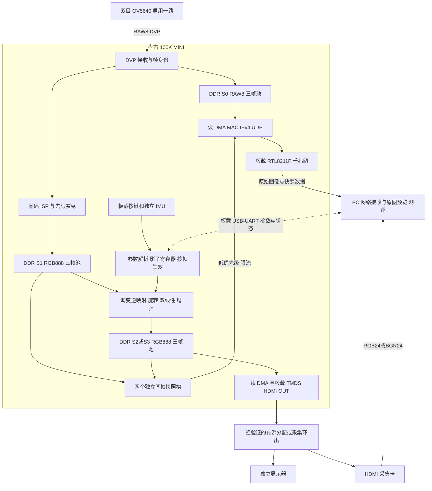

# OV5640 RAW8 千兆网与 HDMI 双路回传方案

2026-10-21 接口修订（优先于本文旧快照/透视/后置增强段落）：按 [仿射交接](FPGA仿射与图像增强及剩余功能实施交接.md) 实施。正式视频网络仅保留PRAW type=1 RAW8，type=2/3及UART0x93/96/97撤销；帧池为RAW/S1/结果三银行64MiB，单帧历史仅持有S1引用，不建立导出槽。内部为六参数仿射＋镜头模型，增强仅关闭/前置。实体接口与帧绑定见 [冻结字节布局](../fpga/config/integration/ENTITY_CONTROL.md)。严格S1/结果同源像素验收缺少实板取证通道，不能用S0软件预览或HDMI到达顺序替代。仿射ON/OFF须独立验证板端HDMI实际采用；物理1080p30、资源与功耗均须新实测。

版本：V1.0
更新日期：2026-09-06
状态：当前实施基线；以下接口、吞吐、功耗与演示均为待实现和待验证要求，不代表已有位流或实测结果。

本文统一主设计、上位机、测评和计划中的跨端约定。器件和算法详见[主设计](PG2L100H_1080p畸变矫正详细设计方案.md)，测试详见[整机测评方案](可控光照箱与上位机测评详细实施方案.md)，开发时间见[两个月计划](两个月开发规划表.md)。本文给出的网络 V1 是工程设计草案，实施冻结前需要以 RTL、PC 编解码器和测试向量共同核验。

2026-10-11 MCU 云端同步：依据 [五轴开发交接 V1.3](MCU五轴控制与FPGA通信开发交接文档.md) 和 [V2 接口补充](MCU_POSE_V2接口实现补充.md)，F4 通过独立 460800 UART 向 FPGA 回传 XYZ 归一化位置和 F1 舵机优先融合的 pitch/yaw，PC 不逐包转发。MCU 外层 version=2、profile=0x4D32，FPGA 新接收路径待实现。该协议不修改本文的 PRAW 图像头、图像类型、帧池或配对规则；机械相对 yaw 不是绝对航向，未知 roll、完整 q_wc 及平台→相机外参保持 null。

## 1. 已选架构及交付范围

- FPGA 为 PG2L100H，开发板为盘古 100K MINI。官方建议双目 OV5640 DVP 模块启用一颗相机，另一颗按模块电路待机；前后图必须来自同一颗相机。
- 必达目标为真实 1920×1080@30FPS：相机采集、FPGA 矫正、S0 网络接收和结果 HDMI 输出分别计数，任何一路持续降帧均不能列为完整目标通过。
- 原图使用传感器的 S0 RAW8 Bayer 数据，经 FPGA 板载千兆以太网传入 PC。完整有效载荷为 2,073,600 byte/frame，禁止视频编码压缩、缩小和补零冒充完整帧。
- FPGA 独立完成基础 ISP、畸变逆映射、双线性插值、旋转与所选增强，将完整 RGB888 结果经唯一板载 HDMI OUT 和一张 HDMI 采集卡传回 PC。
- PC 对 S0 只做必要的基础彩色可视化，界面标为“传感器原始数据预览”；它不是 FPGA 实际产生的 S1。PC 不转发主视频到 FPGA，不承担实时几何矫正，不在硬件掉线时切换为软件矫正。
- 严格测评仍采用 FPGA 独立快照槽中的 S1 与同源 S2/S3。普通 HDMI 回采帧与 S0 的逐帧关联未验证时，界面只能标为独立实时预览。
- 双 HDMI、PC 中转 USB 摄像头和 HDMI 摄像头分配路线保留为历史备选，不作为当前采购与开发基线。

分配设备只用于同时显示结果和回采结果，不能产生第二份不同的视频。若未配备分配设备，可在显示器与采集卡之间切换验证。板载 HDMI IN 为未来输入扩展，本基线不使用它送入 PC 图像。板卡 Type-C USB-UART 不具备 USB3 视频数据口能力。

## 2. 三类图像与无压缩含义

| 名称 | 位置与格式 | 用途 | 不可混淆的边界 |
| --- | --- | --- | --- |
| S0 | DVP 接收后的 RAW8 Bayer，1920×1080 | 连续原始数据回传、基础可视化、ISP 测试 | 每个位置只有一个 Bayer 采样值，不是 RGB888 |
| S1 | FPGA 基础 ISP 后、几何处理前 RGB888 | 标定对应图像、几何测评输入 | PC 自己去马赛克得到的 RGB 不能自动冒充 S1 |
| S2/S3 | FPGA 已定义输出阶段的 RGB888 | 结果显示、同帧精度测评 | 记录增强是否启用及位于几何前后，不能只写“处理后” |

S2 表示重采样后的观测位置；是否已含前置增强由 `enhancement_stage`、LUT 版本与阶段描述符明确。跨端枚举统一为 `disabled/pre_resample/post_resample`；关闭增强用 `disabled`，各端不得自创不兼容枚举。`post_resample`（插值后查表）保留为既有设计的对照；`pre_resample`（源四邻域先查表再插值）是针对赛题“矫正前或过程中”的预处理目标，需要新增实现和独立验证，两者数值通常不同。前置模式未通过时，应明确预处理目标尚未完成。前置方式按 RGB 四邻域最多每像素 12 次通道查表重新预算 LUT 端口与吞吐。几何独立测评关闭增强；两个快照槽只保证 S1 与一个选定结果阶段，不保证同时保存 S1、S2、S3。

S0 网络发送保留全部 RAW8 采样值。RAW8 不是对 RGB888 做视频压缩。RAW8 输出模式本身必须验证，包括实际有效位、Bayer 相位、裁剪、镜像、行列数、曝光条件和帧间隔。

源图及测评证据使用 `.raw` / `.rgb` 裸像素文件配套元数据，记录位深、顺序、stride、尺寸、有效长度和哈希。PNG 属于无损压缩，只能作为明确标记的派生预览或报告图，不能代替本项目“未经压缩”的原始证据。禁止 MJPEG/H.264/H.265 作为主链路，禁止将 YUY2/NV12 或 RGB565 当成完整 RGB888 保真结果。

PC 预览可以缩放窗口，但不得改变接收、存储及测评的全分辨率缓冲。两幅 1080p 图同时按 1:1 显示需要至少 3840×1080 的可用显示区域。

## 3. 硬件与输入门槛

| 项目 | 当前用途 | 必须验证 |
| --- | --- | --- |
| OV5640 双目 DVP 模块 | 单目 RAW8 | 真实 1080p30，不能沿用低分辨率 RGB565 例程认定通过 |
| 板载 32bit DDR | S0、S1、结果、快照和缓存 | 实物容量、频率、控制器地址窗口和混合读写有效带宽 |
| RTL8211F / RGMII | 千兆原图数据口 | 需要实现 MAC、协议、DMA 和流控；链路灯亮不表示能传图 |
| 唯一 HDMI OUT | FPGA RGB888 结果 | 实际输出 1080p30、像素保真、采集卡锁定与长稳 |
| 一张 HDMI 采集卡 | PC 结果接收 | 实际 RGB24/BGR24 模式、分辨率、帧率、色彩范围、丢帧 |
| PC 千兆网口 | S0 与快照接收 | 独立测试网络吞吐、系统队列和完整帧率 |
| USB-UART | 标定参数、模式、状态 | 保留既有控制协议，不承载主视频 |

MINI 硬件手册的 HDMI OUT 电路与例程显示 FPGA 直出 TMDS，MS7200 用于 HDMI IN。DDR 容量文字存在冲突，应以实物核对为准。不得套用其他板卡的 MS7210 输出架构或 200H 专用 J26 引脚。

OV5640 数据手册给出的 DVP PCLK 上限为 96MHz；8bit DVP RGB565/YUV422 在 1080p30 下仅有效数据就需要 124.416MHz，不能作为当前基线。RAW8 的有效需求为 62.208MHz，但消隐、寄存器配置及实物仍需验证。第一周未证明 RAW8 1080p30 时应明确记录输入门槛未通过，不用 720p 或重复帧替代。

## 4. DDR 分配与所有权

以下地址为 DDR 数据窗口内的相对字节偏移，属于规划，实施前核对实际 IP 地址单位、可用范围与所有权。MiB=2^20 byte。

| 帧池 | 槽数×槽大小 | 槽首偏移 | DDR 行跨度 |
| --- | --- | --- | --- |
| SRC / S1 | 3×8MiB | 0x00000000、0x00800000、0x01000000 | 6144 byte，5760 byte 有效 |
| DST / S2或S3 | 3×8MiB | 0x01800000、0x02000000、0x02800000 | 6144 byte，5760 byte 有效 |
| RAW / S0 | 3×4MiB | 0x03000000、0x03400000、0x03800000 | 2048 byte，1920 byte 有效 |
| SNAP_S1 | 1×8MiB | 0x03C00000 | 6144 byte，5760 byte 有效 |
| SNAP_RESULT | 1×8MiB | 0x04400000 | 6144 byte，5760 byte 有效 |

上述共 76MiB，结束于 0x04C00000，不含描述符、日志、有效掩码和其他诊断数据。RAW 每帧实际 DDR 跨度为 2,211,840 byte，不能塞入 2MiB 槽。网络 DMA 去掉行填充，只发送紧凑 RAW8/RGB888。

DVP 分流同时送基础 ISP 与 RAW 写 DMA；基线不额外从 DDR 读 RAW 再送 ISP。RAW 槽状态至少包括 FREE、CAPTURING、READY、SENDING；所有尚未完成的 DDR 事务必须排空后才能释放。网络阻塞不能反压不可暂停的摄像头，无法安全容纳下一帧时作废该 S0 导出帧并计数，主视频处理继续；出现这种情况时，完整 S0 30FPS 目标判为未通过。

快照复制到独立两个槽后再导出，不能因 PC 重传或保存缓慢长期锁住主视频槽。网络缓冲与重传必须有界，停止采样、超时和取消都要有释放过程。

## 5. 带宽与优先级

| 内容 | 有效像素载荷 |
| --- | --- |
| S0 单帧 RAW8 | 2,073,600 byte |
| S0 1080p30 | 62.208MB/s = 497.664Mbps |
| RGB888 单帧 | 6,220,800 byte |
| 结果 RGB888 1080p30 | 186.624MB/s，由 HDMI 与采集通道承担 |
| 一组 S1＋结果快照 | 12,441,600 byte，不含其他诊断数据 |

网络 V1 建议 IPv4、UDP、MTU1500，64 byte 应用头＋最多 1400 byte 图像数据。每个 RAW8 帧为 1482 包（1481 包×1400 byte＋最后 200 byte），30FPS 为 44,460 包/秒。计入 IPv4/UDP、以太网头、FCS、前导码和帧间隔，不含 VLAN/重传时约 543.9024Mbps；这是预算，不是实测吞吐。

短时每秒一组 RGB 快照额外约 108.7763Mbps，与 RAW 实时流共约 652.6787Mbps，仍需计控制、重传和实际实现效率。1Hz 快照只是经验证后允许的条件上限；长稳默认每 60 秒一组。网络不可承受时拒绝新快照，不削减主 RAW 帧率来制造“测试通过”。

RAW 缓存新增 DDR 有效读写各 62.208MB/s，合计 124.416MB/s，另计行填充/突发效率和快照复制。主设计应同时预算 ISP 源图写、几何随机读、结果写、HDMI 扫描读，不能只看网络带宽。

仲裁依次保护不可暂停输入与显示、主处理、RAW 网络实时流、诊断快照；采用有界服务配额，前三类都需证明满足各自截止期限，不能用持续饿死 RAW 通道的方法宣称完整系统通过。

## 6. 网络 V1 参数与重组约定

接口名称及以下值均为待实施的 V1 草案，端口号/IP/MAC 由配置与能力协商冻结，不编造当前已有地址。64B 自定义应用头内的多字节整数使用小端；Ethernet、IPv4、UDP 标准头的字段编码遵循各自协议规定的网络字节序。应用头字段布局如下。

| 偏移 | 字段 | 类型／长度 | 含义 |
| --- | --- | --- | --- |
| 0 | magic | 4 byte | ASCII `PRAW` |
| 4 | protocol_version | u16 | 1 |
| 6 | header_bytes | u16 | 64 |
| 8 | packet_type | u8 | 1=RAW_LIVE，2=SNAP_S1，3=SNAP_RESULT |
| 9 | flags | u8 | bit0 重传，bit1 本帧最后分块；其余为0 |
| 10 | pixel_format | u16 | 1=RAW8，2=RGB888 |
| 12 | stream_epoch | u64 | 源采集代次；采集重启或模式切换时在明确帧边界更新 |
| 20 | frame_id | u64 | FPGA 输入源帧身份 |
| 28 | param_version | u32 | 所属阶段配置版本；实际处理版本同时记录在描述符 |
| 32 | width、height | 各 u16 | 基线1920、1080 |
| 36 | row_stride | u32 | 线上紧凑行宽：RAW8为1920，RGB888为5760 |
| 40 | frame_bytes | u32 | 紧凑有效图像总长度 |
| 44 | payload_offset | u32 | 当前分块在紧凑图像中的字节偏移 |
| 48 | payload_bytes | u16 | 1～1400 |
| 50 | bayer_code | u8 | 0=无；1=RGGB、2=GRBG、3=GBRG、4=BGGR |
| 51 | bit_depth | u8 | RAW采样或RGB每分量均为8 |
| 52 | packet_index、packet_count | 各 u16 | 从0开始的分块索引及总包数 |
| 56 | packet_crc32 | u32 | 头部本字段置0后，覆盖64 byte头及实际载荷 |
| 60 | descriptor_id | u32 | 对应配置/快照描述符，配合流代次区分 |

CRC32 使用 CRC-32/ISO-HDLC：多项式0x04C11DB7，反射实现0xEDB88320，初值与最终异或均0xFFFFFFFF，输入输出反射；校验向量`123456789`为0xCBF43926。它用于错误检测，不是来源认证。既有 UART 继续使用 CRC-16/CCITT-FALSE，两个协议不混用，UART 的1024字节载荷上限不限制UDP图像报文。

运行开始先握手获取格式、能力、Bayer/ISP版本、帧池和重传能力。`stream_epoch` 标识源采集代次，在实际采集重启或模式切换的明确帧边界更新；网络会话应独立管理。PC 重连而 FPGA 持续采集时，不得重标在途帧或已保留快照的身份；既有描述符始终保留其采集时的代次。PC 不能仅按帧号合并不同代次的数据。描述符记录时间戳、标定实体、参数实体、镜像/裁剪、曝光、ISP配置与快照状态，必须可回读，不能只保存一个无法解释的版本号。

PC 按流代次＋帧号＋图像类型＋描述符重组，校验长度、偏移、范围、类型、CRC与完整字节覆盖，支持有界乱序和重复包。数据不完整不得补零后提交为完整图；同一块重复且内容不同时判异常。实时 S0 重传只在原槽仍可用、带宽及截止允许时进行；否则整帧失败并报告，不能无限重试阻塞后续帧。独立快照槽允许缺块重读，完成校验和落盘后释放。

## 7. HDMI 回采与同源证据

HDMI 模式优先配置真实1080p30；若使用60Hz重复显示，处理帧数、重复显示数、采集帧数分开记录，采集带宽按实际输出时序计算。板载直出1080p60仍需要器件/工具资料确认和实板验证，不能由148.5MHz像素时钟配置推断已通过。

PC 的 RAW 网络帧有明确 FPGA 源身份，普通 HDMI CaptureFrame 则只有采集设备自身序号与时间戳。未完成关联验证时，`source_frame_id=null`、`pairing_status=unverified`，不能使用软件到达顺序、固定延时或“当前输出帧号”消息冒充逐帧配对。

严格配对需要经验证的逐帧附加标识或时间关联机制，并覆盖掉帧、重连、重复显示、切模式与参数更新。它是连续同源对比的独立验收门槛；未实现时实时窗口可分别显示两路，但不得计算声称同帧的逐像素误差或宣称每秒30对严格配对。正式交付逐项记录“独立双路回传”“板端同帧快照”和“连续同源对比”的通过状态，前两项通过不代表第三项已经完成。

正式几何/MTF/像素测评使用 FPGA 的 S1 和选定 S2/S3 两个独立快照。两图共用真实源身份，参数/阶段可追溯，图像在 OSD/缩放前取得。低频快照只能证明采样帧，不能代替全帧率动态峰值检测。

## 8. 标定参数解析

实际相机、镜头、焦点和RAW/ISP输出模式冻结后，采集真实标定板。几何标定优先使用 FPGA S1；若用PC重建图，先验证与S1的几何及所需数值等价。PC保存K、D和原始标定证据，读取文件并按约定定点格式封装，FPGA通过UART自行解包、校验并装载fx/fy/cx/cy/k1/k2/p1/p2。

模型与RTL一致；不将有非零高阶项的标定结果直接删项，也不将fisheye模型系数按同名字塞进当前模型。检查尺寸、模型、符号、小数位、正焦距和支持域；备用寄存器整组提交，锁住在途帧版本。回读实际生效寄存器、版本和生效帧，不仅回显收到的数据。PC解析文件与FPGA解析参数报文分别记录，不宣称HDMI或SCCB会自动提供镜头内参。

参数加载后FPGA可以独立运行；断电后的配置恢复需另行实现和验证。若需要脱离PC冷启动，应设计可靠的非易失参数装载，而不是假定运行期寄存器自动保留。

## 9. 演示与能效测量

演示时相机与FPGA由独立于PC的电源供电，FPGA结果直接接独立显示器。加载真实参数后退出PC软件、断开网络和控制连接，仍能实时显示、响应板载旁路/矫正/旋转按键；按键直接作用于板内参数状态，不经过PC。若使用分配或环出设备，供电与EDID状态也须在PC断开后保持。PC掉线期间S0网络回传自然不可用，应记录断连，不能计作连续传输测试通过。

再展示真实内部坐标映射、四邻域像素、插值权重、有效像素和帧完成信号，结合真实S1/结果快照及参考模型验证。断电后黑屏、软件写出的帧号或低CPU占用单独不能证明矫正由FPGA执行。调试逻辑与正式性能位流的差别必须留档。

能效主要在开发板直流入口测电压/电流和能量，同时核对其他供电入口。板级功耗包括FPGA、DDR、HDMI/网口及转换损耗，不冒称芯片本体功耗。整机功耗另计PC和外设，避免重复计算由PC供电的设备。

同一测量窗口记录E焦耳、T秒和完整有效矫正帧N：平均功率E/T，处理帧率N/T，单帧能量E/N，能效N/E。分别测试视频旁路、完整30FPS和实际通过的60FPS；旁路应停止矫正计算使能而非仅切换显示。开启处理的功耗差包含DDR访问变化，只称板级增量。温度稳定后可每工况测5分钟、重复3次，附原始曲线、计数、画质、角度和版本；这是项目计划，不是已测结果或认证结论。

## 10. 60FPS、阶段检查与交付

OV5640 DVP不承担本项目真实1080p60输入。换真实60FPS源后需重新评估输入、ISP、算法、内存、输出和原图回传。RAW8在60FPS下有效载荷995.328Mbps，按本报文预算线上约1087.8048Mbps，已超过千兆；RGB888更高。因此不能承诺沿用该网口输出完整60FPS原图，需要高速数据口或双HDMI等另行设计，分别报告处理核60与双路完整回传60是否通过。

| 阶段 | 必须形成的证据 |
| --- | --- |
| W1 | RAW8真实1080p30模式、板卡/DDR/HDMI与千兆基础接口检查 |
| W2 | RAW网络接收和PC基础预览、FPGA S1彩色链、测试图像保真 |
| W3 | 参数解析、帧池/重组/丢包恢复、快照和回采关联方案 |
| W4 | S0完整30FPS＋完整算法结果30FPS，关联未验证时明确标记 |
| W5～W6 | IMU/增强、严格快照精度、连续关联门槛、长稳、能效和独立演示 |
| W7 | 真60源与新增带宽评估，在独立分支保留30基线 |
| W8及缓冲 | 回归、源码/参数/未压缩证据、报告、演示与发布 |

实现落点：网络/帧池/ISP/算法RTL及模型在`fpga/`，PC网络和HDMI接收/标定/测评在`host/`，MCU控制在`mcu/`；`output/`仅保存规划。原始厂商资料与PDS安装文档保持只读。当前只有文档，不将此计划或空目录列为实现完成。

## 11. 依据

- [MINI硬件手册](../reference/盘古100K200K%20MINI开发板/1_Demo_document/实验例程说明篇/教程1_盘古MINI系列开发板硬件指导手册_V1.3.pdf)：32bit DDR、RTL8211F、USB-UART、MS7200输入及FPGA直出TMDS；资料内部冲突以实物确认。
- [OV5640数据手册](../reference/OV5640双目摄像头资料/芯片数据/OV5640_DataSheet.pdf)：实际DVP和RAW模式边界，配置仍需验证。
- [OpenCV标定模型](https://docs.opencv.org/4.x/d9/d0c/group__calib3d.html)：K/D与模型匹配。
- [SPEC功率与性能方法](https://www.spec.org/power/docs/SPEC-Power_and_Performance_Methodology.pdf)：同窗口测量性能与功率；本项目不声称执行了SPEC认证测试。
