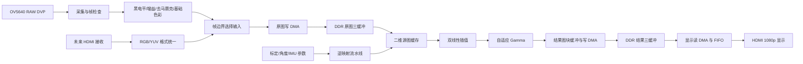

# PG2L100H（盘古100Kmini）1080p 任意角度畸变矫正系统详细设计方案

版本：V2.0 · 日期：2026-09-05  
平台：紫光同创 Logos-2 PG2L100H，盘古100Kmini开发板  
基础输入：官方建议的双目 OV5640 DVP 模组，按此前确定的方案仅启用一路  
必须达到：真实单路 1920×1080@30fps，持续采集、矫正与输出  
进阶目标：更换真实 1080p60 视频源后，实现 1920×1080@60fps  
项目周期：两个月，详见同目录《两个月开发规划表》。

> 本文替代此前 PGL50H/720p 基线方案，作为当前工程设计依据。以下电路架构、资源预算和验收门槛是实施目标，不是已经完成综合或上板测量的结果。具体板卡引脚和摄像头寄存器表必须来自匹配实物版本的资料。

## 1. 设计决策

1. 使用 PG2L100H；单路完成采集、标定、畸变矫正、双线性插值、连续面内旋转、自适应 Gamma 和显示。
2. OV5640 输入优先验证 **RAW8 Bayer DVP**。在 FPGA 先做基本 ISP 和去马赛克，转换为 RGB888 后进入统一视频处理链。
3. 外部 DDR 保存原图和结果，均优先采用 **紧凑 RGB888，3 字节/像素**。三原图槽＋三结果槽，避免画面撕裂。
4. 采用“输出像素→原图采样位置”的逆映射，将镜头畸变、旋转/缩放或有限透视变换合并为一次重采样。
5. 运算部分采用定点流水线，初始目标为 150 MHz、每周期可启动 1 个像素；DDR 读取由二维图块缓存完成。
6. 1080p30 是交付条件。720p/VGA 仅作为短期联调模式，不作为替代成果。
7. 1080p60 是在 30fps 版本冻结后推进的独立性能分支，需要真正的 60fps 摄像头/HDMI 视频源和对应接收硬件。
8. PC 负责标定、控制和评测；逐像素畸变计算与插值必须在 FPGA。只由 PC 生成整张坐标表的实现可用于参考测试，不作为最终核心算法成果。

## 2. 目标定义和物理边界

### 2.1 验收目标

| 类别 | 1080p30 必达版本 | 1080p60 进阶版本 |
|---|---|---|
| 输入 | 单 OV5640，完整 1920×1080，30 个不同采集帧/秒 | 支持真实 1920×1080@60fps 的相机或测试源 |
| 处理 | 每个输入帧完成一次矫正，不持续丢帧 | 每秒处理 60 个不同输入帧 |
| 输出 | 可用 1080p60 HDMI 时序重复显示 30fps 结果；处理 fps 独立报告 | 1080p60，一输入帧对应一结果帧 |
| 畸变 | k1、k2 径向＋p1、p2 切向 | 同一模型，不通过删除算法“提速” |
| 重采样 | RGB 三分量双线性 | 保留双线性 |
| 角度 | 面内连续 0～360°；按真实参数域验证 | 对相同角度集合重新测性能 |
| 动态控制 | 上位机连续改角度；完成 IMU 面内补偿 | 保留按采集时间对应姿态的机制 |
| 增强 | 可开关固定/自适应 Gamma | 保留，或明确报告性能测试时的功能组合 |
| 稳定性 | 至少 2 小时正式长稳；最终冻结版本争取 8 小时 | 至少 2 小时，未通过则标为实验版 |
| 精度 | 全域定点误差、网格直线度、SFR/MTF50 | 与 30fps 采用相同评价口径 |

摄像头帧率允许器件时钟规格范围内的小误差，但必须记录实际均值、最小/最大帧间隔以及是否为 29.97/59.94 模式，并与比赛要求对应。重复帧、把 720p 放大成 1080p、以显示器刷新率代替处理帧率，均不算达标。

### 2.2 任意角度的准确含义

- 面内旋转：可接受任意角度参数，不只支持 0°/90°/180°。有限位宽意味着角度和坐标都有量化精度。
- 俯仰/偏航：是透视变化，使用单应性/相对旋转投影扩展；不能用普通二维旋转冒充。
- 单目纯旋转视图可由内参和旋转关系建立映射；平面目标可用平面单应性。一般三维场景发生平移时，单个整帧变换不能消除视差。[S4]
- 原图视场以外或遮挡部分没有可恢复信息。边界采用有效掩码、裁剪/缩放或填充；双线性插值只解决采样位置不在整数网格上的问题。
- OV5640 为卷帘传感器，快速运动下存在行间形变及模糊。整帧 IMU 补偿首版用于缓慢转动；不承诺消除所有运动畸变。

## 3. 硬件核实与输入模式

### 3.1 FPGA 资源

PG2L100H 官方选型表列出：66,600 LUT6、133,200 FF、240 个 25×18 APM、155 块 36 Kbit RAM，DDR3 上限 1066 MT/s。[S1] 按每块 36×1024 bit 计，块 RAM 总量约 697.5 KiB，实际可用量取决于宽度、深度和端口组织。

“100K”常指等效逻辑规模，不能把 PG2L100H 写成 100,000 个原生 LUT6，也不能误写为 740 个 APM。器件能力不等于板上已引出的接口或已验证时钟。

### 3.2 上板前硬件配置单

| 项目 | 本方案依赖 | 必须获得的依据 |
|---|---|---|
| 开发板 | MES2L676-100HP-MINI，手册列 PG2L100H-6IFBG676 | 实物 PCB 版本与匹配手册 [S7] |
| DDR | 手册确认为 2 颗、32 位；本设计仅需前 64 MiB | 容量条目存在冲突，按颗粒/原理图/IP 配置确认；实测工作速率 [S7] |
| DVP | 一路 RAW 数据、PCLK、HREF、VSYNC 和 SCCB | 官方建议模组原理图、引脚表、RAW 模式配置 |
| HDMI 输出 | 手册有输出接口，但实现描述需核对 | 直出 TMDS 或发送芯片，以实物与该版本例程为准 [S7] |
| HDMI 输入 | 手册明确 MS7200 接收电路 | 优先复用板载输入验证 1080p60；确认实物修订与接口格式 [S7] |
| 参数接口 | CP2102 USB-UART；可选 RTL8211F 千兆以太网 | 先用 UART，网口图像导出属于可选扩展 [S7] |
| 时钟/调试 | 板载参考时钟、PDS 兼容下载器 | 晶振规格、PDS/IP 版本、License、下载与调试例程 |

不能把盘古100K/100Pro/AXP100B 的 DDR 或 HDMI 配置直接当作100Kmini的配置。本文先定义统一内部接口；器件型号、地址、管脚、电源不得依据其他板卡猜填。若实物 DDR 仅为 16 位或实际频率较低，需根据第 7 节预算重新评估，尤其不能直接承诺 60fps。

配套 V1.3 手册（2026-04-01）存在需要记录的冲突：第8/10页对应总512 MB DDR，第15页对应总1 GB；第33页输出引脚表为四对FPGA TMDS，但文字仍出现MS7210。故不据此断言实物一定为1 GB或一定有MS7210。100H可用40针扩展口按手册为J10/J25，J26是200H专用；配置Bank电压前逐脚核查。[S7]

若实物为FPGA直出TMDS，1080p60每条数据通道约1.485 Gbit/s，必须复用该板已验证的1080p60发送工程并检查物理时序；仅闭合148.5 MHz像素时钟不证明串行输出达标。将差异封装在 `hdmi_tx_adapter` 中。

### 3.3 OV5640 DVP 为何采用 RAW

OV5640 V2.03 数据手册表 8-5 列出的 DVP PCLK 最大为 96 MHz，器件列出的最高 1080p 帧率为 30fps；具体接口和数据格式应结合配置验证。[S2]

| 格式 | 8 位 DVP 每像素时钟 | 1080p30 有效 PCLK 下限 | 判定 |
|---|---:|---:|---|
| RGB565 | 2 | 124.416 MHz | 已超过上述 96 MHz，不能作为合规基线 |
| YUV422 | 平均 2 | 124.416 MHz | 同上 |
| RAW8 Bayer | 1 | 62.208 MHz | 带宽有空间，需验证消隐、配置及实物 |
| RAW10，10 位并行 | 1 | 62.208 MHz | 仅在模组引出全 10 位且该模式可用时采用 |

不通过超规格 PCLK、JPEG 替代未压缩数据或把 Bayer 当灰度彩色视频来绕过问题。RAW10 若被打包为多个 8 位字节，其时钟需求必须重新计算，不能套用 10 位并行结果。

第 1 周必须拿到 RAW 配置来源并完成：1920×1080 有效阵列、稳定约 33.33 ms 帧周期、有效位对齐、Bayer 排列和连续帧数据检查。若指定模组不能完成该模式，应立即向板厂获取支持，或按赛题允许情况启用替代输入。更换 FPGA 不能解决输入帧率不足。

配套 Double_OV5640 公开实验说明中的演示模式为720p30 RGB565，不是现成的RAW1080p30证明。[S8] 暗光测试还需限制曝光和自动降帧策略，保证AEC不会把30fps降低成15fps。

OV5640 DVP 不作为真实 1080p60 的输入源：RAW8 的有效需求已达 124.416 MHz，且器件官方 1080p 帧率也止于 30fps。[S2] 因而 60fps 计划必须包含摄像头或输入方式升级。

### 3.4 单路启用与电气接口

逻辑端口：`cam_d[9:0]`（实际使用位可配置）、`cam_pclk`、`cam_href`、`cam_vsync`、`cam_xclk`（按模组）、`reset_n`、`pwdn`、`scl`、`sda`。

- 不因模组是双目而配置两条并行图像链；另一颗按模组电路待机，不切断可能共享的电源。
- 依据手册确认 RAW8 的有效位；AN5642 的 RGB 有效位说明不能自动当成所有模组 RAW 位接法。[S3]
- PCLK 接合适的时钟输入，检查电平转换器是否支持工作速率；传感器裸芯片电压不等于模块接口电压。
- 两颗 SCCB 地址相同且共享总线时，确认独立使能/复位或总线隔离；不得让两颗同时响应读命令。
- 校验 40 针连接器的每个电源与信号脚，不能凭外形对插。
- 帧内不改变裁剪、镜像、曝光模式或输出格式。模式切换时停止 DMA、清空 FIFO、作废旧缓存再重启。

### 3.5 配套硬件准备表

| 项目 | 建议配置 | 数量/时间 |
|---|---|---|
| 主板/输入 | 已确定100Kmini＋官方Double_OV5640，仅启用一路 | 各1，W1到位 |
| IMU | ICM-42688-P SPI模块，带可核查原理图、INT引出 | 1，W2前到位 [S6] |
| 标定板 | 刚性哑光，建议10×7方格、9×6内角点、实测25mm格长 | 1，W1准备；按实际距离调整尺寸 |
| SFR测试卡 | 高质量斜边图卡，另备网格直线卡 | 各1，W2前准备 |
| 支架 | 相机/IMU共用刚性支架、带刻度面内旋转台和俯仰机构 | 1套，W3前到位 |
| 光源 | 低闪烁可调LED面光源、柔光附件 | 1套，W4前准备 |
| 显示器 | 原生1080p、HDMI60Hz；关闭过扫描、额外锐化和插帧 | 1，优先复用 |
| 测量 | 示波器/逻辑分析仪或实验室共享设备；GPIO标记线 | W1测输入，W4测性能 |
| 电源/下载 | 板厂匹配电源和PDS下载器；相机/IMU按各自额定供电 | 1套，W1 |
| 60fps相机候选 | ToupTek OCAM1080P2MPA（IMX385、HDMI1080p60、C口），作为可询价候选 | 可选1，W2锁定来源、W6前到位 [S9] |
| 升级镜头 | 与候选相机匹配、覆盖1/2英寸靶面、可锁焦的C口广角镜头 | 随新相机配置并重新标定 |

摄像头候选的60fps规格来自厂商页，但菜单关闭、固定曝光、畸变校正开关、视频格式和实际链路延迟仍需逐项确认。现阶段不用替换OV5640；该采购路径服务于后续60fps。不同预算可先借用同规格设备，未取得报价不编造总价。

## 4. 总体架构



基线保留完整结果帧：算法可以在 cache miss 时停顿，HDMI 独立按固定时序显示完整结果。输入、处理、显示重叠运行。延迟优化后续再取消结果帧，不能一开始就把不可背压的显示时序和随机读等待强耦合。

### 4.1 统一视频接口

处理前统一为 `pixel_rgb[23:0]`，明确通道次序 R/G/B；DDR 字节次序固定 R、G、B。内部流采用 `valid/ready`，帧头 `sof`、行尾 `eol`、`frame_id`、错误标记与像素同路传播。

DVP/HDMI 输入没有 ready，只有接收端 FIFO。上游溢出时作废整帧，记录错误，绝不提交半帧。算法和 DMA 可停顿的内部接口在 `valid && !ready` 时保持数据及全部元信息。

### 4.2 时钟域

| 时钟 | 起始设计 | 作用 |
|---|---|---|
| `cam_pclk` | RAW 模式实测值 | DVP 捕获 |
| `sys_clk` | 约 100 MHz，按板卡 PLL | 控制、UART、时间戳 |
| `isp_clk` | 可与 `proc_clk` 合并，初始 150 MHz 目标 | 去马赛克与 ISP |
| `proc_clk` | 初始 150 MHz，1 pixel/cycle 无停顿启动 | 映射、插值、cache 控制 |
| `ddr_ui_clk` | DDR IP 实际配置 | DMA/仲裁，位宽不猜定 |
| `hdmi_rx_clk` | 未来接收器恢复时钟 | HDMI 输入 |
| `pix_clk` | 常用 1080p60 为 148.5 MHz | HDMI 输出；59.94 模式另配 |

150 MHz 是布局布线目标，不是器件保证值。跨域通过厂商异步 FIFO 或握手，不将多位参数逐位同步。复位各域同步释放；PLL 和 DDR 初始化成功后才启动视频通路。

## 5. RAW 基础 ISP

### 5.1 流水级

1. **有效阵列捕获**：检查每行/帧计数，分离传感器 dummy 区域，记录完整 1920×1080 原始有效图。
2. **黑电平与增益**：按黑电平校准减法、钳位，再按 R/Gr/Gb/B 增益处理；参数按帧锁定，保存 10～12 位中间精度。
3. **3×3 去马赛克**：2 行 RAM 加窗口寄存器，依据四种 Bayer 排列选择邻域。先实现双线性去马赛克作为正确性基线。
4. **基础色彩处理**：固定白平衡/可选 3×3 色彩矩阵，记录系数来源；没有色卡校准时不杜撰“准确色彩”。
5. **固定输出曲线**：RAW 路线采用可复现的基础显示曲线，再量化到 RGB888，与 HDMI 路线的像素接口统一。
6. **帧统计**：对几何变换前图像统计亮度，用于下一处理帧的增强选择，不让黑边比例左右亮度判断。

去马赛克必须在通用 RGB 畸变重采样之前。直接在 Bayer 网格上做普通 RGB 双线性会混合不同颜色采样位置，产生伪色。

### 5.2 去马赛克定义

以 RGGB 为例：R 点的 G 为上下左右 G 平均，B 为四个对角 B 平均；B 点对称；G 点根据所在行，分别沿水平/垂直插值 R/B。四种 Bayer 排列均用参数指定，并用彩条、红蓝物体和像素转储验证。

RAW边界采用保持Bayer奇偶相位的reflect-101，例如虚拟x=-1取x=1，虚拟x=W取x=W-2；也可仅用同色有效邻居插值，但必须与参考一致。不能直接把R边界像素复制到应为G/B的虚拟位置，也不能为了窗口把输出默默变成1918×1078。首末行/列通过边界生成与末行flush逻辑处理，输出仍是完整1920×1080。

镜像、翻转、裁剪起点奇偶会改变 Bayer 相位。配置变化必须刷新相位和标定档案；去马赛克的两行延迟不代表整机只有两行延迟。

### 5.3 画质与功能取舍

第 2 周完成可测量的彩色 RAW 链，再做标定。边缘感知去马赛克、复杂降噪、局部直方图均衡不是首版依赖。若基础 ISP 引入明显伪色或 MTF 损失，应在质量报告中分离 ISP 与几何插值影响。

## 6. 逆映射算法与定点实现

### 6.1 模型

输出像素为 p=(u,v,1)。基础模式先由六系数仿射变换得到理想归一化坐标：

```text
x = a00*u + a01*v + a02
y = a10*u + a11*v + a12
r2 = x*x + y*y
radial = 1 + r2*(k1 + k2*r2)
xd = x*radial + 2*p1*x*y + p2*(r2 + 2*x*x)
yd = y*radial + p1*(r2 + 2*y*y) + 2*p2*x*y
ud = fx*xd + cx
vd = fy*yd + cy
```

`radial` 使用 Horner 写法降低中间量规模。仍需真实系数和工作域区间检查，不把不同表达式的定点舍入默认视为相同。[S4][S5]

六个系数由输出内参 Kout、显示缩放及逆旋转合成；像素中心以整数坐标表示。行/列递推用于减少每像素乘法：同一行 x、y 按 a00/a10 增量，下一行按 a01/a11 增量。每个图块重算起点，控制累计误差。

上位机与 FPGA 共同固定屏幕坐标系（u 向右、v 向下）、角度正方向、中心点、变换先后次序。不直接照搬数学坐标系符号；用不对称箭头验证正负角。

### 6.2 透视前端

扩展模式将六系数替换为 M：`q=M*p`，`x=q0/q2`、`y=q1/q2`。对于纯旋转，M 可取“输出相机射线转到输入相机坐标”的旋转矩阵乘 Kout 的逆；因此后面的 fx/fy/cx/cy 使用输入相机内参。

平面单应性若先得到输入理想像素，应先乘输入内参的逆转换到归一化坐标，再接上述镜头模型，避免重复施加 K。所有矩阵约定在参考工具中以 0° 恒等变换核对。

分母正负、近零和可表示范围必须检查。倒数采用范围归一化、LUT 初值、定点 Newton 迭代，再恢复指数；其 LUT 位数/迭代次数由误差目标决定，不在未经验证时固定承诺。透视演示先验证 ±15° 俯仰，再测更大范围并发布有效范围，不承诺任何姿态都可无损恢复。

### 6.3 候选位宽

定义 S(W,F)：有符号总 W 位，小数 F 位；U(W,F) 为无符号，均不使用歧义 Q 命名。

| 值 | 初始候选 | 注意事项 |
|---|---|---|
| 仿射系数/矩阵系数 | S(32,26) 或经尺度归一化的独立格式 | 对超域输入返回错误，不饱和后继续 |
| 仿射递推累加器 | S(40,26) | 每图块起点重载 |
| x、y | S(24,20) | 约 [-8,8)，真正受支持域由标定确定 |
| 畸变系数 | S(32,26) | 可按实际范围缩窄，但需记录小数位 |
| r2、radial 及乘积 | 分级区间推导、全位宽乘积后舍入 | 不统一截成 24 位 |
| fx/fy/cx/cy | S(32,16) | 允许像素单位的焦距和主点 |
| ud、vd | S(28,12) | 含负坐标，先判界再转地址 |
| 插值分数 a、b | U(12,12) | floor 提取，0～4095/4096 |

APM 为 25×18；24×24 或 32×24 运算会拆分，不能按一运算一个 DSP 预算。通过位宽搜索、乘法拆分、流水寄存和有限复用在精度、面积、启动间隔间取舍。透视前端、双通道扩展须单独综合。

团队内部坐标误差目标：有效输出区域相对浮点参考 RMS≤0.05 pixel、最大≤0.25 pixel。最大误差超标时保留更多精度或限制参数范围；每项限制都进入用户可见模式和报告。

### 6.4 双线性插值

`i=floor(ud)`、`j=floor(vd)`；a、b 为 12 位分数整数，F=4096。三个 RGB 分量分别计算：

```text
top = (F-a)*P00 + a*P10
bot = (F-a)*P01 + a*P11
out = round(((F-b)*top + b*bot)/(F*F))
```

水平阶段不提前截成 8 位，最终一次舍入并钳位到 0～255。对有符号地址，向零截断不等于 floor。12 位分数与软件参考一致，必要时可量化到 10 位但先验证误差。

采样边界采用“坐标范围检查＋邻域夹取”：当 ud、vd 位于闭区间 [0,W-1]、[0,H-1] 时，将 i+1、j+1 夹到最后一列/行；超出此范围则 invalid。这样恒等映射不会丢失最末行/列。

夹取后可能出现重复邻域地址，cache读取端应合并读取并广播样本，或按端口调度；不能仍假设四个样本必然对应四个不同bank。

超界默认黑色，输出有效掩码；可选择自动/手动裁剪。自动裁剪需检查完整有效域，不凭旋转矩形四角认定没有畸变黑边。强缩小需抗混叠预滤波，基线优先不做大倍率缩小。

## 7. 存储结构与带宽

### 7.1 像素格式

优先源图和结果都以 RGB888 三字节紧凑保存，避免 RGB565 量化削弱边缘和色彩测试。实现独立 pack/unpack：像素可跨 DDR beat，需保留残余字节，行结束正确处理字节使能，严禁以 DDR 总线宽度直接截断像素。

输出图块每行16像素即48字节，首地址也可能不与DDR beat对齐。DMA必须同时处理起始地址低位、首/尾beat字节掩码与图块间边界，不能仅处理整幅图的行尾。若IP不能提供所需写掩码，将图块行段聚合为对齐整行再写；禁止无互斥读改写覆盖相邻图块。

RGB565 可作为明确标注的带宽诊断/资源降级构建，但不默认替换正式画质路径。RGBX8888 的 4 字节对齐更易实现，却增加 1/3 传输，尤其不宜未经评估直接用于 60fps。

### 7.2 地址规划

统一 RGB888 行跨度 6144 字节，1920 像素有效行占 5760 字节。8 MiB 一槽，一帧覆盖 1080×6144=6,635,520 字节，均可容纳。

| 槽位 | DDR 相对字节偏移 | 用途 |
|---|---:|---|
| SRC0/1/2 | 0x00000000 / 0x00800000 / 0x01000000 | ISP 后的原图三缓冲 |
| DST0/1/2 | 0x01800000 / 0x02000000 / 0x02800000 | 矫正结果三缓冲 |
| DIAG | 0x03000000 起，预留 8 MiB | 可选冻结 RAW/测试帧，不参与连续处理 |

主通路 48 MiB，含诊断预留 56 MiB。实际 IP 若按字/beat 寻址，在 DDR 适配层统一转换；上层地址都以字节表达。仅传有效行数据，不浪费带宽填整条 stride。

### 7.3 帧管理

原图状态 `FREE→CAPTURING→READY→PROCESSING→FREE`；结果状态 `FREE→RENDERING→READY→DISPLAYING→FREE`。

每帧描述符包含 frame_id、首/末有效像素时间、模式、宽高、stride、ISP/标定/姿态参数版本和异常位。READY 必须等待最后写事务完成；显示旧槽释放必须等待旧读事务结束。

SRC在释放前也必须排空该frame的cache填充/预取读，或在适配层安全取消并丢弃对应响应。仅完成最后一个输出像素不代表源帧已没有未决事务；帧标签必须贯穿请求及响应，防止延迟返回污染新帧缓存。

正式无丢帧模式按采集顺序处理。过载容错允许丢弃尚未占用的整帧并记录；这种行为用于保持系统可运行，不代表通过帧率验收。只在显示场边界切换完整结果；无新结果重复旧帧并记录原因。

同帧前后对比在结果渲染时读取当前 SRC 生成左右区域，合成到一个 DST。不能在处理结束后释放 SRC，又让显示继续从该槽读取原图。

### 7.4 有效载荷估算

以下均按 RGB888、输出 1080p60 显示时序计算，MB 为十进制；不含 DDR 换行、刷新、过量回填、诊断和额外画中画。

| 数据流 | 30fps 处理＋60Hz 显示 | 60fps 处理＋60Hz 显示 |
|---|---:|---:|
| 原图写 | 186.624 MB/s | 373.248 MB/s |
| 四邻域读，假设无像素复用且只读需要的字节 | 746.496 MB/s | 1492.992 MB/s |
| 结果写 | 186.624 MB/s | 373.248 MB/s |
| 显示读 | 373.248 MB/s | 373.248 MB/s |
| 上述合计 | 1492.992 MB/s | 2612.736 MB/s |
| 若源图读被充分复用到每输出像素约 1 个源像素的参考合计 | 933.120 MB/s | 1492.992 MB/s |

两种合计都不是保证或最坏上界。图块回填只用一小部分、cache 冲突和边缘放大会使源图真实读取更多。必须测 `source_fill_bytes/output_pixel`、回填效率、命中率和最大等待周期。

统一复算公式：`B = b × [R × (g+2) + D]`，R为处理像素/秒、D为显示像素/秒、b为DDR字节/像素，g为“实际源缓存回填字节/(输出像素数×b)”。RGB888取b=3，RGB565取b=2，RGBX取b=4；g必须由访问轨迹/计数得到。

32 位、1066 MT/s 理论为 4.264 GB/s；16 位则为 2.132 GB/s，实际有效带宽更低。是否达标依赖实物工作频率和混合访问轨迹，不依据峰值除法判断。[S1]

### 7.5 仲裁

客户包括采集写、显示读、cache 填充读、结果写。采集 FIFO 高水位、显示 FIFO 低水位可触发紧急服务；其余使用有最大等待限制的轮转。每类统计服务次数、字节和等待时间，防止算法长时间饥饿。

缓存回填使用多个可追踪事务以隐藏行间开销；若板厂接口不支持 ID，则请求 FIFO 维持响应顺序。禁止把 UI 接口的突发语义误认为 AXI；先封装成可仿真的统一 DMA 适配层。

## 8. 二维源图缓存与吞吐

### 8.1 初始配置

采用 16×16 像素源块、128 个缓存槽，RGB888 数据容量 96 KiB；4 路组相联、32 组，标签包含图块坐标和帧代号。每个新处理帧使缓存失效，防止读取旧图。

像素按 x/y 奇偶拆为四个 bank，使单输出像素四邻域落在不同 bank。图块标签最多四个并行查询；需要检查端口、标签复制和跨块访问。回填与读取共享双口 RAM 时，明确同址读写行为并仲裁，不能假设“声明双口”即可无冲突。

未命中冻结该请求或放入等待队列；所有邻域到齐后才输出。相关请求合并一次回填；首版保证正确，再加入多请求并行。坐标、frame_id、参数版本与 valid_mask 一起排队，停顿不能错位。

16×16 RGB888 每行 48 字节，未对齐突发可能读入额外字节。第 3～4 周同时仿真 32×8、16×16、8×32 形状及不同组索引，选实际 DDR 轨迹最优者；不能用一个零度命中率代表全部角度。

### 8.2 输出调度

按 16×16 输出块遍历，块内逐行生成，双缓冲结果小 RAM 收集后按行段写 DDR。结果存入完整帧，因此允许改变输出块顺序改善原图局部性。

跨源块时不能只用输出块四角估计源包围盒；径向非线性和透视会造成内部极值。预取作为增强，基础正确性由逐坐标 miss 检查保障。

### 8.3 30/60fps 的计算预算

| 方案 | 无停顿吞吐 | 1080p 理想整帧处理时间 | 工程判断 |
|---|---:|---:|---|
| 100 MHz，1 pixel/cycle | 100 Mpixel/s | 20.736 ms | 可作为 30fps 回退时钟，60fps 不足 |
| 150 MHz，1 pixel/cycle | 150 Mpixel/s | 13.824 ms | 30fps 有余量；60fps 对缓存等待很敏感 |
| 125 MHz，2 pixel/cycle | 250 Mpixel/s | 8.2944 ms | 60fps 有更多周期余量，但资源和多读口更复杂 |

实际完整处理时间包括缓存停顿、DDR 写回和起止开销。30fps 以每帧≤30 ms 作为内部留余量目标，硬截止为 33.33 ms；60fps 内部目标≤15 ms，硬截止 16.67 ms。用最坏实测帧时间和长期积压判断，不只看平均值。

60fps 优化顺序：减少回填浪费/冲突→改善 outstanding 和预取→确认单通道 150 MHz 是否满足→如不足再采用 2 pixel/cycle。双像素需要最多八个源样本且可能冲突，需双口/复制/banking 和调度证明；不能仅复制算术就声称吞吐翻倍。更高时钟也须通过 PDS，不预设一定能达 200 MHz。

## 9. 增强、参数和姿态

### 9.1 自适应 Gamma

以原图亮度统计选择帧级表，曲线定义 `out=255*(in/255)^gamma`。起始三档可取 0.7/1.0/1.3，暗场提升、正常直通、亮场压暗；这些是调试起点而非最终算法参数。

每 4×4 抽样一次，累加亮度/样本数、暗部和饱和比例。设置迟滞和连续帧确认，表只在新帧处理开始时切换。先用 RGB 共用 LUT 实现，再评估改为亮度域是否改善颜色；基础 ISP 曲线与自适应增强分别命名，避免重复 Gamma 不可追溯。

未拍到的暗部和饱和信息不可恢复。测试增强时分别固定曝光与开启自动曝光，并记录噪声和饱和比例，不能只展示“更亮”。

### 9.2 参数与协议

上位机保存 float64/float32 标定档案和元信息，下发定点载荷。UART 8N1、初始 115200 bit/s，后续可在硬件验证后提高。包格式：

```text
55 AA | version:u8 | cmd:u8 | seq:u16 | length:u16 |
payload | CRC16:u16
```

多字节小端；CRC-16/CCITT-FALSE（0x1021，初始0xFFFF，不反射，xorout0），覆盖 version 至 payload；CRC 也按小端发送。payload 上限 1024，超长、超时、CRC 错误返回可统计状态。

命令：读取状态、写影子参数、提交参数、选择显示模式、读取计数、冻结/分块导出帧、设置姿态零位。提交回应包含实际生效 frame_id 和 param_version；非法焦距、超域系数、模式不符拒绝，不静默使用旧值冒充成功。

每帧锁定一个参数集合。SCCB、UART、IMU 控制不直接修改处理中途的寄存器。上位机断开后维持最后有效参数，显示连接状态；恢复后读取版本再续传。

### 9.3 IMU

优先 ICM-42688-P 模块（SPI、INT，电平匹配），与相机刚性安装。[S6] 先用上位机命令验证动态旋转，再由 FPGA 采样 IMU、上位机融合生成参数；视规则和工期可把姿态融合迁入 FPGA。

采用同一 FPGA 时间基准记录 IMU 采样与 DVP 帧时间，完成陀螺零偏、轴向变换和相机—IMU 外参标定。使用“该图像采集时刻”的姿态，不用开始处理时的最新姿态补偿旧帧。

维护带时间戳的姿态环形队列和帧描述符，用插值匹配曝光中心。VSYNC 不等于曝光中心，需按相机模式标定偏移；HDMI 相机未来还会带来额外 ISP/链路缓冲，需重新标定。动态参数晚到时记录并采用定义的上一组/预测策略，不偷偷计为准确补偿。

六轴 IMU 航向积分会漂移，提供零位复位；加速度变化影响重力倾角估计。IMU用于角度变化，不能代替镜头 k1/k2/p1/p2 的真实标定。

## 10. HDMI 输入升级

统一入口支持以下两条互斥路径：

- DVP：RAW→ISP→RGB888。
- HDMI：HDMI 接收芯片→RGB888 或 YUV→正确色彩转换→RGB888。

配套100Kmini手册列出MS7200输入，优先复用这条板载路径。[S7] 在实物与手册一致时无需另购HDMI接收板；只有版本差异或板载路径不适用时才外接模块。不能把HDMI线接到普通GPIO或输出接口。外接方案应有实际1080p60接收例程、原理图、配置资料，并匹配扩展口IO Bank电压和时钟管脚。

摄像头采购条件：明确 HDMI 真正 1920×1080@60fps、关闭菜单/电子防抖/几何校正、能锁曝光焦点、支持所需 RGB/YCbCr 格式、输出时序可核实。只写“4K”或“HDMI接口”不足以判断。

接收器设置/检查 EDID、HPD、锁定、色彩空间、量化范围；若是 YCbCr422，要按像素时序恢复色度并转换，不能按 RGB 字节直接显示。使用不带内容保护的相机/测试源，不设计受保护内容解密链。

60fps长稳还需匹配输入输出的60/59.94模式及长期时钟漂移。优先验证输出时钟跟随接收参考或可用的帧同步方案；若输入输出自由运行，则分别统计处理完成帧、重复显示帧及未显示结果。三缓冲只能吸收短期抖动，不能消除长期频差；严格逐输入帧显示的验收必须由同步设计证明，不能用显示丢帧掩盖。

输入切换需要停采、释放事务、作废旧帧、加载对应内参/ISP档案、确认新时序后恢复。更换镜头/相机必须重新标定；同一标定档不能跨摄像头复用。

60fps 验证先用可控 HDMI 图案或离线帧回放证明 FPGA 处理能力，再接真实相机验证端到端。前者只能称为“处理核 60fps”，不能替代摄像头实时演示。

## 11. RTL 划分与资源预算

| 模块组 | 主要模块 | 职责 |
|---|---|---|
| 板级 | clock_reset、ddr_adapter、hdmi_tx_cfg | 时钟、电源复位、IP 封装 |
| 输入 | ov5640_sccb、dvp_capture、hdmi_rx_adapter、input_select | 配置、时序检查、输入切换 |
| ISP | raw_gain、bayer_window、demosaic、color_curve | RAW 转彩色 |
| 帧系统 | capture_dma、frame_manager、result_dma、display_dma | 帧所有权、缓存、显示 |
| 几何 | tile_scheduler、coord_affine、coord_projective、coord_distort | 逆映射与有效域 |
| 采样 | source_cache、miss_queue、bilinear_rgb | 二维邻域与插值 |
| 增强/控制 | gamma_stats、param_bank、uart_control、imu_spi | 按帧更新、姿态 |
| 观测 | perf_monitor、snapshot、test_pattern | 计数、图像证据与调试 |

### 11.1 资源目标

| 资源 | PG2L100H 总量 | 30fps 版本规划上限 |
|---|---:|---:|
| LUT6 | 66,600 | 约 50,000 |
| FF | 133,200 | 约 95,000 |
| APM 25×18 | 240 | 约 180 |
| 36 Kbit RAM | 155 | 约 120 |

资源上限为团队预算，实际先综合板厂 DDR/HDMI 基础工程，再分配剩余预算。源图 cache 96 KiB 只是数据量，标签/端口复制/FIFO/IP 开销须按 PDS 报告核算；两个像素通道不能假设仍在该预算内。

查表 Gamma 和统计开销较小，主要压力来自宽位乘法、透视倒数和并行邻域。可复用的是帧间低频运算与配置，不能为了资源把每像素启动间隔变到达不到吞吐。

### 11.2 CDC 与时序约束

所有参考/生成时钟有定义；相机输入相对 PCLK 设置 input delay，HDMI 像素接口按实际芯片设置 output delay。异步域只对合法同步/FIFO路径设置例外，禁止全局 false path 屏蔽通路。

使用厂商验证异步 FIFO，保留灰码指针总线约束要求。参数组通过握手，计数跨域采用快照。检查时钟锁定、复位释放、RAM 同址语义、未约束路径、WNS/TNS 和关键通路。按实际速度等级及工作条件运行实现，不以综合估计频率代替时序收敛。

## 12. 标定、软件参考与测试

### 12.1 标定档案

采集 20～30 幅以上清晰、覆盖四角的棋盘图，固定焦点，记录传感器裁剪、RAW位宽、Bayer排列、镜像、曝光、ISP版本。格长以实物尺寸为准。留独立图作为验证集。

使用 k1/k2/p1/p2 模型，标定时固定 k3 且不开启 rational/thin-prism 模型。不能先用高阶模型拟合，再删除高阶系数而沿用原精度结论。[S4]

检查重投影误差、径向映射是否单调、独立网格直线度和覆盖范围。ISP 的镜头阴影校正与几何校正不是同一功能；逐项查寄存器含义，不根据“lens correction”名字判断已去畸变。

更换镜头、焦点、裁剪/分辨率模式或相机需重新标定；仅确认纯尺度变化时才换算内参。参数档包括原图路径、设备标识、模式、K、D、有效域、标定日期与哈希。

### 12.2 参考链

建立 `RAW参考ISP→浮点几何→定点逐级模型→RTL` 四层对照。允许用 OpenCV 生成参考，但其插值表量化与自实现 12 位权重可能不同，逐比特比较以自定义定点模型为准。[S5]

输出 `coordinate_error`、溢出计数、像素差图和访存轨迹。缺少真实参数时可用零畸变/人工图做单元测试，但不能用虚构系数代替比赛标定数据。

静态帧可通过低速串口冻结导出，实时全帧不走 UART。优先从 DDR 导出无压缩结果；HDMI 采集卡的色度抽样和压缩会影响画质测量，不作为唯一精度证据。

### 12.3 验收表

| 项目 | 方法 | 建议内部门槛/交付 |
|---|---|---|
| 输入格式 | 硬件数 PCLK 有效字、行和帧，导出连续帧 | 完整 1920×1080、正确颜色、实际 fps 日志 |
| 恒等映射 | 同内参、零畸变、0° | 含末行末列的一致性 |
| 定点精度 | 全输出有效域坐标对照 | RMS≤0.05 px、max≤0.25 px |
| 直线度 | 中心/四角多条线拟合 | 自定参考 RMS≤0.5 px，记录实际值及覆盖范围 |
| MTF50/SFR | 斜边卡、多位置、同采样尺度软件对照 | 不凭单中心数值判定全部画质 |
| 角度 | 0、±1、30、45、89、90、135、180、270、359°＋连续扫描 | 方向正确，无异常访问；报告有效视场 |
| 吞吐 | 最坏角度逐帧耗时与输出计数 | 30fps≤33.33 ms；60fps≤16.67 ms，不积压 |
| 稳定性 | 2小时正式/8小时最终长稳 | 正常输入无丢帧、无溢出/欠载、无撕裂 |
| 异常恢复 | 拔插、失锁、坏行、参数 CRC 错误 | 整帧作废、恢复明确，无越界写 |
| 动态姿态 | 同步时间戳、慢速转台、角度与误差曲线 | 帧内参数一致，记录时间偏差与漂移 |

这些精度门槛为内部设计目标，不是新增赛题官方标准。MTF 对比要匹配局部缩放和输出像素尺度；黑边裁剪和缩放会改变采样密度，应同时报告。

### 12.4 延迟

记录采集首/末像素、开始处理、写结果完成、首次显示该 frame_id 的时间。完整帧架构的首像素到结果首像素延迟约为：采集帧周期＋排队＋处理时间＋等待输出场边界，另加小量接口开销。

30fps 下若处理约 20 ms，且无队列积压，等待60Hz场边界为0～16.67 ms，则约为53～70 ms量级；不是已经测出的成绩。显示器响应另计。

GPIO/逻辑分析仪测 FPGA 边界；闪烁 LED＋光电探头或高速拍摄测光到屏。结果明确区分吞吐、流水线时延、帧缓存时延和光到屏时延。

## 13. 两个月实施与风险处置

详细日期、任务、负责人角色和验收见 [两个月开发规划表](./两个月开发规划表.md)。总体顺序：

1. W1：实物资料、RAW1080p30、DDR与HDMI底座，解决输入可行性。
2. W2：RAW ISP、帧池、彩色1080p30直通、标定数据。
3. W3：浮点/定点、静态映射、cache原型与访存仿真。
4. W4：完整1080p30静态矫正达到帧率，形成第一版可演示成果。
5. W5：连续旋转、Gamma、参数原子更新、精度和压力优化。
6. W6：IMU、有限透视验证、1080p30功能冻结与长稳。
7. W7：在保留稳定版本前提下验证HDMI1080p60和性能优化。
8. W8及缓冲：回归、演示、资源/精度/延迟报告，决定60fps是否可发布。

| 风险 | 最晚检查点 | 处理 |
|---|---|---|
| RAW1080p30配置不成立 | W1末 | 获取板厂配置；核对替代源是否允许；不以720p掩盖 |
| mini无HDMI输入或扩展不匹配 | W1～W2 | 提前选接收模块/转接板，避免W7才采购 |
| RAW颜色/分辨率不正确 | W2末 | 确认Bayer相位、有效位、裁剪和ISP |
| cache访问达不到30fps | W3～W4 | 用真实角度轨迹优化块形状、映射、并发回填 |
| 透视精度或时序不收敛 | W6 | 保留已通过的面内连续旋转，不宣称透视完成 |
| 60fps没有足够资源/带宽 | W7 | 只发布1080p30稳定版，列出60fps瓶颈数据 |
| 新功能破坏稳定版 | 全程 | 每个里程碑保存可重建标签和参数档，稳定分支独立回归 |

低延迟直出、多目同步/深度、大规模局部直方图均衡、自制FPGA主板均不作为两个月主线。后续可取消结果帧缓存，但需证明最坏 cache miss 在输出截止时间前被覆盖，不能只用平均带宽论证。

## 14. 建议目录和最终交付

以下为后续实现时建立的目录约定，本文未声称这些代码已经存在：

```text
rtl/board/       时钟、DDR、HDMI、管脚适配
rtl/input/       DVP、RAW ISP、未来 HDMI RX
rtl/memory/      帧池、DMA、cache、仲裁
rtl/geometry/    仿射/透视、畸变、双线性
rtl/control/     UART、参数、IMU、Gamma、计数
sim/             模块与系统仿真
host/            标定、参考模型、控制、评测
calibration/     真实图像、参数、模式说明
constraints/     匹配实际PCB版本的时序/管脚约束
reports/         资源、时序、画质、性能和原始日志
output/          设计方案、规划、发布说明
```

最终交付：可重建 PDS 工程与版本、RTL、约束、摄像头配置来源、标定档案、参考模型、回归测试、原始计数日志、资源/时序报告、画质报告、演示脚本和已验证位流。

演示依次：实时输入fps/分辨率→真实参数矫正→同帧前后对比→连续旋转→IMU零位及补偿→光照改变→读取实际处理/延迟计数。现场保留一键回到稳定配置。

## 15. 参考资料与证据口径

核对日期：2026-09-05。官方资料定义器件与算法事实，具体模组/mini板卡实物资料优先于其他板卡宣传页。

- [S1 紫光同创 Logos-2 官方选型表](https://pangomicro.com/product/logos_family/195.html)：PG2L100H 资源与器件DDR速率。
- [S2 OMNIVISION OV5640 V2.03 数据手册，Sipeed资料镜像](https://dl.sipeed.com/MAIX/HDK/Chip_DS/OV5640-datasheet.pdf)：1080p模式、RAW/DVP格式、表8-5 PCLK；文档印刷页8-4。
- [S3 ALINX AN5642 官方手册](https://alinx.com/public/upload/file/AN5642_UG.pdf)：同类双目DVP接口参考；不代表用户模组完全同脚位。
- [S4 OpenCV Camera Calibration and 3D Reconstruction](https://docs.opencv.org/4.x/d9/d0c/group__calib3d.html)：标定、畸变、投影与变换模型。
- [S5 OpenCV Geometric Image Transformations](https://docs.opencv.org/4.x/da/d54/group__imgproc__transform.html)：逆映射、插值与边界。
- [S6 TDK ICM-42688-P 数据手册](https://invensense.tdk.com/wp-content/uploads/2020/04/ds-000347_icm-42688-p-datasheet.pdf)：IMU接口、电气与同步功能。
- [S7 小眼睛配套平台：盘古100K MINI手册入口](https://szlogicmatrix.com/357.html)；[MINI硬件手册V1.3](https://szlogicmatrix.com/wp-content/uploads/2025/12/盘古MINI系列开发板硬件指导手册_V1.3.pdf)：板卡资源、引脚与上述版本冲突。
- [S8 厂商Double_OV5640实验说明](https://szlogicmatrix.com/wp-content/uploads/2026/01/盘古50K-实验例程说明10-OV5640双目摄像头实验.pdf)：配套模组与720p30 RGB565演示，仅作为模组证据，不复用50K板引脚约束。
- [S9 ToupTek OCAM1080P2MPA官方规格](https://www.touptekphotonics.com.cn/Multi-Iface/OCAM/OCAM1080P2MPA)：候选HDMI1080p60相机、传感器与镜头接口。

已找到的手册见S7/S8；实物对应原理图、官方双目模组RAW寄存器表及PDS工程版本在W1补入配置记录，未取得前不填写未知引脚/器件地址。
