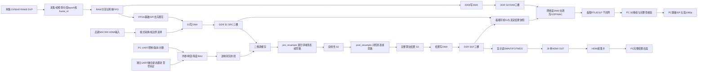

# PG2L100H（盘古100Kmini）1080p 任意角度畸变矫正系统详细设计方案

2026-10-04 灰度矫正增量：独立工程 `mini_raw8_geometry` 在现有 RAW8 链路后实现硬件鱼眼四系数逆映射、灰度邻域插值、结果/掩码 DDR 三槽、写回栅栏及 HDMI 接入，并开放 UART 参数回读与按帧应用。此候选复用 RAW 基址，但灰度结果采用独立 `0x04000000` 三槽，不能同时按下文 RGB888 的 76 MiB 布局运行；不是彩色 S1/S2、1080p30 或实板验收。接口见 [灰度参数约定](FPGA灰度鱼眼矫正参数接口.md)，已执行验证和后续差距见 [实现记录](../fpga/reports/geometry_chain_20261004.md)。下文正式彩色目标保持不变。

整板控制/存储补充：RAW8 候选使用 0x71 启动、RAW8 ACK、0x38574152 描述符和版本 1；帧槽分配时锁存 epoch，配置前帧不重新标记。当前 32-bit HMIC 列地址由逻辑字节地址右移 2 位得到，不改变 76 MiB 逻辑布局。见 [实施增量](FPGA1080pRAW8双路实施增量.md) 与 [整板候选记录](../fpga/reports/raw8_board_candidate_20260922.md)；此阶段仍不含 ISP/矫正。

RAW8 实施增量（2026-09-22）：当前开发直接面向 1080p RAW8 双路，临时 HDMI 为 RAW 采样复制到 RGB 的灰阶马赛克；不是 S1/S2/S3，终期 ISP/矫正架构不变。76 MiB 布局与 PRAW V1 不变；padding 不参与读取。见 [实施约定](FPGA1080pRAW8双路实施增量.md) 与 [离线证据及未完成项](../fpga/reports/raw8_dual_20260922.md)。不将核心仿真等同整板/真实 30fps 验收。

通信联调增量（2026-09-22）：独立[MINI 通信候选](FPGA通信上板联调方案.md)新增 PHY/串口启动及板级时序，已生成合成 TEST 流镜像，未上板。PRAW 格式、76 MiB 帧池及同帧测评约定不变；候选不含 RAW 采集/DDR/ISP/矫正/HDMI，不能代替本方案整机目标。真实 MCU 引脚及 RAW 帧池读 DMA 仍需完成，GPLL 严格仿真限制见[实际报告](../fpga/reports/comms_board_candidate_20260922.md)。

实施进展（2026-09-07）：网络V1保持原64B头，固定1400B分块、绝对超时与描述符门禁已在host实现；FPGA发送端和板端互操作仍待验证。 详见[协议与核心实现](../host/docs/千兆网视频协议与上位机实现.md)及[软件验证记录](../host/reports/PRAW_V1软件验证记录.md)。

版本：V3.0 · 更新日期：2026-09-06
平台：紫光同创 Logos-2 PG2L100H，盘古100Kmini开发板
基础输入：官方建议的双目 OV5640 DVP 模组，按此前确定的方案仅启用一路
必须达到：真实单路 1920×1080@30fps，持续采集、矫正与输出
进阶目标：更换真实 1080p60 视频源后，实现 1920×1080@60fps
项目周期：2026-09-05～2026-11-04，详见同目录《两个月开发规划表》。
跨端回传协议：[OV5640 RAW8 千兆网与 HDMI 双路回传方案](./OV5640_RAW8千兆网与HDMI双路回传方案.md)，其字段及配对规则为本方案的跨端接口依据。

> 本文替代此前 PGL50H/720p 基线方案，作为当前工程设计依据。以下电路架构、资源预算和验收门槛是实施目标，不是已经完成综合或上板测量的结果。具体板卡引脚和摄像头寄存器表必须来自匹配实物版本的资料。

## 1. 设计决策

1. PG2L100H 盘古 100K MINI＋官方双目 OV5640 DVP 模组，仅启用一路。交付目标为真实 1920×1080@30fps 的持续采集、FPGA 矫正、完整结果输出和 PC 双路查看。
2. 输入优先验证 RAW8 Bayer DVP。接收端为同一帧分配 `stream_epoch/frame_id` 后分流：**S0 原始 Bayer 字节经 DDR→板载千兆网→PC；另一支在 FPGA 完成基础 ISP，形成 S1 RGB888，再按选定增强位置完成重采样 S2 和完整结果 S3，经单路 HDMI→采集卡→PC。**
3. PC 左窗显示 S0 经 PC 基础去马赛克/显示曲线后的完整 1920×1080 图像；右窗显示 HDMI 回采结果。PC 不承担比赛链路中的逐像素几何矫正。左窗不是 FPGA 的 S1，不能直接把两窗差异归因于几何算法。
4. 不把两幅图缩成半屏再传输；不以 JPEG/H.264 等编码压缩替代 S0 字节或正式 RGB888 结果。PC 窗口可缩放预览，保存和分析的数据保持完整尺寸。
5. DDR 为 S1/SRC 与最终结果/DST 各设三槽，每槽 8 MiB；S0/RAW 三槽各 4 MiB；额外预留 S1 和选定结果阶段的同帧快照槽，各 8 MiB，共 76 MiB，描述符等另算。
6. 使用输出坐标到源坐标的逆映射，把镜头畸变、旋转/缩放或有限透视合并为一次重采样；定点流水线初始目标 150 MHz、每周期启动 1 像素，二维图块缓存服务四邻域。
7. 完整结果先写 DDR，再由固定 HDMI 时序读取；不把随机读取停顿直接暴露给不可背压的 HDMI。正常基线为 1080p30 输出，1080p60 输出须另验板端发送链和采集卡。
8. S0 的帧号、参数版本由网络协议可靠携带；HDMI 采集返回帧没有可信来源标识时，`source_frame_id=null`、`pairing_status=unverified`。严格质量比较和算法证明使用板端生成的同帧 S1＋S2 或 S1＋S3 快照，不能按软件到达次序冒充同帧。
9. 1080p60 是稳定 30fps 冻结后的独立扩展，需要更换真实 60fps 源、验证 HDMI 发送和 FPGA 吞吐；单千兆网不承担无压缩 RAW8 1080p60 完整帧流。
10. PC 负责真实标定、控制、基础查看和评测；FPGA 必须解析/校验真实内参与畸变参数，并在硬件执行逐像素映射及插值。参考模型和对照回放不冒充实时硬件结果。

## 2. 目标定义和物理边界

### 2.1 验收目标

| 类别 | 1080p30 必达版本 | 1080p60 进阶版本 |
|---|---|---|
| 输入 | 单 OV5640，完整 1920×1080，30 个不同采集帧/秒 | 支持真实 1920×1080@60fps 的相机或测试源 |
| 处理 | 每个输入帧完成一次矫正，不持续丢帧 | 每秒处理 60 个不同输入帧 |
| 输出/回传 | S0 RAW8 通过千兆网实时30帧/秒；完整S2/S3通过HDMI1080p30回采 | 完整结果HDMI1080p60；完整原图60fps回传另选高速路径，不能沿用单千兆网 |
| PC对比 | 两个完整1080p数据面；S0基础显示与HDMI结果为实时观察，未验证配对明确标记 | 分别声明处理60fps、结果回采60fps和原图回传能力 |
| 严格同帧 | 板端S1＋选定S2/S3同帧快照，带epoch、frame_id、参数/阶段标识及校验 | 同一证明机制；快照频率按带宽另验 |
| 畸变 | k1、k2 径向＋p1、p2 切向 | 同一模型，不通过删除算法“提速” |
| 重采样 | RGB 三分量双线性 | 保留双线性 |
| 角度 | 面内连续 0～360°；按真实参数域验证 | 对相同角度集合重新测性能 |
| 动态控制 | 上位机连续改角度；完成 IMU 面内补偿 | 保留按采集时间对应姿态的机制 |
| 增强 | 可开关固定/自适应 Gamma | 保留，或明确报告性能测试时的功能组合 |
| 稳定性 | 至少 2 小时正式长稳；最终冻结版本争取 8 小时 | 至少 2 小时，未通过则标为实验版 |
| 精度 | 全域定点误差、网格直线度、SFR/MTF50 | 与 30fps 采用相同评价口径 |

摄像头帧率允许器件时钟规格范围内的小误差，但必须记录实际均值、最小/最大帧间隔以及是否为 29.97/59.94 模式，并与比赛要求对应。重复帧、把 720p 放大成 1080p、以显示器刷新率代替处理帧率，均不算达标。

### 2.2 任意角度的准确含义

- 面内旋转：可接受任意角度参数，不只支持 0°/90°/180°。有限位宽意味着角度和坐标都有量化精度。
- 俯仰/偏航：是透视变化，使用单应性/相对旋转投影扩展；不能用普通二维旋转冒充。
- 单目纯旋转视图可由内参和旋转关系建立映射；平面目标可用平面单应性。一般三维场景发生平移时，单个整帧变换不能消除视差。[S4]
- 原图视场以外或遮挡部分没有可恢复信息。边界采用有效掩码、裁剪/缩放或填充；双线性插值只解决采样位置不在整数网格上的问题。
- OV5640 为卷帘传感器，快速运动下存在行间形变及模糊。整帧 IMU 补偿首版用于缓慢转动；不承诺消除所有运动畸变。

## 3. 硬件核实与输入模式

### 3.1 FPGA 资源

PG2L100H 官方选型表列出：66,600 LUT6、133,200 FF、240 个 25×18 APM、155 块 36 Kbit RAM，DDR3 上限 1066 MT/s。[S1] 按每块 36×1024 bit 计，块 RAM 总量约 697.5 KiB，实际可用量取决于宽度、深度和端口组织。

“100K”常指等效逻辑规模，不能把 PG2L100H 写成 100,000 个原生 LUT6，也不能误写为 740 个 APM。器件能力不等于板上已引出的接口或已验证时钟。

### 3.2 上板前硬件配置单

| 项目 | 本方案依赖 | 必须获得的依据 |
|---|---|---|
| 开发板 | MES2L676-100HP-MINI，PG2L100H-6IFBG676 | 实物 PCB 版本与匹配手册 [L1] |
| DDR | 两颗、总32 bit；帧池和快照至少76 MiB，描述符等另算 | 颗粒容量/实际IP配置、混合读写有效速率；手册容量冲突未消除 |
| DVP | 单路RAW8、PCLK、HREF、VSYNC、SCCB | 指定双目模组原理图与RAW模式配置；J10/J25逐脚核对 |
| HDMI输出 | **板载J9单路输出，FPGA直驱4对TMDS** | [L1] p.33～34电路/管脚表和MINI例程；不按MS7210板载发送设计 |
| HDMI输入 | **单路MS7200接收电路** | [L1] p.31～32；后期换源复用，不作为第二输出 |
| 千兆网 | **板载RTL8211F，RGMII，10/100/1000M** | 本项目必须协商到1000M；实现MAC/ARP/IPv4/UDP及RAW发送，不是可选导出项 |
| USB控制 | CP2102 USB-UART，Type-C连接器 | 只用于控制/状态，不是USB3视频接口 [L1] p.30 |
| PC采集 | 一路HDMI采集卡＋千兆网卡 | 实测完整1080p30回采；严格RGB比较核实RGB888/4:4:4、无编码和无隐藏缩放 |
| 扩展口 | 100H可用J10/J25；J26仅200H | Bank电压、时钟引脚、电源和负载逐项核对 |
| 时钟/调试 | 板载参考时钟、匹配PDS和下载器 | 工具/IP版本、授权、生成时钟与实际约束 |

不能把100Pro/AXP100B的资源当作MINI。配套硬件手册p.8等处写总512 MB，p.15写总1 GB；两者均大于当前规划容量，但正式地址空间仍以实物和DDR配置为准。手册部分文字和通用教程残留MS7210描述，p.33电路图和MINI顶层四对TMDS交叉证明本板输出走FPGA直驱。[L1][L2]

1080p30标准时序的像素时钟为74.25 MHz、DDR10:1串行器为371.25 MHz、每数据通道742.5 Mbit/s。1080p60则分别为148.5 MHz、742.5 MHz和1.485 Gbit/s。MINI回环例程有1080p60/148.5 MHz配置，但资料存在板型和电气约束版本差异；本地旧版DS04001 v1.5给出的IO时钟680 MHz、LVDS速率表也不能提供当前TMDS 1.485 Gbit/s保证。[L3][L4] 因此基线不依赖板载HDMI60，W1实测HDMI30＋目标采集卡，60发送另向板厂确认并验证。

后期如确需外接发送芯片，MS7210的24 bit RGB444输入及1080p60级发送可作为候选，模块、转接、电平和引脚仍待适配；它不是当前板载器件，也不属于本次RAW千兆网＋单HDMI基线所需采购。

### 3.3 OV5640 DVP 为何采用 RAW

OV5640 V2.03 数据手册表 8-5 列出的 DVP PCLK 最大为 96 MHz，器件列出的最高 1080p 帧率为 30fps；具体接口和数据格式应结合配置验证。[S2]

| 格式 | 8 位 DVP 每像素时钟 | 1080p30 有效 PCLK 下限 | 判定 |
|---|---:|---:|---|
| RGB565 | 2 | 124.416 MHz | 已超过上述 96 MHz，不能作为合规基线 |
| YUV422 | 平均 2 | 124.416 MHz | 同上 |
| RAW8 Bayer | 1 | 62.208 MHz | 带宽有空间，需验证消隐、配置及实物 |
| RAW10，10 位并行 | 1 | 62.208 MHz | 仅在模组引出全 10 位且该模式可用时采用 |

不通过超规格 PCLK、JPEG 替代未压缩数据或把 Bayer 当灰度彩色视频来绕过问题。RAW10 若被打包为多个 8 位字节，其时钟需求必须重新计算，不能套用 10 位并行结果。

第 1 周必须拿到 RAW 配置来源并完成：1920×1080 有效阵列、稳定约 33.33 ms 帧周期、有效位对齐、Bayer 排列和连续帧数据检查。若指定模组不能完成该模式，应立即向板厂获取支持，或按赛题允许情况启用替代输入。更换 FPGA 不能解决输入帧率不足。

配套 Double_OV5640 公开实验说明中的演示模式为720p30 RGB565，不是现成的RAW1080p30证明。[S8] 暗光测试还需限制曝光和自动降帧策略，保证AEC不会把30fps降低成15fps。

OV5640 DVP 不作为真实 1080p60 的输入源：RAW8 的有效需求已达 124.416 MHz，且器件官方 1080p 帧率也止于 30fps。[S2] 因而 60fps 计划必须包含摄像头或输入方式升级。

### 3.4 单路启用与电气接口

逻辑端口：`cam_d[9:0]`（实际使用位可配置）、`cam_pclk`、`cam_href`、`cam_vsync`、`cam_xclk`（按模组）、`reset_n`、`pwdn`、`scl`、`sda`。

- 不因模组是双目而配置两条并行图像链；另一颗按模组电路待机，不切断可能共享的电源。
- 依据手册确认 RAW8 的有效位；AN5642 的 RGB 有效位说明不能自动当成所有模组 RAW 位接法。[S3]
- PCLK 接合适的时钟输入，检查电平转换器是否支持工作速率；传感器裸芯片电压不等于模块接口电压。
- 两颗 SCCB 地址相同且共享总线时，确认独立使能/复位或总线隔离；不得让两颗同时响应读命令。
- 校验 40 针连接器的每个电源与信号脚，不能凭外形对插。
- 帧内不改变裁剪、镜像、曝光模式或输出格式。模式切换时停止 DMA、清空 FIFO、作废旧缓存再重启。

### 3.5 配套硬件准备表

| 项目 | 建议配置 | 数量/时间 |
|---|---|---|
| 主板/输入 | 已确定100Kmini＋官方Double_OV5640，仅启用一路 | 各1，W1到位 |
| 姿态模块 | 可独立输出融合姿态的UART模块，直接接FPGA；具体型号尚未确认 | 1，W2前核对协议/电平/频率；与PC控制UART独立 |
| 标定板 | 刚性哑光，建议10×7方格、9×6内角点、实测25mm格长 | 1，W1准备；按实际距离调整尺寸 |
| SFR测试卡 | 高质量斜边图卡，另备网格直线卡 | 各1，W2前准备 |
| 支架 | 相机/IMU共用刚性支架、带刻度面内旋转台和俯仰机构 | 1套，W3前到位 |
| 光源 | 低闪烁可调LED面光源、柔光附件 | 1套，W4前准备 |
| PC与网络 | 千兆网卡/独立端口、Cat5e以上网线；足够连续接收和存储带宽 | 1套，W1；USB外形不代表网口速率 |
| HDMI采集卡 | 实测支持1080p30；选择可取完整无编码帧的模式，核实RGB888/4:4:4与范围 | 1，W1；不要只看HDMI环出规格 |
| 显示器 | PC显示两路完整数据的预览；可选HDMI直连调试屏 | 优先复用；UI缩放不改源数据 |
| 测量 | 示波器/逻辑分析仪或实验室共享设备；GPIO标记线 | W1测输入，W4测性能 |
| 电源/下载 | 板厂匹配电源和PDS下载器；相机/IMU按各自额定供电 | 1套，W1 |
| 60fps相机候选 | ToupTek OCAM1080P2MPA（IMX385、HDMI1080p60、C口），作为可询价候选 | 可选1，W2锁定来源、W6前到位 [S9] |
| 升级镜头 | 与候选相机匹配、覆盖1/2英寸靶面、可锁焦的C口广角镜头 | 随新相机配置并重新标定 |

摄像头候选的60fps规格来自厂商页，但菜单关闭、固定曝光、畸变校正开关、视频格式和实际链路延迟仍需逐项确认。现阶段不用替换OV5640；该采购路径服务于后续60fps。不同预算可先借用同规格设备，未取得报价不编造总价。

## 4. 总体架构



S0为未做ISP的Bayer原始字节；S1为FPGA基础ISP输出、几何处理前的RGB888；S2为重采样后、最终OSD/分屏前的观测点；S3为完整算法结果、显示缩放前的观测点。`enhancement_stage`为`disabled/pre_resample/post_resample`：pre模式在源四邻域查表后插值，因此S2已含增强；post模式在S2之后查表，作为独立对照。除专门定义的实验外不同时启用两者。几何精度测评关闭增强。正常只缓存选定结果，阶段、增强位置和LUT实体/版本一并记录，不能凭S2名称断言未增强，也不能凭S3名称推断Gamma必然在插值后。

两条回传路径传送不同表示：**千兆网发送完整S0；HDMI发送完整S2/S3**，不生成左右缩小后的VIEW帧作为回传基线。PC左窗执行的基础ISP必须标注版本、Bayer相位和显示曲线；它只让RAW可看，不补做参赛几何矫正。S1与PC左窗的颜色或锐度差异不属于几何模块单独误差。

保留完整结果帧，使算法在cache miss时可停顿，HDMI始终读取完整已提交结果。网络发送进一步解耦，网络断线或拥塞不反压不可停的DVP，不阻塞正常FPGA处理；但发生RAW漏帧时，双路实时回传验收应记为失败，不能只报告算法仍运行。

### 4.1 统一视频和帧接口

RAW入口为`raw[7:0]`；S1后统一为`pixel_rgb[23:0]`，通道次序R/G/B。内部流采用`valid/ready/sof/eol`，`stream_epoch/frame_id`、采集首末时间、模式、错误标志与像素同路传播。有效数据只有在`valid && ready`时消费；停顿期间保持所有元信息。

DVP/HDMI接收没有ready。异步FIFO溢出时作废受影响整帧，记录错误，不提交半帧。RAW分流必须明确两分支的事务归属：RAW帧池不可用时，可丢弃并记录整份网络副本而继续ISP，但不得中途拼接下一帧；公共采集FIFO溢出则两个分支均标记该帧无效。

PC原始数据主键为`stream_epoch/frame_id/stage_id/param_version`。stream_epoch是源采集代次：相机采集重启或模式切换在明确帧边界更新，新旧帧分属各自代次；PC/网络重连不改写在途帧或快照的epoch，旧描述符始终保留原身份。HDMI采集卡没有可信源帧号时保持`source_frame_id=null`和`pairing_status=unverified`；可显示时间接近的两帧做观察，不能标为精确同帧。严格对照使用板端快照证明链。连续HDMI源关联另设验收门槛，低频快照不能证明每秒30对同源；未关联时只发布独立双流能力，见第12节及[跨端回传方案](./OV5640_RAW8千兆网与HDMI双路回传方案.md)。

### 4.2 时钟域

| 时钟 | 起始设计 | 作用 |
|---|---|---|
| `cam_pclk` | RAW模式实测，符合器件上限 | DVP捕获 |
| `sys_clk` | 约100 MHz，依实际PLL | 控制、UART、公共时间戳 |
| `isp_clk/proc_clk` | 初始150 MHz、每周期启动1像素 | 基础ISP、映射、插值、cache |
| `ddr_ui_clk` | DDR IP实际配置 | DMA/仲裁；用户总线位宽按IP |
| `rgmii_tx_clk` | 千兆模式125 MHz | PHY发送，4 bit双沿；约束及相位按PHY/板卡 |
| `rgmii_rx_clk` | PHY恢复时钟 | ARP/控制包等接收 |
| `hdmi_rx_clk` | 后期MS7200恢复时钟 | HDMI输入 |
| `pix_clk` | 基线1080p30为74.25 MHz | HDMI输出；29.97/60/59.94另配 |
| `tmds_serial_clk` | 基线371.25 MHz，DDR10:1 | 直驱TMDS；60模式742.5 MHz单独确认 |

这些为设计配置目标，不是实测时序成绩。多位参数通过快照握手，视频和MAC侧通过厂商异步FIFO；各域同步释放复位，PLL/DDR/PHY状态符合条件后逐项启动。网络启动和断线不能复位整个视频系统。30fps同样需要核对输入/输出实际帧周期和长期时钟漂移；三缓冲只吸收短期抖动，长期重复/漏显示必须计数并按第10节同步原则处理。

## 5. RAW 基础 ISP

### 5.1 流水级

1. **有效阵列捕获**：检查每行/帧计数，分离传感器 dummy 区域，记录完整 1920×1080 原始有效图。
2. **黑电平与增益**：按黑电平校准减法、钳位，再按 R/Gr/Gb/B 增益处理；参数按帧锁定，保存 10～12 位中间精度。
3. **3×3 去马赛克**：2 行 RAM 加窗口寄存器，依据四种 Bayer 排列选择邻域。先实现双线性去马赛克作为正确性基线。
4. **基础色彩处理**：固定白平衡/可选 3×3 色彩矩阵，记录系数来源；没有色卡校准时不杜撰“准确色彩”。
5. **固定输出曲线**：RAW 路线采用可复现的基础显示曲线，再量化到 RGB888，与 HDMI 路线的像素接口统一。
6. **帧统计**：对几何变换前图像统计亮度，用于下一处理帧的增强选择，不让黑边比例左右亮度判断。

去马赛克必须在通用 RGB 畸变重采样之前。直接在 Bayer 网格上做普通 RGB 双线性会混合不同颜色采样位置，产生伪色。

### 5.2 去马赛克定义

以 RGGB 为例：R 点的 G 为上下左右 G 平均，B 为四个对角 B 平均；B 点对称；G 点根据所在行，分别沿水平/垂直插值 R/B。四种 Bayer 排列均用参数指定，并用彩条、红蓝物体和像素转储验证。

RAW边界采用保持Bayer奇偶相位的reflect-101，例如虚拟x=-1取x=1，虚拟x=W取x=W-2；也可仅用同色有效邻居插值，但必须与参考一致。不能直接把R边界像素复制到应为G/B的虚拟位置，也不能为了窗口把输出默默变成1918×1078。首末行/列通过边界生成与末行flush逻辑处理，输出仍是完整1920×1080。

镜像、翻转、裁剪起点奇偶会改变 Bayer 相位。配置变化必须刷新相位和标定档案；去马赛克的两行延迟不代表整机只有两行延迟。

### 5.3 画质与功能取舍

第 2 周完成可测量的彩色 RAW 链，再做标定。边缘感知去马赛克、复杂降噪、局部直方图均衡不是首版依赖。若基础 ISP 引入明显伪色或 MTF 损失，应在质量报告中分离 ISP 与几何插值影响。

## 6. 逆映射算法与定点实现

### 6.1 模型

输出像素为 p=(u,v,1)。基础模式先由六系数仿射变换得到理想归一化坐标：

```text
x = a00*u + a01*v + a02
y = a10*u + a11*v + a12
r2 = x*x + y*y
radial = 1 + r2*(k1 + k2*r2)
xd = x*radial + 2*p1*x*y + p2*(r2 + 2*x*x)
yd = y*radial + p1*(r2 + 2*y*y) + 2*p2*x*y
ud = fx*xd + cx
vd = fy*yd + cy
```

`radial` 使用 Horner 写法降低中间量规模。仍需真实系数和工作域区间检查，不把不同表达式的定点舍入默认视为相同。[S4][S5]

六个系数由输出内参 Kout、显示缩放及逆旋转合成；像素中心以整数坐标表示。行/列递推用于减少每像素乘法：同一行 x、y 按 a00/a10 增量，下一行按 a01/a11 增量。每个图块重算起点，控制累计误差。

上位机与 FPGA 共同固定屏幕坐标系（u 向右、v 向下）、角度正方向、中心点、变换先后次序。不直接照搬数学坐标系符号；用不对称箭头验证正负角。

### 6.2 透视前端

扩展模式将六系数替换为 M：`q=M*p`，`x=q0/q2`、`y=q1/q2`。对于纯旋转，M 可取“输出相机射线转到输入相机坐标”的旋转矩阵乘 Kout 的逆；因此后面的 fx/fy/cx/cy 使用输入相机内参。

平面单应性若先得到输入理想像素，应先乘输入内参的逆转换到归一化坐标，再接上述镜头模型，避免重复施加 K。所有矩阵约定在参考工具中以 0° 恒等变换核对。

分母正负、近零和可表示范围必须检查。倒数采用范围归一化、LUT 初值、定点 Newton 迭代，再恢复指数；其 LUT 位数/迭代次数由误差目标决定，不在未经验证时固定承诺。透视演示先验证 ±15° 俯仰，再测更大范围并发布有效范围，不承诺任何姿态都可无损恢复。

### 6.3 候选位宽

定义 S(W,F)：有符号总 W 位，小数 F 位；U(W,F) 为无符号，均不使用歧义 Q 命名。

| 值 | 初始候选 | 注意事项 |
|---|---|---|
| 仿射系数/矩阵系数 | S(32,26) 或经尺度归一化的独立格式 | 对超域输入返回错误，不饱和后继续 |
| 仿射递推累加器 | S(40,26) | 每图块起点重载 |
| x、y | S(24,20) | 约 [-8,8)，真正受支持域由标定确定 |
| 畸变系数 | S(32,26) | 可按实际范围缩窄，但需记录小数位 |
| r2、radial 及乘积 | 分级区间推导、全位宽乘积后舍入 | 不统一截成 24 位 |
| fx/fy/cx/cy | S(32,16) | 允许像素单位的焦距和主点 |
| ud、vd | S(28,12) | 含负坐标，先判界再转地址 |
| 插值分数 a、b | U(12,12) | floor 提取，0～4095/4096 |

APM 为 25×18；24×24 或 32×24 运算会拆分，不能按一运算一个 DSP 预算。通过位宽搜索、乘法拆分、流水寄存和有限复用在精度、面积、启动间隔间取舍。透视前端、双通道扩展须单独综合。

团队内部坐标误差目标：有效输出区域相对浮点参考 RMS≤0.05 pixel、最大≤0.25 pixel。最大误差超标时保留更多精度或限制参数范围；每项限制都进入用户可见模式和报告。

### 6.4 双线性插值

`i=floor(ud)`、`j=floor(vd)`；a、b 为 12 位分数整数，F=4096。三个 RGB 分量分别计算：

```text
top = (F-a)*P00 + a*P10
bot = (F-a)*P01 + a*P11
out = round(((F-b)*top + b*bot)/(F*F))
```

水平阶段不提前截成 8 位，最终一次舍入并钳位到 0～255。对有符号地址，向零截断不等于 floor。12 位分数与软件参考一致，必要时可量化到 10 位但先验证误差。

采样边界采用“坐标范围检查＋邻域夹取”：当 ud、vd 位于闭区间 [0,W-1]、[0,H-1] 时，将 i+1、j+1 夹到最后一列/行；超出此范围则 invalid。这样恒等映射不会丢失最末行/列。

夹取后可能出现重复邻域地址，cache读取端应合并读取并广播样本，或按端口调度；不能仍假设四个样本必然对应四个不同bank。

超界默认黑色，输出有效掩码；可选择自动/手动裁剪。自动裁剪需检查完整有效域，不凭旋转矩形四角认定没有畸变黑边。强缩小需抗混叠预滤波，基线优先不做大倍率缩小。

## 7. 存储结构与带宽

### 7.1 像素格式

S0每像素一个RAW8字节；S1及选定结果均为紧凑RGB888、3字节/像素。RGB565会改变颜色精度，仅可用于明确标注的带宽诊断构建，不能替代正式质量链。RAW8没有JPEG/H.264编码，也不能把Bayer字节直接解释为灰度彩色视频。

RGB888行跨度6144字节，有效5760字节；RAW行跨度2048字节，有效1920字节。网络仅发送RAW有效字节，重组成紧凑stride1920，绝不发送或显示DDR填充。DDR总线上的pack/unpack保留跨beat残余字节，正确处理首尾掩码。

16×16 RGB输出块每行48字节，首地址未必beat对齐。DMA必须同时处理起始偏移与首尾字节使能；不支持掩码时聚合为可合法写出的行段，禁止无互斥读改写损坏邻块。只传有效区域，不主动填满行stride。

### 7.2 地址规划

以下均为DDR相对字节地址；总线按字/beat寻址的IP须由适配层转换。

| 槽位 | 起始地址 | 单槽分配 | 内容与有效覆盖 |
|---|---:|---:|---|
| SRC0/1/2 | 0x00000000 / 0x00800000 / 0x01000000 | 8 MiB | S1；每帧1080×6144=6,635,520字节地址跨度 |
| DST0/1/2 | 0x01800000 / 0x02000000 / 0x02800000 | 8 MiB | 选定S2或S3；同上 |
| RAW0/1/2 | 0x03000000 / 0x03400000 / 0x03800000 | 4 MiB | S0；每帧1080×2048=2,211,840字节地址跨度 |
| SNAPSHOT_S1 | 0x03C00000 | 8 MiB | 指定帧S1完整快照 |
| SNAPSHOT_RESULT | 0x04400000 | 8 MiB | 同帧选定S2/S3完整快照 |

分配区结束于`0x04C00000`，合计76 MiB；不是此前的64 MiB规划。帧描述符、有效掩码、包状态或新增证据槽另行分配并验证实际DDR空间。RAW使用2048行跨度时超过2 MiB，因此这里每槽必须为4 MiB，不能按有效字节数误配2 MiB。

### 7.3 帧所有权与快照

- S1：`FREE→CAPTURING→READY→PROCESSING→FREE`，附加快照复制引用；所有几何/cache及快照读事务排空后释放。
- 结果：`FREE→RENDERING→READY→DISPLAYING→FREE`，显示和快照复制分别持引用。
- RAW：`FREE→CAPTURING→READY→NET_SENDING→FREE`；只有全部DMA读取和发送所需数据已安全转移后释放，不能边发边被下一帧覆盖。
- 快照：`FREE→COPYING→READY→EXPORTING→FREE`；不覆盖尚未导出的证据，已有请求时新请求返回BUSY或明确排队。

每份描述符包含epoch、frame_id、阶段、首末采集时间、模式、宽高、stride、ISP/标定/姿态版本、状态和校验信息。READY需等待最后写事务完成；释放槽位需等待相关读响应排空，不能只看最后一个输出像素。

同帧快照请求必须在S1尚未释放前注册，并绑定同一采集帧的S1与选定结果阶段。复制至专用快照槽后，再释放原处理槽引用；完整性校验通过才对PC标记可用。仅有S3常规缓存时，要求S2快照需事先启用S2捕获或选择S2输出，不能事后恢复不存在的阶段。

正式处理按采集顺序，无持续丢帧。过载容错可丢弃未占用的整帧并计数，但不等于验收通过。HDMI只在场边界切换完整结果；同帧的S0通常早于结果到达PC，PC为两路分别维护队列和状态，不以到达顺序赋相同ID。

### 7.4 DDR有效载荷估算

下表单位为十进制MB/s。基线RAW在捕获后直接分流给ISP和RAW写DMA，因此RAW额外DDR开销是一次写和一次网络读。若改为ISP再从RAW帧池读取，须再加62.208 MB/s@30的有效读流量。

| 数据流 | 30fps处理＋30Hz输出＋RAW30网传 | 30fps处理＋已验证60Hz输出＋RAW30网传 | HDMI真源60fps处理/60Hz输出，无RAW网传 |
|---|---:|---:|---:|
| S1写 | 186.624 | 186.624 | 373.248 |
| 四邻域读，假设无复用且只读所需字节 | 746.496 | 746.496 | 1492.992 |
| 结果写 | 186.624 | 186.624 | 373.248 |
| HDMI显示读 | 186.624 | 373.248 | 373.248 |
| RAW写＋网络读 | 124.416 | 124.416 | 0 |
| 以上合计 | **1430.784** | **1617.408** | **2612.736** |
| 若源缓存读约等于一次完整源图的参考合计 | **870.912** | **1057.536** | **1492.992** |

两种合计都不是保证或最坏上界，不含stride访问浪费、低效突发、刷新、过量回填、快照/掩码及控制。统一公式为`B=3×[R×(g+2)+D]+2×Q+B_snapshot`，R为处理像素/秒，D为输出像素/秒，Q为RAW8像素/秒，g为实际源回填字节除以`3×输出像素数`。没有RAW分支时Q=0。

一次S1＋结果快照若采用从既有帧复制到专用槽、随后网络导出，至少新增两帧读、两帧写和两帧导出读，即37.3248 MB的有效DDR流量；每秒一次不是默认承诺。若阶段捕获方式不同应重新计数。网络快照和RAW实时争用同一网口，其协议开销还需计入第7.6节。

32 bit、1066 MT/s的器件理论带宽为4.264 GB/s，实际工作速率由板卡/IP确认。必须用真实角度混合访问统计`source_fill_bytes/output_pixel`、最大DMA等待、FIFO水位和最坏帧时间，不能拿理论峰值作达标证明。

### 7.5 仲裁与故障隔离

采集写、几何源读、结果写和HDMI读为实时主链路，采用有等待上限的仲裁，采集高水位/显示低水位触发紧急服务；不能用无限固定优先级饿死算法。RAW网络读优先级低于实时主链路，但正常双流模式仍须获得足够服务额度；快照复制与导出更低，带宽不足返回BUSY、限流或暂停快照。

网络断开时停止发帧并按策略释放未占用RAW副本，保存drop/link状态，恢复时使用完整帧重新开始。主处理可继续，但日志分别报告硬件处理成功与RAW回传失败。PC处理不及、包丢失、队列溢出都不得静默转换成重复帧。

多个未决DDR事务必须可追踪；无ID接口以有序队列关联响应。UI突发语义按实际IP封装，不假设所有板厂接口都是AXI。网络FIFO、MAC发包和RGMII间的CDC同样纳入检查。

### 7.6 RAW8千兆网协议与预算

跨端字段、CRC覆盖和错误恢复以[双路回传方案](./OV5640_RAW8千兆网与HDMI双路回传方案.md)为准，不另建不兼容协议。基线为以太网/IPv4/UDP，MTU1500、不使用IP分片；每个数据报为64字节应用头＋最多1400字节有效图像数据，应用头多字节字段小端；Ethernet/IPv4/UDP标准头遵守各自网络标准和字节序。头携带epoch、frame_id、偏移、有效长度、Bayer排列、参数版本和CRC32等标识。

1920×1080 RAW8每帧2,073,600字节，最多1482个图像数据包（最后包200字节）；30fps为44,460包/秒。仅RAW有效数据497.664 Mbit/s；无VLAN、IPv4无选项，计64字节应用头、UDP/IP、以太网头/FCS、前导码和帧间隔，约**543.9024 Mbit/s**，尚未含ARP、额外元信息、重传/快照。链路必须协商到1000M；100M回退直接标为不满足实时条件。

PC用offset而非到达次序重组，校验长度/范围/重复包一致性和CRC，超时缺包则标帧无效，不用上一帧像素补洞。正常实时流不等待无限重传；若实现补发，只能在保留槽和时限范围内进行。快照按可靠完成/校验机制导出，具体命令遵循跨端协议。

RAW8 1080p60有效数据已为995.328 Mbit/s，同口径含包开销约1087.8048 Mbit/s，超过1G线速。因此不能把RAW30网传结果外推到60；对HDMI输入的RGB888，单路1080p30有效数据也达1492.992 Mbit/s，更不能直接复用为千兆彩色原图实时回传。

一组S1/结果快照每秒一次在同口径下额外约108.7763 Mbit/s，与RAW30合计约652.6787 Mbit/s；这是条件预算，不含额外控制/重传。网络容量统计须同时包含RAW连续流、快照、协议与控制开销；“快照≤1 Hz”仅是条件上限，实际频率以可用带宽、队列和DDR压力测试决定；正式长稳默认每60秒一组，压力测试再按能力增加。

## 8. 二维源图缓存与吞吐

### 8.1 初始配置

采用 16×16 像素源块、128 个缓存槽，RGB888 数据容量 96 KiB；4 路组相联、32 组，标签包含图块坐标和帧代号。每个新处理帧使缓存失效，防止读取旧图。

像素按 x/y 奇偶拆为四个 bank，使单输出像素四邻域落在不同 bank。图块标签最多四个并行查询；需要检查端口、标签复制和跨块访问。回填与读取共享双口 RAM 时，明确同址读写行为并仲裁，不能假设“声明双口”即可无冲突。

未命中冻结该请求或放入等待队列；所有邻域到齐后才输出。相关请求合并一次回填；首版保证正确，再加入多请求并行。坐标、frame_id、参数版本与 valid_mask 一起排队，停顿不能错位。

16×16 RGB888 每行 48 字节，未对齐突发可能读入额外字节。第 3～4 周同时仿真 32×8、16×16、8×32 形状及不同组索引，选实际 DDR 轨迹最优者；不能用一个零度命中率代表全部角度。

### 8.2 输出调度

按 16×16 输出块遍历，块内逐行生成，双缓冲结果小 RAM 收集后按行段写 DDR。结果存入完整帧，因此允许改变输出块顺序改善原图局部性。

跨源块时不能只用输出块四角估计源包围盒；径向非线性和透视会造成内部极值。预取作为增强，基础正确性由逐坐标 miss 检查保障。

### 8.3 30/60fps 的计算预算

| 方案 | 无停顿吞吐 | 1080p 理想整帧处理时间 | 工程判断 |
|---|---:|---:|---|
| 100 MHz，1 pixel/cycle | 100 Mpixel/s | 20.736 ms | 可作为 30fps 回退时钟，60fps 不足 |
| 150 MHz，1 pixel/cycle | 150 Mpixel/s | 13.824 ms | 30fps 有余量；60fps 对缓存等待很敏感 |
| 125 MHz，2 pixel/cycle | 250 Mpixel/s | 8.2944 ms | 60fps 有更多周期余量，但资源和多读口更复杂 |

实际完整处理时间包括缓存停顿、DDR 写回和起止开销。30fps 以每帧≤30 ms 作为内部留余量目标，硬截止为 33.33 ms；60fps 内部目标≤15 ms，硬截止 16.67 ms。用最坏实测帧时间和长期积压判断，不只看平均值。

60fps 优化顺序：减少回填浪费/冲突→改善 outstanding 和预取→确认单通道 150 MHz 是否满足→如不足再采用 2 pixel/cycle。双像素需要最多八个源样本且可能冲突，需双口/复制/banking 和调度证明；不能仅复制算术就声称吞吐翻倍。更高时钟也须通过 PDS，不预设一定能达 200 MHz。

## 9. 增强、参数和姿态

### 9.1 自适应Gamma与增强位置

基于S1原图亮度统计选择帧级LUT，曲线定义`out=255*(in/255)^gamma`，0.7/1.0/1.3仅作初始调试档。每4×4抽样，累加亮度、暗部和饱和比例，设迟滞/连续帧确认。基础ISP曲线与自适应增强分别命名，保存实际LUT实体/哈希，不能只记录“Gamma开启”。

增强位置与[测评方案](./可控光照箱与上位机测评详细实施方案.md)统一：

| 模式 | 精确数据顺序 | S2/S3含义与用途 |
|---|---|---|
| `disabled` | S1四邻域→双线性→结果 | 正式几何精度基线；S2不含自适应增强，S3可与S2数值相同 |
| `pre_resample` | 从保持未增强S1的cache取四邻域→各RGB通道查表→双线性→结果 | 满足“矫正前或过程中”的增强主线；S2已包含前置增强，S3为最终算法输出 |
| `post_resample` | S1四邻域→双线性得到S2→各RGB通道查表→S3 | 保留原后置实现作独立对照，软件参考按实际顺序计算 |

非线性LUT与插值通常不可交换，不能用post参考评估pre硬件，也不能把pre的S2当纯几何结果。查表放在cache取样之后，cache和DDR的S1始终保持原基础ISP结果，不就地改写源图。选定LUT绑定该源帧/处理描述符，从四邻域到整帧保持唯一版本；切表只在明确帧边界提交。

每周期启动1个RGB输出像素，pre模式最多需要4×3=12次独立地址查表，post模式只需3次。pre须足够的LUT副本/读端口或经证明满足吞吐的调度，重新综合RAM/逻辑及最坏帧耗时；不能沿用后置Gamma“开销很小”的结论。关闭增强先完成几何30fps，W5增加并验证pre主线，post只作对照；pre_resample未通过时，必须标记赛题“矫正前或过程中”的预处理目标未完成，不能用post对照替代；同时保留已经验证的主几何链正确性。

未拍到的暗部和饱和信息不可恢复。增强测试分别固定曝光和开启自动曝光，记录噪声/饱和比例、实际位置与LUT；不只展示画面变亮。两个快照槽一次只保存S1和选定S2/S3之一；要比较两个输出阶段需另加缓冲或可复现静态诊断回放，不宣称已同时保存三阶段。

### 9.2 参数与协议

实施索引（2026-09-21）：FPGA端通信实现见[通信子系统与PRAW发送](FPGA通信子系统与PRAW发送实现V1.md)及[MCU独立链路](FPGA_MCU通信协议V1.md)。MCU环境遥测端点复用下述外层UART帧，命令空间/会话独立；不代替本节PC标定参数解析或已有MCU电机文本协议。

上位机保存 float64/float32 标定档案和元信息，下发定点载荷。UART 8N1、初始 115200 bit/s，后续可在硬件验证后提高。包格式：

```text
55 AA | version:u8 | cmd:u8 | seq:u16 | length:u16 |
payload | CRC16:u16
```

多字节小端；CRC-16/CCITT-FALSE（0x1021，初始0xFFFF，不反射，xorout0），覆盖 version 至 payload；CRC 也按小端发送。payload 上限 1024，超长、超时、CRC 错误返回可统计状态。

命令：读取状态、写影子参数、提交参数、选择显示模式、读取计数、冻结/分块导出帧、设置姿态零位。提交回应包含实际生效 frame_id 和 param_version；非法焦距、超域系数、模式不符拒绝，不静默使用旧值冒充成功。

每帧锁定一个参数集合。SCCB、UART、IMU 控制不直接修改处理中途的寄存器。上位机断开后维持最后有效参数，显示连接状态；恢复后读取版本再续传。

FPGA参数寄存器和协议必须保留可读回的`fx/fy/cx/cy/k1/k2/p1/p2`及图像模式/定点缩放说明，不能只接收一张PC坐标查找表而声称完成参数解析。上位机将真实K/D按约定位宽量化，FPGA解析字段、长度、版本和CRC，检查焦距正值、主点/系数有效域、分辨率一致性、溢出及不支持模型；失败回执明确原因，成功提交返回实际生效frame_id和版本。用真实标定档逐项读回和误差测试证明解析正确；用于单元测试的零畸变系数必须标记测试模式。

RAW网络头中的参数版本反映该帧实际采集/ISP配置；几何和增强版本在处理描述符及快照中记录。HDMI捕获缺失的标识不能由UART查询“当前版本”回填为历史事实。RAW数据包使用CRC32，控制包保持本节既有CRC16，两者用途不同。

### 9.3 独立UART姿态模块与同步

当前优先选择能独立输出融合姿态的UART模块，直接接FPGA，具体型号尚未确认。模块与相机刚性固定；W2冻结实际输出协议、校验、更新率、坐标系和电平。TTL电平须匹配IO Bank；RS-232/RS-485需对应收发器。IMU UART、板载CP2102的PC控制UART和设备控制UART使用独立接收路径，不无仲裁并接。旧ICM-42688-P是SPI原始六轴器件，仅保留为另行实现姿态融合的备选，不能称为已选串口融合模块。[S6]

模块输出适配为约定姿态：建议Hamilton四元数[w,x,y,z]，主动旋转，保存q_wc（相机坐标到参考世界），相机轴x右/y下/z前。输出定义不同则显式转换，经单轴运动验证；姿态融合在外置模块完成，PC只调试/可视化，断开PC后FPGA仍能接收姿态。

FPGA按包接收校验并记录时间戳，建立模块时间与FPGA时间的偏移/漂移关系；只有串口到达时刻时，还需标定传输和融合延迟并标为近似同步。32字节、200Hz、8N1需64,000bit/s，115200下单包约2.78ms，只是设计示例，不是指定模块能力。

保持姿态环形队列，按图像采集/曝光中心而非开始处理时刻选取或插值姿态，并绑定源帧描述符。VSYNC不自动等于曝光中心；OV5640卷帘/长曝光和后期HDMI相机ISP缓冲的偏移需分别测量。丢包、过期、晚到时按已定义保持/预测/暂停策略降级并计数，不能静默当准确补偿。

先用上位机指令和板载按键验证映射，再加入模块姿态。六轴融合的航向可能漂移，需零位与独立角度参考；IMU不能替代真实镜头K/D。未完成模块适配/同步时只声明已经验证的按键旋转和姿态范围。

### 9.4 独立运行演示

相机与FPGA独立供电，结果可直接送独立显示器；如同时回采，用经过验证、PC断开后仍能保持供电/EDID的有源分配或采集环出。没有该设备时，在显示器与采集卡之间切换验证。分配器只复制结果，不能产生一份不同原图。

真实参数装载后，板载按键直接控制旁路/矫正、旋转角和稳定配置恢复，参数在FPGA帧边界提交，路径不经过PC。退出PC软件、拔除网线/控制线后，应继续实时输出并响应这些按键；此时网络不可用必须单独记录，不计入完整双流长稳。旁路能耗对照需要停止几何计算使能，不仅切换显示地址。

运行期参数寄存器不等于断电保存。脱离PC冷启动需要另实现可靠非易失参数装载及完整性/版本检查；未完成前，仅声明“装载参数后可独立运行”。

## 10. 1080p60 与 HDMI 输入升级

60fps属于独立扩展：必须分别证明真实输入60fps、完整算法60fps、结果发送/回采60fps以及所需原图回传能力。原30fps双流版保留。统一入口支持以下两条互斥路径：

- DVP：RAW→ISP→RGB888。
- HDMI：HDMI 接收芯片→RGB888 或 YUV→正确色彩转换→RGB888。

配套100Kmini手册列出MS7200输入，优先复用这条板载路径。[S7] 在实物与手册一致时无需另购HDMI接收板；只有版本差异或板载路径不适用时才外接模块。不能把HDMI线接到普通GPIO或输出接口。外接方案应有实际1080p60接收例程、原理图、配置资料，并匹配扩展口IO Bank电压和时钟管脚。

摄像头采购条件：明确 HDMI 真正 1920×1080@60fps、关闭菜单/电子防抖/几何校正、能锁曝光焦点、支持所需 RGB/YCbCr 格式、输出时序可核实。只写“4K”或“HDMI接口”不足以判断。

接收器设置/检查 EDID、HPD、锁定、色彩空间、量化范围；若是 YCbCr422，要按像素时序恢复色度并转换，不能按 RGB 字节直接显示。使用不带内容保护的相机/测试源，不设计受保护内容解密链。

60fps长稳还需匹配输入输出的60/59.94模式及长期时钟漂移。优先验证输出时钟跟随接收参考或可用的帧同步方案；若输入输出自由运行，则分别统计处理完成帧、重复显示帧及未显示结果。三缓冲只能吸收短期抖动，不能消除长期频差；严格逐输入帧显示的验收必须由同步设计证明，不能用显示丢帧掩盖。

输入切换需要停采、释放事务、作废旧帧、加载对应内参/ISP档案、确认新时序后恢复。更换镜头/相机必须重新标定；同一标定档不能跨摄像头复用。

60fps验证先用可控HDMI图案或离线帧回放证明FPGA处理能力，再接真实相机验证端到端。前者只能称为“处理核60fps”，不能替代摄像头演示。输入变为HDMI后不存在OV5640的S0 Bayer流，原始参考阶段改为模式定义的接收数据/S1，禁止仍标RAW8；完整原图60fps回传需另设高速路径（例如经过适配验证的附加HDMI或更高速网络/总线）。单千兆网可继续发参数、计数和限速快照，不能声称两份全帧60fps都在实时回传。

## 11. RTL 划分与资源预算

| 模块组 | 主要模块 | 职责 |
|---|---|---|
| 板级 | clock_reset、ddr_adapter、hdmi_tx_adapter、rgmii_adapter | 时钟、复位、直驱TMDS、PHY适配 |
| 输入 | ov5640_sccb、dvp_capture、hdmi_rx_adapter、input_select | 配置、时序检查、输入切换 |
| ISP | raw_gain、bayer_window、demosaic、color_curve | RAW 转彩色 |
| 帧系统 | raw_write_dma、capture_dma、frame_manager、result_dma、display_dma | RAW/SRC/DST分支所有权、快照引用、显示 |
| 网络 | raw_net_dma、row_compactor、packetizer、eth_mac、arp_ipv4_udp、net_status | RAW去stride、分包、CRC、RGMII发送和链路统计 |
| 几何 | tile_scheduler、coord_affine、coord_projective、coord_distort | 逆映射与有效域 |
| 采样 | source_cache、miss_queue、bilinear_rgb | 二维邻域与插值 |
| 增强/控制 | gamma_stats、source_lut_bank、post_lut、param_bank、uart_control、imu_uart_rx、attitude_adapter | pre/post位置、按帧LUT、独立UART姿态与时间适配 |
| 观测 | perf_monitor、snapshot_copy、snapshot_export、test_pattern | 同帧S1/结果证据、计数与回放 |

### 11.1 资源目标

| 资源 | PG2L100H 总量 | 30fps 版本规划上限 |
|---|---:|---:|
| LUT6 | 66,600 | 约 50,000 |
| FF | 133,200 | 约 95,000 |
| APM 25×18 | 240 | 约 180 |
| 36 Kbit RAM | 155 | 约 120 |

资源上限为包含RAW网络/CRC/FIFO/快照控制的整机团队预算，不是算法独占预算。先分别综合DDR/HDMI底座、RGMII/MAC/UDP和ISP，再分配余量；网络包缓冲、CDC、CRC/校验和与头部逻辑均要计入。源图 cache 96 KiB 只是数据量，标签/端口复制/FIFO/IP 开销须按 PDS 报告核算；两个像素通道不能假设仍在该预算内。

亮度统计开销相对小，但pre_resample最多12次独立查表/像素，需要计入LUT端口复制；另有宽位乘法、透视倒数和并行邻域压力。可复用的是帧间低频运算与配置，不能为了资源把每像素启动间隔变到达不到吞吐。

### 11.2 CDC 与时序约束

所有参考/生成时钟有定义；相机输入相对PCLK设置输入约束，HDMI直驱按TMDS/串行器要求约束；RGMII同时核对TX/RX两沿、PHY内部延时与板上走线，避免MAC和PHY重复加延时。异步域只对合法同步/FIFO路径设置例外，禁止全局 false path 屏蔽通路。

使用厂商验证异步 FIFO，保留灰码指针总线约束要求。参数组通过握手，计数跨域采用快照。检查时钟锁定、复位释放、RAM 同址语义、未约束路径、WNS/TNS 和关键通路。按实际速度等级及工作条件运行实现，不以综合估计频率代替时序收敛。PDS工程、IP、约束、时序与下载的具体操作须查阅`E:\PDS_Pangu\PDS_2022.2-SP6.4\doc`对应官方资料；原目录只读，示例复制到fpga开发区后使用。

## 12. 标定、软件参考与测试

### 12.1 标定档案

采集 20～30 幅以上清晰、覆盖四角的棋盘图，固定焦点，记录传感器裁剪、RAW位宽、Bayer排列、镜像、曝光、ISP版本。格长以实物尺寸为准。留独立图作为验证集。

使用 k1/k2/p1/p2 模型，标定时固定 k3 且不开启 rational/thin-prism 模型。不能先用高阶模型拟合，再删除高阶系数而沿用原精度结论。[S4]

检查重投影误差、径向映射是否单调、独立网格直线度和覆盖范围。ISP 的镜头阴影校正与几何校正不是同一功能；逐项查寄存器含义，不根据“lens correction”名字判断已去畸变。

更换镜头、焦点、裁剪/分辨率模式或相机需重新标定；仅确认纯尺度变化时才换算内参。参数档包括原图路径、设备标识、模式、K、D、有效域、标定日期与哈希。

### 12.2 参考链与同帧证明

建立`S0→FPGA基础ISP得到S1→可选源邻域LUT→重采样S2→可选后置对照LUT→最终S3`阶段链，增强位置互斥并写入元数据；算法参考模型放`fpga/model/`，PC采集/重组/评测放`host/`。OpenCV可用于浮点参考，其插值表量化与自定义12位权重不同，逐比特比较以自定义定点模型为准。[S5]

实时双窗展示的是PC从S0形成的基础显示图和HDMI回采结果。由于基础ISP、HDMI色彩转换及到达延迟均可能不同，双窗只用于实时观察，不能直接用于“FPGA几何误差”结论。HDMI来源ID无可靠证据时保留null/unverified，不按交错帧、时间最近或软件计数强行认定同帧。

严格评测按请求在FPGA锁定采集帧，导出S1＋选定S2/S3快照及epoch/frame_id、ISP/几何/Gamma版本、阶段、K/D档案哈希、有效掩码和像素校验；只有这些一致才能组成可验收配对。关闭增强后S1与S2用于隔离几何误差。pre模式的S2已含增强，不能用S2/S3之差代表前置增强；比较off/pre/post需相同S1、几何参数和明确LUT的可复现诊断，并保存对应来源。两个快照槽一次只保存S1和选定结果，不能声称同时保留S1/S2/S3。

严格未压缩证据保存为S0的`.raw`、S1/结果的`.rgb`及描述符/校验/哈希；PNG仅为派生预览，不能替代原始未压缩文件。PC可将该S1送入浮点/定点几何参考，输出坐标误差、溢出计数、像素差图、直线度和SFR报告。缺少真实K/D时可用人工图或零畸变做单元测试，不能代替真实标定测评。S0通过网络逐字节保存，S1/结果快照通过网络校验导出，UART只传控制和低速应急分块。

HDMI采集卡需核实实际取帧格式、色彩范围、4:4:4/4:2:2、压缩/缩放及重复/漏帧。即使接口写RGB888，也要用已知图案比较验证数值路径；未经验证的采集图不作为唯一精度证据。

证明FPGA承担核心运算须保存：指定输入计数、实际运行位流/参数版本、硬件逐帧开始/完成时间、完整阶段快照、定点/RTL对照和PDS资源时序。PC断开后独立显示并响应板载按键、旁路/启用差异和确定性回放可作补充；还要观察内部坐标、四邻域、插值权重和帧完成信号。单张截图、低PC占用或断电黑屏不足以证明硬件加速，调试逻辑与正式性能位流差别留档。

### 12.3 验收表

| 项目 | 方法 | 建议内部门槛/交付 |
|---|---|---|
| 输入格式 | 硬件数 PCLK 有效字、行和帧，导出连续帧 | 完整 1920×1080、正确颜色、实际 fps 日志 |
| RAW回传 | 已知图案/实际RAW逐字节对照，乱序/丢包/重连 | 完整1920×1080、30帧/秒、CRC/帧完整性、缺包不可补旧像素 |
| 参数解析 | 真实K/D下发、读回、非法字段/版本/CRC注入 | 值与定点误差可追溯，错误明确拒绝，不静默旧值 |
| 同帧证据 | 板端S1＋选定结果快照 | epoch/frame_id/阶段/版本/校验一致；HDMI未知ID保持null |
| 恒等映射 | 同内参、零畸变、0° | 含末行末列的一致性 |
| 定点精度 | 全输出有效域坐标对照 | RMS≤0.05 px、max≤0.25 px |
| 直线度 | 中心/四角多条线拟合 | 自定参考 RMS≤0.5 px，记录实际值及覆盖范围 |
| MTF50/SFR | 斜边卡、多位置、同采样尺度软件对照 | 不凭单中心数值判定全部画质 |
| 角度 | 0、±1、30、45、89、90、135、180、270、359°＋连续扫描 | 方向正确，无异常访问；报告有效视场 |
| 吞吐 | 最坏角度逐帧耗时与输出计数 | 30fps≤33.33 ms；60fps≤16.67 ms，不积压 |
| 稳定性 | 同时RAW30网传、完整矫正、HDMI30回采；2小时正式/8小时最终 | 分别统计采集/处理/RAW网络/HDMI/PC，不隐瞒任一路丢帧、缺包或重复 |
| 异常恢复 | 拔插、失锁、坏行、参数 CRC 错误 | 整帧作废、恢复明确，无越界写 |
| 动态姿态 | 同步时间戳、慢速转台、角度与误差曲线 | 帧内参数一致，记录时间偏差与漂移 |

这些精度门槛为内部设计目标，不是新增赛题官方标准。MTF 对比要匹配局部缩放和输出像素尺度；黑边裁剪和缩放会改变采样密度，应同时报告。

### 12.4 延迟

记录采集首/末像素、开始处理、写结果完成、首次显示该 frame_id 的时间。完整帧架构的首像素到结果首像素延迟约为：采集帧周期＋排队＋处理时间＋等待输出场边界，另加小量接口开销。

30fps下若处理约20 ms且无积压，基线等待30Hz输出边界为0～33.33 ms，首像素到结果首像素约53～87 ms量级，属于估算。若使用已验证60Hz输出，边界等待可缩到0～16.67 ms。HDMI采集卡、USB、PC队列及显示器延迟另测；RAW网络一般更早到达，不用两路到达时间差直接当几何核延迟。

GPIO/逻辑分析仪测 FPGA 边界；闪烁 LED＋光电探头或高速拍摄测光到屏。结果明确区分吞吐、流水线时延、帧缓存时延和光到屏时延。

### 12.5 资源效率与能效

资源报告必须对应最终含网络、快照、ISP和视频链的同一位流，并分列LUT/FF/APM/块RAM、时序、处理fps、有效帧数和功能组合。可额外报告几何模块增量，不能以增量冒充整机消耗。

在相同分辨率、有效新帧率、图卡/光照及功能下测板卡供电端电压/电流，报告平均/峰值功率、仪器和采样方法。记录是否包含相机、IMU、PHY等；PC/采集卡功耗分别列出，避免把系统外处理能耗隐藏。`能量/有效帧=平均功率/有效完成fps`，以成功处理/校验帧为分母，不以HDMI刷新或重复帧作分母。

若比较CPU/GPU软件基准，应固定同一S1、同一几何模型/输出尺寸/插值精度，说明是否包含传输和显示，报告功耗测量边界及吞吐/延迟。只有实测结果才能声称节能或提速，规划预算不写成比赛成绩。

## 13. 两个月实施与风险处置

日期沿用2026-09-05～2026-11-04，不因本次架构更新自动延期。详见[两个月开发规划表](./两个月开发规划表.md)。

1. W1：核对实物与输入，验证RAW1080p30、DDR、HDMI30采集卡及千兆协商/发包底座。
2. W2：FPGA基础ISP、RAW/SRC/DST帧池、PC网络重组和RAW基础显示，打通完整RAW30＋HDMI30双流，采集真实标定图。
3. W3：定点算法/cache、真实K/D解析、帧描述符与同帧快照；仿真网络丢包/背压和混合DDR访问。
4. W4：完整1080p30矫正＋双回传持续运行，形成首个带证据的演示版本。
5. W5：连续角度、pre_resample增强与post对照、按帧LUT、独立UART姿态适配；实施并验证HDMI连续源关联与PC状态标签。
6. W6：UART姿态同步/有限透视、双流长稳和HDMI连续源关联独立验收、资源/延迟/能效报告，冻结已通过的30fps能力。
7. W7：真60fps输入和完整处理/发送分别验证，原图60fps高速回传作为另行设计，不挤占稳定版。
8. W8及缓冲：分别出具RAW30、处理/结果30、快照测评和连续同源对比结论。HDMI仍null/unverified时可发布已通过的双路独立回传和快照能力，但连续30对同源对比未完成；另准确标记60fps范围。

| 风险 | 最晚检查点 | 处理 |
|---|---|---|
| RAW1080p30配置不成立 | W1末 | 获取板厂配置；替代源需确认规则，不以720p掩盖 |
| 千兆协商/完整RAW流不成立 | W1～W2 | 检查RGMII、PHY、MAC、包长、网卡/队列，网络是基线功能 |
| HDMI30采集不完整或被色度抽样/压缩 | W1～W2 | 更换/配置采集模式；严格质量以板端快照为准 |
| RAW颜色或Bayer排列错误 | W2末 | 保存S0，分别复核PC基础ISP与FPGA ISP，不混淆两阶段 |
| cache与RAW网络竞争导致超时 | W3～W4 | 混合轨迹测量、配额/水位/块形状优化，先限流快照 |
| HDMI回采无法确定源帧 | 全程 | 保持null/unverified，严格配对走板端快照 |
| 同帧快照占用实时槽过久 | W3～W4 | 预注册请求、专用快照槽、DMA引用计数，BUSY/限流 |
| 透视或60fps不收敛 | W6～W7 | 发布已通过30fps范围，报告瓶颈，不虚报高速回传 |
| 新功能破坏稳定版 | 全程 | 可重建里程碑、位流/参数版本和回归证据独立保存 |

多目深度、复杂CLAHE、自制FPGA主板及完整原图60fps高速传输均不作为本次30fps主线的前置条件。低延迟直出需另证明最坏cache等待可被截止时间覆盖。

## 14. 建议目录和最终交付

依据根目录AGENTS.md，所有实现及其产物直接归属对应开发区，`output/`仅存规划。以下是职责约定，不表示代码已经实现：

```text
fpga/rtl/board/      时钟、DDR、RGMII、HDMI、板级适配
fpga/rtl/input/      DVP、RAW分流、基础ISP、未来HDMI RX
fpga/rtl/network/    MAC/ARP/IPv4/UDP、RAW分包/去stride、网络计数
fpga/rtl/memory/     帧池、DMA、cache、快照与仲裁
fpga/rtl/geometry/   仿射/透视、畸变、双线性
fpga/rtl/control/    UART、参数解析、IMU、Gamma、性能计数
fpga/model/         浮点/定点/逐级ISP参考与访存模型
fpga/sim/           模块与系统仿真
fpga/constraints/   对应PCB版本的引脚/时序约束
fpga/reports/       综合、时序、硬件验证证据
host/src/           网络重组、RAW基础显示、HDMI采集、控制与测评
host/data/          原始采集、真实标定图、同帧快照及日志
host/reports/       画质、延迟、能效和比赛测评报告
mcu/               云台/光照等设备端实现（型号另定）
output/            需求、接口、设计、排期和验收规划
```

最终交付包括可重建PDS工程/RTL/IP/约束/位流，RAW初始化来源，FPGA真实参数解析及读回证据，网络/HDMI/PC模式配置，真实标定档，S0原始流与板端同帧S1/结果证据，参考模型，逐帧性能/丢包计数，资源/时序/画质/延迟/能效报告及现场脚本。

演示依次为：真实输入和两回传fps→PC完整S0基础显示与HDMI结果→同帧快照严谨对照→连续角度→IMU→光照/Gamma→硬件计数和测评证据。来源ID未知的实时HDMI窗口始终保留未验证配对提示，并提供一键恢复稳定配置。

## 15. 参考资料与证据口径

原网页核对日期：2026-09-05；本地硬件/例程和架构补充核对：2026-09-06。官方资料定义器件与算法事实，具体模组/mini板卡实物资料优先于其他板卡宣传页。

- [S1 紫光同创 Logos-2 官方选型表](https://pangomicro.com/product/logos_family/195.html)：PG2L100H 资源与器件DDR速率。
- [S2 OMNIVISION OV5640 V2.03 数据手册，Sipeed资料镜像](https://dl.sipeed.com/MAIX/HDK/Chip_DS/OV5640-datasheet.pdf)：1080p模式、RAW/DVP格式、表8-5 PCLK；文档印刷页8-4。
- [S3 ALINX AN5642 官方手册](https://alinx.com/public/upload/file/AN5642_UG.pdf)：同类双目DVP接口参考；不代表用户模组完全同脚位。
- [S4 OpenCV Camera Calibration and 3D Reconstruction](https://docs.opencv.org/4.x/d9/d0c/group__calib3d.html)：标定、畸变、投影与变换模型。
- [S5 OpenCV Geometric Image Transformations](https://docs.opencv.org/4.x/da/d54/group__imgproc__transform.html)：逆映射、插值与边界。
- [S6 TDK ICM-42688-P 数据手册](https://invensense.tdk.com/wp-content/uploads/2020/04/ds-000347_icm-42688-p-datasheet.pdf)：原SPI六轴备选的接口/电气参考，不代表当前UART融合姿态模块已选型。
- [S7 小眼睛配套平台：盘古100K MINI手册入口](https://szlogicmatrix.com/357.html)；[MINI硬件手册V1.3](https://szlogicmatrix.com/wp-content/uploads/2025/12/盘古MINI系列开发板硬件指导手册_V1.3.pdf)：板卡资源、引脚与上述版本冲突。
- [S8 厂商Double_OV5640实验说明](https://szlogicmatrix.com/wp-content/uploads/2026/01/盘古50K-实验例程说明10-OV5640双目摄像头实验.pdf)：配套模组与720p30 RGB565演示，仅作为模组证据，不复用50K板引脚约束。
- [S9 ToupTek OCAM1080P2MPA官方规格](https://www.touptekphotonics.com.cn/Multi-Iface/OCAM/OCAM1080P2MPA)：候选HDMI1080p60相机、传感器与镜头接口。

已找到的手册见S7/S8；实物对应原理图、官方双目模组RAW寄存器表及PDS工程版本在W1补入配置记录，未取得前不填写未知引脚/器件地址。

### 本地硬件与例程补充依据

- [L1 MINI硬件手册V1.3](../reference/盘古100K200K%20MINI开发板/1_Demo_document/实验例程说明篇/教程1_盘古MINI系列开发板硬件指导手册_V1.3.pdf)：p.7单入/单出；p.15 DDR；p.28～30千兆网/CP2102；p.31～34 MS7200输入和J9直驱TMDS；p.36～40扩展口。
- [L2 MINI双目Top.v](../reference/盘古100K200K%20MINI开发板/2_Demo/5_1%20双目摄像头例程/ov5640_200k/rtl/Top.v)和[约束](../reference/盘古100K200K%20MINI开发板/2_Demo/5_1%20双目摄像头例程/ov5640_200k/ov5640.fdc)：双目720p/RGB565、合成后rgb2tmds。仅参考接口，不冒充本项目1080p30实现。
- [L3 MINI回环RTL](../reference/盘古100K200K%20MINI开发板/2_Demo/2_10_hdmi_loop/2_10_hdmi_loop/source/hdmi_loop.v)与[PLL配置](../reference/盘古100K200K%20MINI开发板/2_Demo/2_10_hdmi_loop/2_10_hdmi_loop/ipcore/PLL/PLL.v)：1080p/148.5 MHz配置；工程器件和资料版本须复核，不能据此保证当前实板60fps长稳。
- [L4 DS04001 Logos2器件数据手册v1.5](../reference/盘古100K200K%20MINI开发板/4_IC_datasheet/FPGA/DS04001_Logos2系列FPGA器件数据手册.pdf)：p.27 IO时钟，p.36 LVDS性能；旧版数值与当前TMDS能力需向板厂/器件方澄清。
- [L5 MS7210数据手册](../reference/盘古100K200K%20MINI开发板/4_IC_datasheet/HDMI%20PHY/《MS7210%20Datasheet-CN》-sp%281%29.pdf)：p.2/6 24bit RGB444与148.5 MHz 1080p输入；仅供外接扩展候选参考。

原始reference及PDS官方资料只读；正式工程仅使用复制到fpga开发区、记录来源和适配修改后的依赖。本次只更新设计规划，未运行综合、布局布线、实际网络/摄像头/HDMI或能耗测试。
