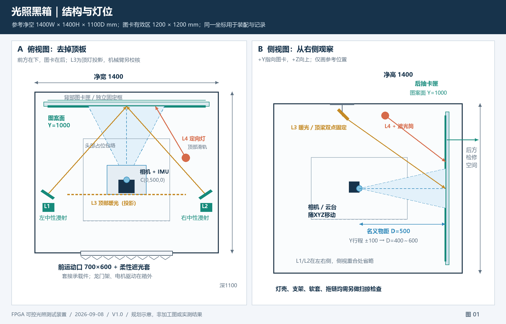

# 基于STM32F103RCT6的三轴龙门架、二维无刷云台与光照黑箱完整设计方案

版本：V1.0
日期：2026-09-09
状态：待实施设计；全部资源、速度、精度、照度与时间指标均为设计目标，不代表已完成F103实板验证。

## 1. 方案定位与功能范围

本文件是独立的F103RCT6实施方案，与[原F407方案](STM32F407ZGT6_三轴龙门架与二维无刷云台黑箱测试系统设计方案.md)并列保留。原F407文档、引脚规划及配置不因本文而被替换。本文选择F103RCT6作为新方案目标，不据此认定用户已有F103核心板的具体型号、晶振或接口引出。

本版采用**STM32F103RCT6＋三路STEP/DIR步进驱动＋一台可同时控制Roll/Pitch的独立无刷云台控制器＋四路DAC恒流光源＋低速GPIO扩展器**。目标保留原系统的运动、光照、环境测量、实体操作、上位机通信及同步功能，以重新分配引脚、压缩缓存和有界实时调度适应F103。

| 功能 | F103版实现 | 能力边界 |
| --- | --- | --- |
| XYZ平移 | 三轴步进轨迹和脉冲输出 | 三轴均可运动，速率上限须并发实测 |
| Roll/Pitch转动 | 独立云台控制器执行闭环，F103串口发目标/取反馈 | 不在F103上新增双路FOC；没有Yaw轴 |
| 光照 | 四通道外置DAC＋恒流驱动，按标定配方执行 | 场景名、DAC码不能替代lx |
| 按键、限位与保护 | 普通按键扩展，关键反馈直连，独立硬件保护 | 总线/软件故障不能取消急停和Z防坠 |
| 环境采样 | 光电单通道20kSa/s；温度、电压、照度低速采样 | 默认上传事件和统计，原始波形分段采集后导出 |
| FPGA同步 | 两路捕获＋一路计划事件，64位软件时间 | 对16位硬件计数器做扩展，丢同步明确失效 |
| PC控制 | USB-UART接PC后端，执行预装实验 | 轨迹在设备端执行，不由浏览器逐脉冲控制 |
| 视频与图像评估 | 沿用FPGA和host链路 | 视频不进入F103，PC不替代FPGA实时矫正 |

本文引用[光照黑箱详细设计](光照黑箱详细设计方案.md)中的机械和光学结构；该既有文档的F407控制描述仍归原方案，**F103版控制、电气和固件配置以本文为准**。视频接口继续服从[RAW8千兆网与HDMI双路回传方案](OV5640_RAW8千兆网与HDMI双路回传方案.md)，不改变网络报文、帧池或同源配对协议。

## 2. 整机结构与输入输出

~~~mermaid
flowchart TB
    PC["PC：Python后端 + Web界面"]
    MCU["STM32F103RCT6"]
    MOT["3路STEP/DIR驱动器"]
    XYZ["XYZ龙门架"]
    CTRL["独立Roll/Pitch云台控制器"]
    GIM["无刷云台 + 关节编码器"]
    DAC["DAC60504 + 4路恒流驱动"]
    LED["L1/L2中性漫射、L3暖光、L4定向光"]
    IO["TCA9535：普通按键与状态灯"]
    ENV["照度、光电、温度与电压"]
    SAFE["急停、限位、门、硬件许可、Z防坠"]
    CAM["单路OV5640 + 独立融合IMU"]
    FPGA["PG2L100H FPGA"]
    HDMI["唯一HDMI OUT：显示器 / 采集支路"]

    PC <-->|"USB-UART"| MCU
    MCU --> MOT --> XYZ
    MCU <-->|"独立UART"| CTRL
    CTRL <--> GIM
    XYZ -.-> CAM
    GIM -.-> CAM
    MCU -->|"SPI + LDAC + EN"| DAC --> LED
    MCU <-->|"I2C"| IO
    ENV --> MCU
    SAFE -->|"硬件禁止、制动、反馈"| MOT
    SAFE --> CTRL
    SAFE --> DAC
    SAFE --> MCU
    CAM -->|"DVP图像 / IMU独立UART"| FPGA
    FPGA -->|"S0 RAW8千兆网"| PC
    FPGA --> HDMI
    HDMI -->|"采集支路"| PC
    FPGA -->|"帧边沿"| MCU
    MCU -->|"计划事件"| FPGA
~~~

| 接口/数据 | 输入 | 输出及处理 |
| --- | --- | --- |
| PC–F103 | 参数、轨迹、灯光、回零、停止、查询 | ACK、实际执行阶段、测量值、事件和错误 |
| F103–步进驱动 | 限位、硬件许可实际反馈 | STEP、DIR、独立EN；驱动器承担相电流 |
| F103–云台控制器 | 实际反馈、故障、控制器身份 | Roll/Pitch目标、速度限制、停止和查询 |
| F103–DAC | 电源/故障检查、读回 | 四路电流设定值、LDAC、四路EN、总关断 |
| I²C环境/面板 | OPT3001新照度、按键状态 | 低速配置、状态灯；设备与总线故障可见 |
| 模拟输入 | 光电模拟量、两温度点、电源分压 | 光强统计/短波形、温度/电压与时间 |
| 同步 | FPGA帧边沿、光电比较器边沿 | 捕获时间、事件序号、同步质量标志 |
| PC图像 | S0、HDMI及板端严格快照 | host负责显示、归档和测评，F103只提供环境记录 |

FPGA帧/事件GPIO的可用引脚、Bank电压和连接器必须从实物板卡资料核对。本文给出MCU端候选，不编造FPGA管脚。IMU算法姿态独立送FPGA，不通过F103或云台控制器替代；云台控制用传感器与评估真值分别标注。

## 3. 芯片、最小系统与资源边界

目标STM32F103RCT6为LQFP64，72MHz Cortex-M3、256KiB Flash、48KiB SRAM，片内没有硬件浮点单元。该封装最多51个GPIO，通用TIM2～TIM5为16位。型号中的RC不能按RE的512KiB/64KiB配置链接。[ST F103RC数据手册：DS5792，器件表与计时器表](https://www.st.com/resource/en/datasheet/stm32f103rc.pdf)

### 3.1 最小系统要求

- 首选原理图可得、引脚充分引出的F103RCT6核心板；板载LED、USB、RTC、LCD等占用逐项登记，不能把裸芯片候选表直接当成开发板接线表。
- 3.3V数字与模拟供电按数据手册去耦；VDDA滤波，模拟分压/前端输出不超过输入允许范围。普通“5V容忍GPIO”说明不能用于ADC输入。
- HSE暂按8MHz晶振，PLL×9得到72MHz；晶振实物不同时重新推导时钟。SWDIO/SWCLK保留；关闭JTAG释放相应引脚。
- BOOT0、PB2/BOOT1有确定电平；PB2不分配业务。NRST保留复位与下载连接，不与大电流负载共线。
- PC14/PC15保留作LSE/扩展选择，首版不依赖RTC做微秒同步；PC13若被板载LED或RTC功能占用，必须先处理才能作限位输入。
- 外部下拉/上拉保证复位期间STEP低、运动许可不成立、LED总关断成立、Z保持/制动进入经验证状态。接口逻辑初设PERMIT_REQ高表示请求许可、BRAKE_REQ高表示请求释放，外部下拉保证复位无请求；LED_ALL_OFF高表示禁止，外部上拉保证复位关灯。实际驱动EN极性由接口级适配和配置记录，不直接套用上述请求极性。
- 使用官方STM32CubeF1的CMSIS/HAL/LL作为驱动来源，冻结版本/提交及许可证；时间敏感路径使用审查过的LL/寄存器实现。[ST官方STM32CubeF1](https://github.com/STMicroelectronics/STM32CubeF1)

### 3.2 与F407版相比的明确调整

| 项目 | 本F103版选择 |
| --- | --- |
| SRAM | 基础预算30KiB，受控扩展后≤36KiB，另留12KiB余量 |
| Flash | 程序目标≤200KiB；配置页和保留空间单列 |
| 运算 | 快路径整数/定点；复杂计划在低优先级或PC端预计算 |
| 时间轴 | TIM2 16位硬件＋软件高位，不保留F407的32位溢出周期 |
| GPIO | 44业务GPIO候选全部分配；普通面板采用TCA9535 |
| DMA | USART1、USART3、ADC1固定通道；SPI2、步进、捕获不用DMA |
| 采样 | ADC1仅一路光电20kSa/s；ADC2承担低速温度/电压 |
| PC链路 | 115200用于控制/统计/事后导出；连续原始波形属于另验能力 |
| RTOS | 首版裸机事件循环＋分级中断；不把RTOS作为功能前提 |
| Flash写入 | 仅在运动禁止、采样暂停的维护状态进行 |

## 4. 机械系统、黑箱与图卡

### 4.1 XYZ及Roll/Pitch

坐标为X向右、Y指向图卡、Z向上。相机零位x_C=+X、y_C=-Z、z_C=+Y。Roll绕光轴，Pitch为水平轴俯仰；实际嵌套顺序、转轴与光心偏置均保存到安装配置。

| 项目 | 参考目标 | 放行条件 |
| --- | --- | --- |
| XYZ有效行程 | 300 / 200 / 150mm | 与机构、线缆、遮光套和图卡视场共同检查 |
| X/Y速度 | 初调5mm/s，目标50mm/s | 步频、失步、抖动和停止距离实测 |
| Z速度 | 目标20mm/s | 独立防坠/制动先通过 |
| 加速度 | X/Y 200、Z 100mm/s² | 按负载、振动和最坏停距调整 |
| Roll | 参考−90°～+90° | 电缆/机械/视场分别验收，不默认无限旋转 |
| Pitch | 机械参考−30°～+30° | 大角度不自动属于全画幅测评域 |
| 云台角速度 | 10°/s起步，验证后30°/s | 实际角度反馈、曝光和同步质量可用 |
| 重复定位 | 平移≤0.1mm，转角≤0.2°目标 | 量具实测；不把微步/编码器分辨率当准确度 |
| 停稳判定 | 实际误差与角速度满足门限持续300ms起 | 无直线编码器时平移只能报告推算位置 |

使用预装导轨/丝杆滑台作为起点；参考1.8°两相步进、16微步、5mm导程。宽龙门优先机械同步或已解决扭斜的成品结构；若改为两侧独立电机，需增加第四步进通道，本引脚/调度预算不自动覆盖。

~~~text
每毫米脉冲 = (360 / 1.8) × 16 / 5 = 640 pulse/mm
50mm/s → 32,000 pulse/s；20mm/s → 12,800 pulse/s
1微步的指令位移 = 1/640mm ≈ 1.56μm，不是定位精度

50mm/s、200mm/s²：
理想制动时间 = v/a = 250ms
理想制动距离 = v²/(2a) = 6.25mm
~~~

机构负载包括嵌套滑台、云台、相机、可能随动的FPGA接口板及全部线缆。电机按目标转速下转矩、加速惯量、摩擦与线缆力选型，不能按保持转矩直接判断。Z采用配平＋失电抱闸＋机械挡块；断电制动距离需实测。

### 4.2 黑箱、灯位和图卡固定

参考光学腔净空1400W×1400H×1100D mm，图案面Y=1000，有效区1200×1200，名义光心C=(0,500,0)。相机D=400～600mm、X±150、Z±75。尺寸需依据真实镜头、焦点和机构重新冻结。

| 光源 | 出口中心(X,Y,Z)，mm | 安装形式 |
| --- | --- | --- |
| L1 | (-600,400,0) | 左侧中性白竖向漫射灯，参考900×90出口 |
| L2 | (+600,400,0) | 右侧同型号，镜像安装 |
| L3 | (0,400,+600) | 顶部暖白横向漫射灯，双点支撑 |
| L4 | (+450,650,+600) | 顶部可调定向灯，双角度锁紧与遮光筒 |

箱体消光，灯具热路向箱外；扩散片与LED间初设50mm、可调30～80mm。侧灯前后/角度可调，九点均匀性不达标时改距离、端部配光或有效ROI，不单纯提高电流。图卡采用独立刚性卡匣：三A点定平面、两B点下托承重、一C点侧向定位，后侧压扣压向非成像定位肩面。后门净通行≥1300×1300mm、后方留≥800mm检修及承托空间。

灯具及图卡安装详见[灯具剖面图](figures/lightbox/02_light_mount.svg)、[图卡固定图](figures/lightbox/03_chart_mount.svg)和[黑箱机械详设](光照黑箱详细设计方案.md)。复用这些结构图不表示继续采用F407接线。

在假设60°水平视场、16:9针孔且转轴交于光心时，满XYZ＋Roll±90°、Pitch=0的最大X/Z绝对包络约547.5/472.5mm；Pitch±5°约549.6/552.6mm。若同时Pitch±30°，约646.7/1279.5mm，超过图卡。正式以真实K/D边界射线、光心偏置和声明ROI验算，初装优先开放小角域。

换卡进入CARD_CHANGE，先停稳并确认Z保持、关闭强光、暂停正式采样；换后登记chart_id、尺寸、平面偏置和方向，再复核焦点/ROI。换卡不自动机械回零，不自动重置IMU参考。

## 5. 驱动器、云台和电源

### 5.1 三路步进

候选DM542E与已匹配的两相步进电机，24V支路供电。F103的3.3V GPIO通过满足电流和时序的缓冲/隔离级驱动光耦输入，按实际版本设置5V/24V逻辑档。参考官方手册要求PUL脉宽至少2.5μs、DIR提前至少5μs；本版初设脉冲高低各至少约10μs、DIR建立20μs，仍以实物版本核验。[Leadshine DM542E用户手册](https://www.leadshine.com/upfiles/downloads/d5375bf4c28b5c75b2d150c9762781c9_1651052967281.pdf)

六路正/负限位分别接常闭可诊断输入与按方向阻断的硬件逻辑。正限位阻断继续正行、负限位阻断继续负行，受控回退保留专门流程。限位首次可信触发即抑制撞向该方向，不等长时间软件消抖。回零按实际几何选择安全轴序，不统一假定“Z先向下”。

### 5.2 一台双轴云台控制器

候选BaseCam SimpleBGC32 Extended，启用Roll/Pitch，匹配两只云台无刷电机及受支持的关节编码器。选择独立12V支路，按电机和控制器实际允许值限流；其官方1.5A持续电流是多电机合计，不能作为每轴连续1.5A预算。[BaseCam Extended](https://www.basecamelectronics.com/simplebgc32ext/)

F103通过**一个USART3接口**同时控制两轴，目标更新初设50Hz，反馈50Hz起步，实际报文长度和固件支持决定最终频率。目标角、关节实测角、控制器融合姿态各用独立字段，记录角度单位、零位和参考系。[BaseCam Serial API](https://www.basecamelectronics.com/serialapi/)

采购前确认：目标位置/速度控制、实际反馈来源、超时停止、故障查询、编码器许可和固件版本。闭环用于执行目标轨迹；关闭会抵消试验动作的不受控自动跟随/回中，不能关闭电机自身位置闭环。

若两台独立驱动各占一个UART，则本方案还需要总线网关或重新分配接口；不能在现有引脚表上直接并接两个TX。平衡重心、转轴刚度和线缆阻力先于软件调参。角度精度最终由独立量具/图卡参考验证。

### 5.3 电源与布线

~~~text
24V装置电源
 ├─ 运动支路保护/硬件许可 → 三路步进驱动
 ├─ 制动与防坠支路 → Z失电抱闸
 ├─ 各路保护 → 四路LED恒流驱动
 ├─ 24V→12V → 云台控制器
 └─ 24V→5V→3.3V → F103、接口、传感器、GPIO扩展器

FPGA、相机、采集卡和显示器按其原有合规供电独立连接。
~~~

初步预算：步进120W、灯光80W、云台20W、控制与风扇10W，共230W；加30%约299W，可用24V/15A级电源作为选型起点。这里是分配预算，启动、热降额、回馈与实测电流决定最终电源。

电机功率、LED开关节点、DVP/IMU线和模拟采样线分区，金属框架按电气方案接保护地。裸TTL/I²C不沿长拖链布线；按距离选择电平匹配、差分或隔离。DVP先验证短线及运动误码，必要时板卡靠近相机并重新计载荷，不能直接加长普通排线。

## 6. F103RCT6候选引脚与连接表

下表为**LQFP64芯片物理脚号**，不是开发板排针号。依据DS5792引脚定义与RM0008复用设计；须用实板原理图和CubeMX冲突检查冻结。所有关键输入在接口板处理后进入3.3V逻辑域。

### 6.1 运动、通信、灯光与采样

| 信号 | MCU引脚 | 物理脚号 | 模式与连接 |
| --- | --- | --- | --- |
| STEP_X / Y / Z | PC4 / PC5 / PC6 | 24 / 25 / 37 | 同GPIOC端口，BSRR原子更新，经许可门/缓冲 |
| DIR_X / Y / Z | PC7 / PC8 / PC9 | 38 / 39 / 40 | GPIO输出，经电平接口 |
| EN_X / Y / Z | PC10 / PC11 / PC12 | 51 / 52 / 53 | 独立使能，复位禁能 |
| PC TX / RX | PA9 / PA10 | 42 / 43 | USART1，接USB-UART |
| 云台 TX / RX | PB10 / PB11 | 29 / 30 | USART3默认映射，接唯一双轴控制器 |
| 环境 SCL / SDA | PB6 / PB7 | 58 / 59 | I²C1默认映射，3.3V上拉 |
| DAC CS / SCK | PB12 / PB13 | 33 / 34 | CS普通GPIO，SPI2时钟 |
| DAC SDO / SDI | PB14 / PB15 | 35 / 36 | MCU MISO / MOSI，保留读回 |
| L1 / L2 EN或测试PWM | PA6 / PA7 | 22 / 23 | TIM3_CH1 / CH2，默认映射 |
| L3 / L4 EN或测试PWM | PB0 / PB1 | 26 / 27 | TIM3_CH3 / CH4，默认映射 |
| DAC_LDAC | PA5 | 21 | 四路影子值准备后统一更新 |
| LED_ALL_OFF | PA8 | 41 | 外部总关断逻辑；不是DAC60504不存在的CLR脚 |
| FRAME_CAPTURE | PA0 | 14 | TIM2_CH1，来自经电平匹配的FPGA帧信号 |
| PHOTO_CAPTURE | PA1 | 15 | TIM2_CH2，光电比较器 |
| EXP_EVENT_OUT | PA2 | 16 | TIM2_CH3计划比较事件，输出电平适配FPGA |
| 光电模拟量 | PC0 | 8 | ADC1_IN10，独立20kSa/s |
| 温度1 / 温度2 / 电源分压 | PC1 / PC2 / PC3 | 9 / 10 / 11 | ADC2_IN11 / IN12 / IN13，低速 |

### 6.2 保护反馈、许可与保留脚

| 信号 | MCU引脚 | 物理脚号 | 要求 |
| --- | --- | --- | --- |
| X负 / X正限位 | PB3 / PB4 | 55 / 56 | EXTI3 / EXTI4，关闭JTAG后使用 |
| Y负 / Y正限位 | PB5 / PB8 | 57 / 61 | EXTI5 / EXTI8 |
| Z负 / Z正限位 | PB9 / PC13 | 62 / 2 | EXTI9 / EXTI13；PC13解除板载占用，仅输入 |
| 急停反馈 | PA11 | 44 | EXTI11，独立硬件急停仍直接控制许可 |
| 门回路反馈 | PA12 | 45 | EXTI12，前/后门常闭链；需要区分门时另加非关键诊断 |
| 实际许可反馈 | PD2 | 54 | EXTI2，与许可请求分开 |
| BRAKE_REQ | PA3 | 17 | 经驱动/联锁请求释放或保持制动 |
| PERMIT_REQ | PA4 | 20 | MCU请求，不是最终硬件许可 |
| HEALTH_HEARTBEAT | PA15 | 50 | 供外部健康监测，关闭JTAG后使用 |
| SWDIO / SWCLK | PA13 / PA14 | 46 / 49 | 始终保留调试 |
| HSE输入 / 输出 | PD0 / PD1 | 5 / 6 | 8MHz晶振候选 |
| PB2 / BOOT1 | PB2 | 28 | 固定启动配置，不接业务负载 |
| LSE预留 | PC14 / PC15 | 3 / 4 | 首版不使用，保留 |
| BOOT0 / NRST | 专用脚 | 60 / 7 | 启动和复位，不并到业务GPIO |
| VBAT | 专用脚 | 1 | 依据是否有备份电源正确连接 |
| VDDA / VSSA | 专用脚 | 13 / 12 | 模拟供电与地；此封装不另造独立VREF脚 |
| VDD | 专用脚 | 19 / 32 / 48 / 64 | 全部连接并就近去耦 |
| VSS | 专用脚 | 18 / 31 / 47 / 63 | 全部接地 |

在保留HSE、SWD、PB2和PC14/15后，本表**恰占44个业务GPIO**，不再假定有大量备用脚。实际核心板占用无法解除时，必须重新分配或调整接口板，不将硬限位转移到慢总线解决。

复用限制同时冻结：不启用PA11/PA12上的USB或默认CAN；不启用会占PC6～PC9的TIM3重映射；关闭PA4/PA5上的片内DAC；PB3不再作SWO输出。SPI2读回使用DAC的SDO功能，不能误切成ALARM后仍当数据读取。

EXTI5～9共享中断入口、EXTI10～15共享入口；线号互异不等于每个信号有独立向量。中断按挂起位处理全部来源，只做锁存/请求停止，重工作留给状态机。硬件许可门不依赖EXTI中断是否及时响应。

### 6.3 普通面板GPIO扩展

采用TCA9535，3.3V供电，地址脚A2/A1/A0接低时7位地址0x20；OPT3001地址脚接地时0x44。只挂普通按键与状态灯，首版每10ms轮询，INT不占MCU引脚。TCA9535没有内部输入上拉，按键需外部确定电平；输出上电前先写安全值，再设方向。[TI TCA9535数据手册](https://www.ti.com/lit/ds/symlink/tca9535.pdf)

| 扩展口 | 用途 |
| --- | --- |
| P00～P04 | 正常、夜间、强光、侧光/场景、普通受控停止键 |
| P05～P07 | 回零、确认/恢复、备用输入 |
| P10～P15 | 运行、正常光、低照、强光、故障等指示灯，经限流/驱动 |
| P16～P17 | 备用低速口 |

普通STOP键与实体急停分开标识；总线故障时普通按钮可能不可用，但急停、门、限位及Z防坠仍保持硬件作用。实体切灯会生成事件，自动测试中人工介入按配置中断当前工况，PC不得用旧界面值立即覆盖。

## 7. 时钟、定时器、DMA与中断

### 7.1 时钟及定时器分配

SYSCLK/HCLK=72MHz，PCLK1=36MHz，PCLK2=72MHz；APB1分频为2时该总线上的定时器内核为72MHz。ADC时钟初设PCLK2/6=12MHz。具体分频必须从实际时钟树计算。[ST RM0008参考手册](https://www.st.com/resource/en/reference_manual/rm0008-stm32f101xx-stm32f102xx-stm32f103xx-advanced-arm-based-32-bit-mcus-stmicroelectronics.pdf)

| 资源 | 职责 | 初始配置/约束 |
| --- | --- | --- |
| TIM1 | 三轴STEP统一100kHz节拍 | PSC=0，ARR=719；仅更新中断，不占PWM脚 |
| TIM2 | 两路捕获＋计划事件＋时间扩展 | PSC=71，ARR=65535，1μs计数 |
| TIM3 | 四路灯EN/PWM | 20kHz测试PWM可用PSC=0、ARR=3599；正式模拟模式EN保持稳定 |
| TIM4_CC4 | ADC1内部20kHz触发 | 计数1MHz，ARR=49，CCR4=25起；配置规则触发源 |
| TIM6 | 1kHz有界运动/制动服务 | PSC=71，ARR=999；无通道引脚 |
| SysTick | 非关键系统节拍或诊断 | 不作为帧/光电精确时间来源 |
| TIM5 / TIM7 / TIM8 | 预留 | 不把未使用硬件当作已实现功能 |

TIM4的CC4事件在芯片内部触发ADC，**PB9保持GPIO限位，不复用为TIM4_CH4引脚**。必须正确配置比较事件、ADC EXTSEL与触发使能，并用实际样本计数验证；仅设置ARR不能证明ADC已按20kSa/s触发。若改TIM3_TRGO，会与灯PWM共享计时基准，不允许未经整表核对替换。

### 7.2 DMA固定映射

| 工作 | DMA资源 | 同时运行要求 |
| --- | --- | --- |
| ADC1光电 | DMA1 Channel1 | 16位循环4KiB缓冲 |
| USART3 TX / RX | DMA1 Channel2 / Channel3 | 云台独立缓冲 |
| USART1 TX / RX | DMA1 Channel4 / Channel5 | PC独立缓冲 |
| SPI2 DAC | 不使用DMA | 与USART1的Channel4/5冲突，采用有界低频事务 |
| I²C1 | 不使用DMA | 超时状态机/短事务，不阻塞实时中断 |
| TIM1/TIM2 | 不使用DMA | STEP、捕获、时间扩展使用对应中断 |
| DMA1 Channel6/7、DMA2 | 预留 | 后续功能必须重新做映射和仲裁检查 |

特别禁止同时启用与已分配通道冲突的TIM1_UP、TIM2_CH1、TIM2_UP、SPI2_RX/TX等DMA请求。GPIO复用、DMA请求、定时器触发是三张不同的资源表，不能只检查其中一张。

建议抢占顺序：TIM1 STEP最高，TIM2捕获/溢出其次，TIM6运动/制动服务再次，保护反馈软件处理与一般DMA/通信在其后。实体保护独立于该优先级；长临界区、HAL超时等待或打印不得阻断前三类服务。

## 8. 步进实时算法与停止策略

### 8.1 100kHz输出层

每10μs进入TIM1，两个相位构成20μs步进决策周期：一相位允许产生STEP上升沿，另一相位统一拉低。三轴分别运行整数DDA，相位累加溢出产生脉冲；频率目标上限50k pulse/s，首版正式目标32k pulse/s/轴。

三轴STEP使用GPIOC一次BSRR置位/复位，控制掩码只包含PC4～PC6，不覆盖DIR/EN。剩余步数精确计数，停止时STEP明确为低；DIR只在该轴停止、STEP低并满足建立时间后改变。定点频率量化、负向位置、整数溢出和最后一步另行验证。

该算法仍有20μs决策网格：32k pulse/s平均周期31.25μs，通过20/40μs间隔组合实现。需要将这项计划量化与软件执行抖动分开报告；如果它引起振动或运动误差，修改输出算法并重新验收，不能仅报告“中断准时”而忽略量化。

### 8.2 CPU预算

~~~text
72MHz / 100kHz = 每次TIM1节拍720个CPU周期
假设ISR耗时400周期 → CPU占用约55.6%
本版目标：最坏TIM1 ISR≤220周期，约3.06μs/30.6%
~~~

220周期是包含入口、退出、三轴处理和最坏分支的开发目标，不是测得结果。输出ISR内禁止浮点、除法、动态内存、日志、串口解析和I²C访问。主循环任务分片，有界地提供新参数。

| 路径 | 初始预算目标 | 如何验证 |
| --- | --- | --- |
| TIM1 | 最坏≤220周期，无漏节拍 | DWT周期计数＋外部逻辑测量，含嵌套/总线负载 |
| TIM2 | 捕获服务通常<100μs | 同时帧/光电/回绕压力；时间有效性独立判断 |
| TIM6 | 每1ms有界执行，CPU预算≤5% | 独立停止尾仍满足期限 |
| 主机/云台/ADC/灯控/主循环 | 总忙时目标≤70% | 含全部中断占用，记录峰值与队列高水位 |
| STEP额外时序误差 | 相对计划网格目标≤1μs | 在驱动器输入端测，不只测CPU引脚 |

未满足预算时，优先精简快路径、缩小低优先级日志和接口工作；必要时换为经过DMA冲突复核的硬件输出方案。不得为了“通过”而将50mm/s目标静默降成5mm/s；降额必须写入GET_CAPS和报告。

### 8.3 轨迹、队列和本地减速

轨迹输入为绝对目标块，包含XYZ、速度/加速度、Roll/Pitch目标、段ID与时间/条件。首版梯形加减速与三轴直线插补；S曲线在该基线通过后扩展。几何碰撞边界在预装和执行时均限制，不能只对终点做检查。

6KiB轨迹预算建议拆成4KiB高层块和2KiB就绪微段/影子状态。示例高层块128字节、32个；微段64字节、最多32个，对应约32ms的1ms微段。具体结构经过编译sizeof核对，不能把整个6KiB宣称为长期逐毫秒轨迹存储。

**32ms微段队列不能代替250ms制动尾。** 独立TIM6服务保留当前速度、预计算的定点减速度、各轴剩余距离与停止状态；低水位或PC失联时触发可脱离通信/主循环继续执行的有界减速。微段不足前预留反应时间，本地能生成整个停止过程；实际停止空间还要包括响应、误差与机械余量。

TIM6把三轴速率、方向请求和步数写入影子小块，TIM1仅在指定20μs相位切换整组指针/版本，避免半组新参数被抢占使用。高层插补/64位单位换算不放在每10μs快路径；停止积分应预计算每毫秒增量，避免慢运算卡住服务。

若连本地停止服务都超期、微段真实欠载或输出序列完整性丢失，进入FAULT并执行已验证的硬件禁止/防坠策略，位置可信度失效。不能继续保持最后速度，也不能把异常断STEP声明为正常受控停止。

## 9. 48KiB内存与Flash规划

### 9.1 SRAM预算

| 用途 | 预算KiB | 说明 |
| --- | --- | --- |
| PC串口RX/TX | 4 | 各2KiB，有界队列与协议背压 |
| 云台RX/TX | 2 | 各1KiB，按实际报文和频率验收 |
| 高层轨迹、就绪微段 | 6 | 长计划用紧凑块，本地减速状态另计 |
| ADC光电环形缓冲 | 4 | 2048个uint16样本 |
| 事件环 | 4 | 例64条×64字节；归档依赖及时导出 |
| 协议解析、设备状态、规划工作区 | 4 | 包含停止状态，禁止无界临时副本 |
| MSP栈 | 4 | 裸机主循环和嵌套中断共享，实测高水位 |
| 其他库/全局数据 | 2 | 链接后核算，不能藏在未列项 |
| 基础合计 | **30** | 设计预算 |
| 受控扩展 | 6 | 新功能先评审再占用 |
| 剩余保留 | **12** | 总计48，不预先宣称全部可用于新功能 |

UART DMA环、解析器帧和发送包避免多重拷贝；队列满时拒绝新任务并返回BUSY/NO_SPACE。RX环被覆盖要记录OVERFLOW，丢弃到可靠帧边界重新同步，不将损坏数据当命令。正式运行不使用无界malloc，不用浮点printf和庞大格式化日志消耗Flash/栈。

64条事件在每秒60帧锚点加其他事件时仅约1s级容量。正常及时发送和确认，拥塞时先限制非关键遥测；关键事件丢失记录序号缺口并使严格同步样本失效，不仅增加一个计数后继续宣称完整记录。

### 9.2 Flash与配置持久化

Flash总256KiB。程序含库目标≤200KiB；配置采用尾部两页、每页2KiB的A/B记录，按高密度器件页组织核对。可以在0x0803F000和0x0803F800放两页配置，其余保留空间由链接脚本明确禁止程序侵入配置页。首版通过SWD或芯片支持的下载方式维护，不默认预留双镜像OTA。

配置含magic、格式版本、长度、单调版本、校验和提交标记。先写备用页并校验，最后提交；断电保留上一份有效配置。保存实物引脚/极性、每毫米脉冲、限位与停止参数、灯光配方和设备ID，不在高频事件中反复写Flash。

F103运行时Flash擦写会影响取指/中断响应，因此仅在运动禁止、采样暂停、灯光进入维护状态后写配置；该段时间同步标记无效。禁止在RUNNING/SETTLING执行参数持久化、下载或断点停核。恢复后建立新同步epoch，必要时重新回零。

## 10. 四路光照与环境测量

### 10.1 光源、电流控制与稳定判据

| 通道 | 光学配置 | 电气预算 |
| --- | --- | --- |
| L1/L2 | 同批中性白，左右漫射 | 各20W上限起点 |
| L3 | 约3000K暖白漫射 | 20W上限起点 |
| L4 | 定向白光、遮光筒/光阑 | 20W上限起点 |

采用DAC60504四路12位输出，先设置并回读四路DACx-SYNC-EN=1，再由SPI2非DMA写缓冲，PA5 LDAC统一更新。同步位默认0时每次CS上升即可更新对应通道，不能据此实现四路同步阶跃。数据寄存器读回的是缓冲值，执行确认还需LDAC事件及光电/照度证据；VIO=3.3V，VDD/参考/增益依所选调光量程配置。初始0～2.5V可作为接口设计起点，3.3V供电下不能假定能输出完整5V。复位期间外部LED_ALL_OFF生效，DAC零码/量程/读回正确后再开放各路使能。[TI DAC60504](https://www.ti.com/lit/ds/symlink/dac60504.pdf)

候选LM3409恒流方案须使用完整模块或完成外部MOSFET、电感、采样电阻与散热设计；24V母线下LED串压留调节余量。正式静态光照采用模拟电流设定，纹波及低档断续行为仍需验证；PWM只用于已说明的频闪工况或使能，不以极小占空比冒充稳定低照。[TI LM3409](https://www.ti.com/lit/ds/symlink/lm3409.pdf)

初始场景：NORMAL中心500～1000lx，NIGHT中心5～20lx，BRIGHT中心3000～10000lx为能力探索目标，SIDE不均匀、WARM暖光、SPOT局部强光、STEP阶跃。按实测冻结范围；四路80W不能保证1.44m²卡面全域10000lx。低照可用低电流档/有编号ND片，重新校准。

图卡九点X/Z各{-540,0,+540}，测头平行图卡、法向-Y。均匀模式目标Emin/Emax≥0.8；关灯漏光≤0.5lx且≤最低正式照度10%。固定探头只跟踪该点，不代表L4亮斑或全幅照度。主光与顶暖光位置不同，不能将WARM称为只改变光谱的单变量实验。

稳态反馈用OPT3001的100ms新转换模式起步，控制1～5Hz；800ms模式应相应降低更新率。采用查表前馈＋有界PI修正、限幅和抗积分饱和；至少10次独立新读数在设定值±5%内作为采样门槛，热稳定另外检查。[TI OPT3001](https://www.ti.com/lit/ds/symlink/opt3001.pdf)

### 10.2 ADC分工

- ADC1与ADC2选择独立模式，不启用双ADC合并数据路径。
- ADC1：PC0一条光电通道，定时器触发20kSa/s；CONT=0、SCAN=0、序列长度1，DMA1 Channel1循环。
- ADC2：PC1/PC2温度和PC3电压低速转换，10～100Hz范围按传感器热响应选择，无DMA。
- ADC时钟12MHz，采样周期按前端阻抗选择。例如55.5采样周期加转换时间仅用于预算，最终验证建立时间、带宽及噪声；不把ADC标称最大转换率当采样系统有效带宽。
- 光电模拟前端包含跨阻放大、量程/限幅与适当滤波；比较器输出独立送PA1，带迟滞。探头未经光谱标定只输出相对光强，不能直接当照度计。
- 20kSa/s可记录有限带宽阶跃包络；20kHz PWM细节使用更高带宽仪器，不以同频采样结果判断“无频闪”。

### 10.3 波形模式与串口带宽

~~~text
一路原始波形：20,000 sample/s × 2 byte = 40,000 byte/s
115200 8N1：理论11,520 byte/s，未扣协议
4KiB环：2048样本，可容纳102.4ms
~~~

默认模式持续采样、输出均值/最值/波动统计和实际边沿，不承诺持续上传全部原始样本。

短波形模式先ARM并累积预触发，初设事件前25ms＋后25ms，各约500样本。TIM2捕获真实比较器事件；TIM6在后触发窗口满足后只停后续采样触发、置FREEZE_PENDING，不在中断中阻塞等待。低优先级冻结服务确认在途转换与DMA写入结束后，读取最终样本计数/写指针，形成不可改的波形描述符。

4KiB环相对约1000样本窗口留有余量；服务延迟必须小于剩余覆盖时间。采样索引、DMA回绕、事件时刻和停止延迟以实测建立关系，不能按中断到达时刻猜样本。采样间隔为50μs；相位已知且选择最近采样点时，仅采样量化项不超过±25μs；若只知道所在区间，则区间宽50μs。比较器、ADC孔径和跨计时基准误差另外计入，报告不能把TIM2的1μs分辨率当成ADC同步准确度。

冻结后暂停该原始波形流，通过分块READ_WAVE导出，PC确认并释放后再ARM；不可把事后导出标为无间断实时波形。若导出/冻结期间仍需要连续统计，作为额外缓冲能力重新预算，首版不默认具备。

可选连续原始上传通过921600等更高波特率单独协商与实测；921600 8N1理论92160byte/s不等于可用净带宽。必须计入帧封装、ACK、统计、USB-UART和主机接收能力，持续流在GET_CAPS中单独声明，不能默认为115200基线的一部分。

## 11. 16位计时器的同步与计划事件

### 11.1 时间有效域

TIM2@1MHz每65.536ms回绕。软件扩展输出64位μs时间，绑定boot_id和sync_epoch；不能照搬F407约71.6分钟一次的32位回绕处理。1μs分辨率不等于1μs绝对准确度，晶振误差、接口延迟、滤波和捕获抖动均需测量。

唯一TIM2服务负责更新软件高位；运行期间禁止改PSC/ARR、发UG重置计数或让调试停核后继续使用旧时间轴。必须保证溢出服务不漏跨两个回绕，捕获读出延迟严格小于半回绕32.768ms，目标通常<100μs。长临界区/调度异常超过允许域即标TIMESTAMP_INVALID，不猜补高位。

### 11.2 回绕和捕获处理原则

1. 软件高位、UIF和CNT在短串行化段一致读取；先读状态、CNT，再读状态，若期间新发生回绕，重读CNT。
2. 软件高位尚未计入的一个UIF仅补一次。高位更新与UIF清除由唯一所有者处理，其他上下文不能同时递增。
3. 先读待处理CCRx，再取得可靠当前now；利用低16位模差回溯捕获时间：
~~~text
age = uint16(now_low16 - CCRx)
capture_time = now64 - age
~~~
4. 该回溯仅在当前时刻可靠、捕获延迟满足上述界限且没有overcapture时有效，不能用于任意历史值。
5. 读取前后检查CCxOF；发生覆盖、事件速率超限、帧锚点缺失时，相应事件/样本失效并重新锚定。
6. SR状态位按RM0008规定的清除语义定点处理，避免读改写整个SR误清后来到达的新标志。读取CCR后产生的新CC标志继续处理。

需验证回绕前、回绕后、回绕与双路捕获同时发生、重复边沿、断线/抖动和长中断屏蔽；不能仅用每秒打印一次时间戳证明正确。

光电阶跃测量按预期触发窗口武装，首版捕获目标边沿后关闭该通道并等待下一次ARM，避免20kHz PWM每周期都产生捕获中断。背景波动由ADC统计观察；若需连续光电边沿记录，必须另设最大事件率、过滤和CPU/日志预算，过载时明确失效。

### 11.3 计划GPIO和灯光动作

PC提前预装绝对目标时刻与event_id；目标属于设备boot_id＋sync_epoch时间域，不能直接填入PC系统时钟。设备事件队列保存64位目标，只在目标进入未来半回绕窗口且仍有装载余量时装载TIM2_CH3。初设最小装载提前量200μs，实际应大于最坏服务延迟加余量。

到点由比较硬件产生上升沿。首版脉宽1ms，上升沿的TIM2 ISR直接装载T+1000μs的下降比较，不经TIM6或主循环；若剩余装载时间不足200μs，脉冲判无效并进入定义的安全低电平。下降完成后关闭该次比较，防止下次回绕再次触发。迟到返回MISSED_DEADLINE，**不立即补发GPIO冒充准时执行**。

从武装上升沿到下降完成，CH3由该event_id独占，后续事件不得覆盖CCR。初设相邻上升沿至少间隔2ms，预装时拒绝重叠或间隔不足；若需要重排，必须由调用方确认新的目标时刻，不能静默改时刻。取消、同步失效、复位或进入维护时，同时撤销软件队列和已装载的CH3硬件输出并恢复安全电平。

普通手动SET_LIGHT可以报告SPI/LDAC提交时间；计划灯光阶跃先写完四路DAC影子值，按允许误差执行LDAC。若要求LDAC与事件边沿具有更小的硬件级偏差，应另用门控/连线方案并验收；当前PA2比较输出和PA5软件LDAC不能宣称严格同时。真正光变起点始终由光电捕获决定。

### 11.4 FPGA源帧关联

同步分级：无帧线时只记录工况区间；有已验证帧边沿后，把捕获序号与FPGA的stream_epoch/source_frame_id锚定；再将真实角反馈和光变事件映射到帧时间。缺边沿、复位、来源变化时清除有效锚点并重建。

相机滚动快门不是全帧同时曝光，按帧边沿或曝光中心近似时需声明误差。云台控制器若没有采样时戳，只能记录UART接收时刻及反馈年龄，不当作精确测量时刻。

此MCU同步能力不自动验证HDMI帧身份。HDMI源身份未知仍填null/unverified，不按S0/HDMI到达顺序配对。正式几何精度使用板端S1与同帧S2/S3快照；S0的PC基础预览不能冒充S1。

## 12. 固件模块、状态机和故障处理

### 12.1 软件模块

| 模块 | 职责 | 执行环境 |
| --- | --- | --- |
| board_f103 / clock / pinmap | 最小系统、时钟、AFIO、默认电平 | 启动及受控配置 |
| safety / watchdog | 实际许可、保护、健康与故障锁存 | 硬件＋有界中断/状态机 |
| step_engine | 三轴相位、STEP掩码、精确步数 | TIM1快路径 |
| motion_service | 微段切换、影子更新、本地减速 | TIM6 1kHz |
| motion_planner | 高层块校验、插补准备、停止空间检查 | 可抢占主循环分片 |
| gimbal_adapter | 厂商编解码、两轴状态、反馈过期 | DMA回调＋低优先级解析 |
| lighting / io_panel | DAC、照度闭环、面板、配方 | 有超时的低速事务 |
| sensing / waveform | ADC、统计、触发与冻结描述符 | DMA/时间服务＋主循环 |
| timebase / event_scheduler | 时间扩展、帧锚点、计划事件 | TIM2＋有界准备 |
| protocol / experiment | PC协议、幂等、任务/工况状态 | 分片主循环 |
| storage | 配置A/B页、CRC、维护模式 | 运动和采样暂停时 |

~~~mermaid
stateDiagram-v2
    [*] --> BOOT
    BOOT --> SELF_TEST
    SELF_TEST --> UNHOMED
    UNHOMED --> HOMING
    HOMING --> READY
    READY --> ARMED
    ARMED --> RUNNING
    RUNNING --> SETTLING
    SETTLING --> READY
    READY --> CARD_CHANGE
    CARD_CHANGE --> UNHOMED: 位置失效
    CARD_CHANGE --> READY: 检查通过
    RUNNING --> STOPPING
    STOPPING --> READY: 受控停止且位置有效
    STOPPING --> FAULT: 服务或位置失效
    READY --> FAULT
    RUNNING --> FAULT
    RUNNING --> ESTOP
    ESTOP --> UNHOMED: 人工解除并检查
    FAULT --> UNHOMED: 人工恢复
~~~

该图只展示主路径；任一状态可因保护条件转FAULT/ESTOP。READY必须包括实际许可、门状态、可用配置和健康通信条件；ACK不等于就绪。

### 12.2 故障与恢复

| 条件 | 响应 | 恢复 |
| --- | --- | --- |
| PC心跳超过500ms初值 | TIM6本地受控停止，不继续旧速度命令 | 重握手、位置检查，人工重新启动 |
| 云台反馈过期/控制器故障 | 停复合轨迹并执行云台已验证停止方式 | 重新确认模式、姿态与反馈来源 |
| 限位/门/急停 | 硬件许可回路执行方向禁止或整机停止/制动/关强光 | 人工解除；位置不可信时回零 |
| 总线卡死、照度过期 | I²C任务超时；灯光工况无效，按策略关闭/限流 | 总线恢复后重新稳定，不用旧照度 |
| 队列/事件/DMA溢出 | 计数、缺口、样本失效；运动数据欠载进入停止/故障 | 清旧会话并重新预装 |
| 温升/欠压 | 降流或关断，当前测评中断 | 供电温度稳定后重新建立工况 |
| MCU复位/看门狗 | 默认禁能、灯关闭、Z保持/抱闸，旧任务作废 | 新boot_id，自检和回零 |
| 时间失效/调试停核 | 停严格同步采样，计划事件作废 | 新sync_epoch与帧锚点 |

F103 I²C存在需要按硅修订处理的BUSY/时序勘误；记录DBGMCU修订信息，采用官方恢复流程、有界事务和新数据超时检测，不能无限等BUSY清除。[ST ES0340勘误](https://www.st.com/resource/en/errata_sheet/es0340-stm32f101xcde-stm32f103xcde-device-errata-stmicroelectronics.pdf)

外部健康心跳由主循环完成关键任务健康检查后更新，不能在一个永远运行的STEP中断中持续翻转。IWDG配合外部许可监测；制动释放必须同时有正常供电、实际驱动保持能力及硬件许可，PA3只是请求。故障动作不宣称达到某个功能安全认证等级。

## 13. PC–F103通信和实验协议

### 13.1 外层与能力协商

延续项目已有外层语义，不另改FPGA客户端协议。PC–MCU独立握手，使用device_type与profile_id区分F103/F407；本版建议profile_id为F103_RC_V1，数字命令号在实现前统一登记。

~~~text
55 AA | version:u8 | cmd:u8 | seq:u16 | length:u16 | payload | CRC16:u16
~~~

多字节小端，payload≤1024字节，总长10+payload。CRC-16/CCITT-FALSE：poly0x1021、init0xFFFF、不反射、xorout0，覆盖version至payload，CRC小端发送；ASCII“123456789”应为0x29B1。CRC16按该定义实现，不能将片内固定CRC32的默认结果当作CCITT校验。串口解析处理半包、粘包、垃圾、超长、CRC错和接收超时，校验通过前不执行动作。

GET_CAPS至少返回：device_id/boot_id、profile、固件/配置版本、XYZ/旋转轴、实际速率和量程、反馈类型、时间有效性、载荷上限、队列空位、raw_wave_mode、是否支持连续波形、可用波特率。PC按能力启用按钮，不将F407配置盲写到F103。

### 13.2 命令与执行阶段

| 语义 | 输入 | 输出 |
| --- | --- | --- |
| HELLO / GET_CAPS | 会话、版本 | 身份、能力、boot_id与配置 |
| LOAD_TRAJECTORY / ARM | ID、绝对目标块、约束、校验 | 接收块号、容量、校验/可执行状态 |
| HOME / MOVE / START | 轴、目标、速度、开始条件 | accepted / applied / completed / settled或故障 |
| SET_LIGHT | 场景/四路设定、附件/配方版本 | 已接受、DAC提交、实测照度、新数据与稳定标志 |
| STOP / GET_STATE | 请求/状态游标 | 停止阶段、实际许可、位置是否有效 |
| ARM_WAVE / READ_WAVE / RELEASE_WAVE | 触发、预后窗、wave_id和偏移 | 描述符、数据块、CRC及采样/事件有效性 |
| GET_EVENTS / ACK_EVENTS | 游标、确认范围 | 事件序号、丢失范围、时间来源 |
| SAVE_CONFIG | 校验后的配置 | 维护状态许可、持久化版本，不在运行中擦写 |

位置传输可用有符号μm，角度用毫度，时间用μs；这些是数值单位，不是量具精度。相同会话、seq、cmd、payload重发返回原执行记录；相同seq内容不同拒绝。seq回绕前完成窗口排空/换会话，不能将很久以前的命令误当重试。

超过容量先返回BUSY/NO_SPACE，不先ACK再悄悄丢掉轨迹。复位/重连废弃旧ARM与未完成事务，必须重新核对boot_id，不重放相对位移或旧START。

### 13.3 带宽和任务优先级

默认115200 8N1；例96字节总长状态包20Hz占1920byte/s，事件、ACK和块传输共同占剩余带宽。每个方向分别核算，不把全双工当成共享一半或无上限。1024字节payload整包约89.8ms，可能延迟同方向STOP命令，因此动态期间普通块长度建议≤256，长轨迹在ARM前上传。

串口发送优先故障/ACK/同步事件，再状态，最后波形块和调试信息。已在线路上传出的一个UART包不可抢占；硬件急停始终独立。接收采用信用/低水位控制，PC限制未确认事务数；2KiB环不容纳无限连续1024字节包。

完整波形仅在冻结后按wave_id、偏移、长度、哈希/校验取出，PC持久化后确认释放。提高波特率需要双方协商、空闲切换、确认与失败回退，不能一端静默切速。

## 14. 上位机接入、测评与现场展示

现有host为本机Python后端＋Web工作台。本次新增的是设计，不宣称UART/HDMI已经接入；现有状态以[Web与核心说明](../host/docs/Web界面与核心接入说明.md)为准。

后端新增MCU串口适配器、能力模型、实验执行服务、环境日志及波形归档；浏览器只发高层动作。Windows/Ubuntu使用相同协议，按设备身份绑定串口，不写死COM号。连接关闭、页面关闭、后端退出与USB断线分别验证停止行为。

界面建议包含：设备身份与F103 profile、三轴目标/实际反馈来源、Roll/Pitch目标与反馈、光照配方与lx、门/限位/急停/温度、允许工作域、任务阶段、波形及时间质量。未接入时控制禁用，mock/replay/live明确标记。

### 14.1 实验顺序

1. 核对图卡、相机模式、位流、F103/云台固件与配置，读取设备能力和实际许可。
2. 自检与回零，建立安装坐标，装入经碰撞/视场验证的工作域。
3. 固定焦点、曝光、增益与ISP，设置正常光并用新照度判稳，取得真实K/D。
4. 静态几何采用板端S1和同帧S2/S3，检查直线度、对应角点与有效区域；增强关闭和开启分别测试。
5. 动态测试先固定曝光，使用实际角反馈、帧锚点和硬件计数；再单列AE开启组。
6. 光照阶跃固定姿态，记录实际光电起点、曝光变化和FPGA输出响应；过曝饱和不声称可恢复。
7. 超时、越界、缺帧、同步无效、位置不可信、过温或过曝按失败/无效记录，不删掉不利样本。
8. 现场演示正常网格→Roll/Pitch→XYZ→光照变化→已验证组合工况，独立HDMI显示器保持FPGA计算来源可见。

### 14.2 证据与计量边界

每次保存run_id、设备/启动/同步epoch、动作与事件ID、图卡/灯位版本、目标与实际位置及来源、照度测点、温度、曝光、真实帧号和质量标志。F103只提供设备环境，不能给未经验证的HDMI帧伪造source_frame_id。

S0原始证据用.raw，S1/S2/S3裸RGB用.rgb并附尺寸/格式/stride/哈希；PNG仅派生预览。图像采集/环境关联数据归host/data，系统测评报告归host/reports；MCU板级脉冲、串口、热测试记录归mcu/data、mcu/reports。

处理延迟区分FPGA内部和包含曝光/显示的端到端延迟。MCU光电事件提供刺激时刻；完整显示延迟需要屏幕探头或其他同步测量。原始输入帧率、网络完整帧率、FPGA结果帧率分别验收，60FPS需真实60源及独立验证的回传能力。

功耗将FPGA视频处理、运动灯光装置、PC/采集器分开测。24V铭牌和本方案230W预算不是实测；F103替换不自动证明整机节能，仍按实际相同工况测电流/电压与有效帧数。

## 15. 开发环境、目录与阶段规划

### 15.1 工程落点

本文件为output规划材料。后续实现直接进入对应开发区，不覆盖现有F407相关工程或把实现写入output。

~~~text
mcu/firmware/f103rct6/      F103工程、板级驱动、协议、运动、灯控
mcu/config/f103rct6/        引脚、机构、光源、固件配置
mcu/tests/f103rct6/         单元、协议、故障注入与板级测试
mcu/scripts/f103rct6/       构建、烧录与设备端验证脚本
mcu/data/f103rct6/          原始板级测量
mcu/reports/f103rct6/       资源、实时性、接线与验证报告
mcu/build/f103rct6/         构建输出
mcu/release/f103rct6/       固件、配置、版本与校验

host/src/                 MCU profile适配、控制、采集和测评
host/data/                系统采集证据
host/reports/             系统测评报告
fpga/                     视频、算法、同步GPIO对应实现
~~~

使用STM32CubeMX选精确器件、生成F1初始化框架，STM32CubeIDE或已验证的Arm GNU工具链构建；冻结版本、依赖来源和构建参数。发布应包含ELF/map、固件、配置模板、协议/profile版本、资源占用和已通过测试。后续同时支持两种硬件时分别维护F103/F407 profile，PC通过握手选择设备适配器，不假定现有F407固件已实现该profile接口。

RC可能使用ST官方高密度STM32F103xE头文件分组；此宏名不改变RC真实容量，链接脚本仍限定256KiB/48KiB。芯片温度等级按RCT6订货信息核对，整机温度上限还受光源、电源、线材及机械材料限制。

### 15.2 八阶段实施计划

以下为建议顺序，可结合整机两个月计划安排；只有前一阶段通过才能开放后一阶段运动/同步能力。

| 阶段 | 任务 | 必须产出/放行条件 |
| --- | --- | --- |
| W1 | 板卡引脚、最小系统、时钟、SWD、默认禁能、I²C扩展 | 接线表、芯片修订、配置与上电安全检查 |
| W2 | 单轴STEP、TIM1周期与三轴并发，限位/急停/Z防坠 | 脉宽/频率/抖动、方向和停止距离；无负载再加负载 |
| W3 | USART1/3 DMA、幂等、流控、轨迹队列与本地停止尾 | 断线停止、欠载注入、无重复动作 |
| W4 | 云台两轴、平衡/编码器、坐标与运动包络 | 实际反馈来源、重复定位、低速组合运动 |
| W5 | 四路DAC、光照箱、OPT3001、ADC1/2与短波形 | 九点照度、低照漏光、纹波/温度、数据不覆盖 |
| W6 | TIM2回绕捕获、计划事件、FPGA帧锚点 | 溢出/双捕获/迟到/缺边沿测试，真实同步误差 |
| W7 | host控制、真实图卡/同帧证据与自动工况 | 静态、动态、增强分项报告，全部无效原因可追溯 |
| W8 | 全并发、2h长稳、冻结版8h、发布与演示 | 硬件资源、时序和测评达标；备用恢复流程 |

外部库需裁剪到实际功能，逐步测量Flash/RAM和栈。外设单独成功不代表全并发成功；不能跳过W2/W3后直接以视频演示宣称F103替代完成。

## 16. 测试矩阵与替代验收

| 编号 | 项目 | 方法与初始门槛 |
| --- | --- | --- |
| F01 | 接线/启动 | 复位、欠压、下载均不误发STEP或亮强光；SWD可用 |
| F02 | 精确脉冲 | 三轴正反向、边界与长序列，发出步数与目标一致 |
| F03 | 全并发实时性 | 3轴各32kpulse/s＋双UART压力＋20kSa/s＋切灯，TIM1≤220周期目标，无漏节拍 |
| F04 | 运动性能 | 驱动输入脉宽/DIR时序符合手册，额外抖动≤1μs目标，量化单列 |
| F05 | 本地停止 | 50mm/s失联/微段低水位，脱离PC完成≥250ms减速尾，实际停距用于更新限位 |
| F06 | 硬件保护 | 正负限位、门、急停、失电Z保持/制动按最坏载荷实测 |
| F07 | 内存/程序 | map、栈高水位，基础30KiB预算、总≤36KiB目标、程序≤200KiB目标 |
| F08 | 协议健壮性 | 半包、超长、CRC错、重试、seq回绕、DMA环覆盖、复位旧包，动作不重复 |
| F09 | 计时回绕 | 回绕前后、双路同时、延迟、overcapture，不能错一个65.536ms周期后仍判有效 |
| F10 | 计划事件 | 长期预装、半回绕窗口、迟到、重复回绕；迟到不补发伪准时事件 |
| F11 | 光电采样 | 样本率、索引、预后窗、冻结/导出/释放，写指针与wave_id一致 |
| F12 | 灯光品质 | 九点Emin/Emax≥0.8目标，漏光、低档纹波、热漂移；实际能力按测得范围 |
| F13 | 光照时序 | 正常↔夜间/强光各10次，DAC、实际光变、帧和输出响应独立记录 |
| F14 | 云台与位移 | 量具检查重复定位/实际姿态，合成运动不过包络，不以指令代真值 |
| F15 | FPGA/host证据 | S0完整率、结果率、严格同帧快照、HDMI未关联状态均真实 |
| F16 | 长稳 | 30min快速回归，正式≥2h，冻结版本争取8h，包含运动、切灯、温升及队列峰值 |

220周期、70%忙时、均匀性、精度等为内部目标，比赛成绩按实际指标与测量条件报告。F03不能在运行压力时关掉ADC或降低步频而沿用满功能结论。F05的受控停止与F06的硬件急停分开测量；异常停机不自动恢复运行。

单元/仿真可在PC验证CRC、序号、定点、回绕算法及队列，但不能代替真实I/O、时序、同步、照度和视频验收。测试报告明确通过、失败、无效、未测，不把方案预算或mock输出列为实测。

## 17. 物料、风险与交付清单

### 17.1 初步物料

| 部件 | 数量 | 选型要求 |
| --- | --- | --- |
| STM32F103RCT6核心板/最小系统 | 1 | 64脚引出、48KiB/256KiB、可读原理图 |
| TCA9535接口板 | 1 | 3.3V、地址0x20、按键外部上拉、指示灯驱动 |
| STEP/DIR接口与DM542E类驱动 | 3路 | 电平/光耦电流、时序与电机匹配 |
| XYZ丝杆导轨及电机 | 1套 | 实际行程、转速扭矩、刚性与载荷 |
| Z配平/失电抱闸/挡块 | 1套 | 掉电制动和停止距离经验证 |
| 双轴云台控制器、电机、编码器 | 1套 | 单UART管理两轴，可读实际反馈和故障 |
| 相机旁独立融合IMU | 1 | 直连FPGA，协议/电平/更新率另核 |
| DAC60504＋四路恒流驱动 | 1组 | 量程、读回、LDAC、总关断与散热 |
| L1/L2/L3/L4光源 | 4路 | 光学位置、温升、低档和均匀性逐路验收 |
| OPT3001、光电前端、温度探头 | 1组 | 量程、带宽、测点方向和3.3V输入保护 |
| 照度计/示波器/逻辑分析仪/位移角度量具 | 按测试准备 | 准确度和带宽覆盖目标 |
| 24V电源、支路保护、DC/DC、硬件许可 | 1套 | 瞬态、热降额、回馈和Z防坠联合设计 |
| 黑箱、图卡匣、线缆/拖链 | 1套 | 按实际视场、负载和维护空间冻结 |
| USB-UART与PC | 1套 | 默认115200，扩展波特率另验证 |

型号候选不是已购买事实，本文不提供未核实时价。光源功率、电机功率和电源额定值均不能替代量测。

### 17.2 首要风险及处理

| 风险 | 处理与不可省略的条件 |
| --- | --- |
| 原核心板占用关键GPIO | 先查原理图；只扩展普通面板，不牺牲保护/同步信号 |
| 无刷实际需要两个独立串口 | 增加受支持网关/总线或重新分配；不得直接并接TX |
| 100kHz ISR超预算 | 优化或替换输出实现并重新测全并发，能力降额公开 |
| RAM/Flash膨胀 | 裁剪库、固定结构、map/栈检查，禁止靠未标注型号扩容 |
| I²C故障拖死主循环 | 官方勘误恢复＋有界超时；本地停止和保护独立 |
| 捕获回绕/计划事件错误 | 有效域监测、overcapture失效、迟到拒绝与重新锚定 |
| 光电波形覆盖或通信不足 | 独立wave_id冻结、信用读取、实际长度和缺口；不伪连续流 |
| 满角度移出图卡 | 真实射线和机构扫掠核验，允许域与机械极限分开 |
| 光照/热能力不足 | 以实测重定范围，改变配光/结构后重新校准 |
| DVP线缆随动失败 | 调整板卡/线长并复核负载，不用软件掩盖原始错误 |

### 17.3 最终交付

交付F103独立固件及配置、引脚/电平表、机械/光学配置、BOM和依赖来源、协议/profile说明、Flash/RAM及实时性报告、停止/保护验证、照度/波形标定、严格同源图像与整机测评报告、发布哈希和现场恢复步骤。

只有上述必要硬件和全并发验收完成后，才能声明F103版已替代F407完成本系统。本文完成的是完整实施规划；原F407方案继续独立保留。
