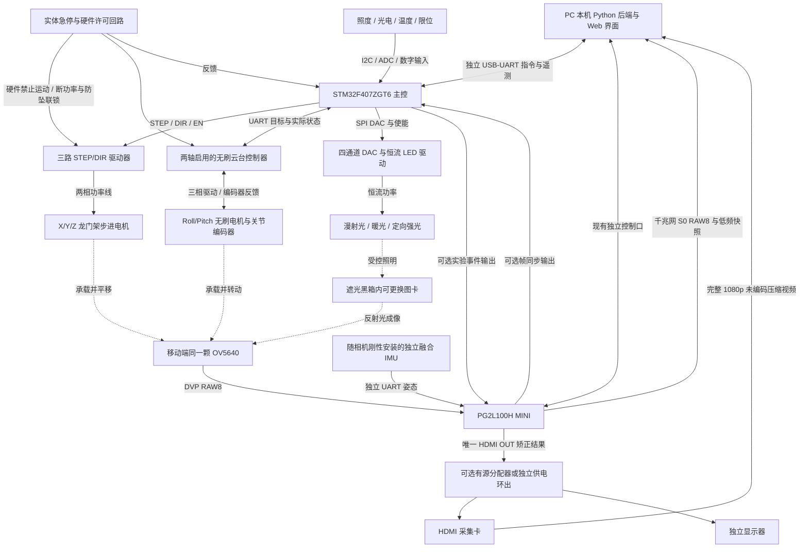

# 基于 STM32F407ZGT6 的三轴龙门架、二维无刷云台与可控光照黑箱测试系统设计方案

版本：V1.0

日期：2026-09-08

性质：硬件与软件实施方案；本文的速度、精度、功耗和时间预算均为设计目标，不代表已完成实物验证。

适用项目：PG2L100H 盘古 100K MINI FPGA 图像畸变矫正；单路 OV5640 DVP，稳定 1920×1080@30FPS，后续拓展真实 1080p60。

## 1. 结论与设计范围

**现有 STM32F407ZGT6 可以作为整套测试装置的主控，无须为了本方案更换 STM32。** 建议它负责三轴步进轨迹、云台目标下发、灯光控制、环境采样、事件计时和 PC 通信；无刷电机的换相与姿态/位置闭环由专用云台控制器负责。

该分工仍然是基于 F407 的测试系统：PC 下发实验任务，F407 在设备端执行运动和光照时序。1080p 图像继续由 FPGA 采集、处理、回传，既不进入 F407，也不经 PC 转发给 FPGA。

用户已明确拥有 F407、采用三轴步进龙门架和二维无刷云台。云台轴向、机械尺寸、载荷、电机实物及预算尚未给定；本文据此提出一套可落地的参考配置：**三轴平移 X/Y/Z，加横滚 Roll 与俯仰 Pitch 两个转轴**。这是一套五自由度装置，不能同时独立产生 Roll/Pitch/Yaw 三轴旋转。若现成云台是“偏航＋俯仰”，需替换安装方案或接受缺少光轴横滚测试；第三转轴作为以后扩展。

本文件细化现有[整机测评方案](可控光照箱与上位机测评详细实施方案.md)中的机械、灯光和 MCU 部分。本次用户指定的“三平移＋二旋转”作为本文件的机械基线；旧文档中泛称“三轴旋转云台”的内容不表示本装置拥有第三旋转轴。视频接口继续遵循[RAW8 千兆网与 HDMI 双路回传方案](OV5640_RAW8千兆网与HDMI双路回传方案.md)，不新增第二路 HDMI 输出，也不改变同源图像配对规则。

## 2. F407 为什么够用

STM32F407ZG 的主要资源包括 168MHz Cortex-M4F、1MiB Flash、192KiB SRAM，以及多组定时器、UART、SPI、I²C、ADC。192KiB SRAM 中包含 64KiB CCM；DMA 缓冲应放在可被 DMA 访问的普通 SRAM，不能将 CCM 当作 DMA 缓冲区。[ST 产品页](https://www.st.com/en/microcontrollers-microprocessors/stm32f407zg.html)、[STM32F405/407 数据手册](https://www.st.com/resource/en/datasheet/stm32f407zg.pdf)

| 工作 | 本方案实现 | 对主控的要求 |
| --- | --- | --- |
| 三轴步进运动 | 统一定时节拍产生 STEP；驱动器负责相电流 | 少量整数运算、GPIO、轨迹队列 |
| 两轴无刷云台 | UART 下发角度/速度并读取编码器及故障 | 不在 F407 上运行两套无刷底层控制 |
| 四路光源 | SPI DAC 调整恒流设定，GPIO/PWM 控制使能 | 慢速照度反馈、准确记录切换事件 |
| 环境与保护 | I²C 照度、ADC 温度/光强、限位/急停反馈 | 有界采样与明确故障状态 |
| 同步 | 定时器捕获 FPGA 帧边沿及光电边沿 | 公共设备时间轴，不依赖 PC 到包时刻 |
| 上位机 | 独立 USB-UART 控制与遥测 | 115200 8N1 起步，轨迹预装而非逐脉冲下发 |

一帧 1080p RAW8 为 2,073,600 字节，远大于 F407 片内 RAM；因此本方案从结构上不让 MCU 缓存视频。视频达到 30FPS 或以后 60FPS，并不会要求步进运动以相同频率执行一整次定位；MCU 只需持续产生运动、记录每帧对应的环境。

不建议首版同时自研双路无刷功率级、双路 FOC、三轴运动和整机测评。如果后期要求完全自研无刷控制，可增加独立电机控制子板，再由 F407 统筹；只有在实测计算预算或接口预算不足时才重新评估主控。直接换为 H7 不能替代编码器、功率驱动、机械平衡和控制调参。

## 3. 整体硬件与数据流

### 3.1 系统结构



图中的帧同步和事件 GPIO 是新增接口建议，**并不表示开发板已有指定同步插座**。接线前依据 `reference/` 中实际 MINI 修订版原理图确认可用扩展引脚、Bank 电压、方向和连接器；本文件不给未经验证的 FPGA 管脚编号。

### 3.2 三条职责边界

1. **视频链路**：OV5640 → FPGA → 原图千兆网、结果 HDMI → PC。FPGA 保持独立处理能力。PC 的 RAW 基础可视化不能代替 FPGA ISP 后的 S1；精度比较使用板端同源 S1 与 S2/S3 快照。
2. **实验控制链路**：PC → F407 → 位移、转角、灯光。浏览器只发高层任务，设备端承担运动时序和停止策略。
3. **测量链路**：编码器、量具、照度计、光电探头 → F407/PC → 实验记录。云台设定角度不自动等于真实相机角度，灯光 DAC 码也不等于照度。

FPGA 的算法姿态来自相机旁独立融合 IMU。云台控制器自己的 IMU、关节编码器用于控制和实验记录，不能未经声明就替代 FPGA 姿态输入。正式自动姿态测评不把轨迹预设值当作算法答案；若使用上位机角度指令模式，应单独标注为该模式的功能测试。

## 4. 坐标、测试能力与机械指标

### 4.1 坐标约定

采用常见龙门架坐标：X 向右，Y 沿深度指向图卡，Z 竖直向上。零位时相机坐标为 x 向右、y 向下、z 沿光轴指向图卡，即 `x_C = X，y_C = -Z，z_C = Y`。

- Roll：绕相机光轴旋转，直接产生画面平面内旋转。
- Pitch：绕云台定义的水平转轴倾斜，产生透视变化。
- 软件同时保存关节角、安装零位和变换顺序；多轴叠加时用齐次变换或四元数表达姿态，不把两个角简单相加。
- 图卡坐标固定在可更换板的定位基准上。拆装相机、移动图卡、调整云台转轴后，都需检查外参和安装变换。

镜头 K、D 是成像模式与镜头状态的标定参数；相机位置、朝向改变主要改变外参。若焦距、对焦位置、分辨率、裁剪或传感器模式改变，应复核并按需要重新标定。平面图卡可用单应关系评价透视校正；任意三维场景的平移视差不能由一张二维仿射矩阵统一消除。[OpenCV 单应与相机运动说明](https://docs.opencv.org/4.x/d9/dab/tutorial_homography.html)

### 4.2 参考机械目标

以下仅用于首版设计，采购前必须按实物载荷、镜头视场、桌面和运输尺寸复核。

| 项目 | 首版建议目标 | 说明 |
| --- | --- | --- |
| X/Y/Z 有效行程 | 300 / 200 / 150mm | 分别为横移、前后、升降；不含回零和停止余量 |
| 相机、IMU及云台运动端载荷 | 初按 0.5kg | 逐轴计算还需计入该轴承载的滑台、支架和线缆 |
| 受力计算示例移动质量 | 2kg | 是计算假设，不是电机已验证载荷 |
| X/Y 最大工作速度 | 50mm/s | 初调先限制 5mm/s |
| Z 最大工作速度 | 20mm/s | 配平、制动和防坠优先 |
| X/Y、Z 工作加速度 | 200、100mm/s² | 调试依据振动、失步和实际停止距离降低 |
| Roll 正式演示范围 | −90°～+90° | ±180°须另验线缆、结构与视野；不默认无限转动 |
| Pitch 正式演示范围 | −30°～+30° | 机械预留到 ±45°需校核碰撞和图卡覆盖 |
| 云台角速度 | 先 10°/s，验证后 30°/s | 更高速只作为压力项 |
| 线性重复定位 | ≤0.1mm，实测目标 | 不能从微步数直接推导 |
| 角度重复定位 | ≤0.2°，实测目标 | 不等于绝对精度或 FPGA 亚像素误差 |
| 到位判定初值 | 位移稳定，角误差≤0.2°且角速度≤0.5°/s，连续300ms | 没有线性反馈时仅可声明指令执行完成 |

按 `位移像素≈焦距像素×位移/物距` 估计，假设 fx=1500px、物距500mm，0.1mm 平移约为0.3px；0.2°小角转动约为5.2px。这里 fx 只是说明测量尺度的假设值，不能写入真实标定文件。因此严格亚像素评价应使用同源图像与可信算法参考，不能依靠上述机械重复定位目标充当亚像素真值。

## 5. 三轴龙门架设计

### 5.1 传动与电机选择

首版选择预装线性导轨＋5mm 导程丝杆滑台；优先一轴一电机。宽龙门两侧应机械同步或采用已解决防扭斜的成品模组。若改为左右独立双电机驱动，则实际变成四路步进，需增加驱动、独立回零和防扭斜逻辑，不能直接沿用本文三路配置。

| 部件 | 推荐配置 | 选型依据 |
| --- | --- | --- |
| X/Y 步进电机 | 两相、1.8°；42或57机座，按转速下扭矩曲线选 | 先按单相额定电流约1～2A、足够动态余量筛选，不凭保持转矩判断高速能力 |
| Z 步进电机 | 两相、1.8°，优先带常闭制动器的成套模组 | 可用57机座作为起点；载荷未知时不冻结具体绕组型号 |
| 三路驱动器 | Leadshine DM542E，24V 工作，STEP/DIR | 能匹配两相步进；核对正版实物输入电平、额定电流及微步表 |
| 直线测量 | 验收用百分表/位移量具；动态真值可选直线编码尺 | 电机步数只能提供推算位置 |
| 每轴行程检测 | 正负限位各1个；负端可兼回零，共6个 | 优先常闭触点及断线可检结构，另设机械缓冲挡块 |

DM542E 官方资料给出最高200kHz 脉冲输入，并提供5V/24V逻辑配置；本方案32kHz工作脉冲低于该上限。**F407 的3.3V GPIO不直接当作驱动器光耦输入的合格驱动源**，须加满足输入电流和时序的缓冲/隔离接口；电流开关须区分峰值与RMS。[Leadshine DM542E 官方资料](https://m.leadshine.com/product-detail/stepper-motor/stepper/DM542E.html)

参考脉冲和推力预算：

```text
整步数 = 360° / 1.8° = 200 步/转
16 微步、5mm 导程：每毫米脉冲 = 200 × 16 / 5 = 640 pulse/mm
50mm/s：STEP = 32,000 pulse/s；20mm/s：STEP = 12,800 pulse/s
微步位移 = 1/640mm ≈ 1.56μm，仅是指令分辨率

竖直轴示例：m=2kg，a=0.1m/s²，暂估摩擦力5N
所需轴向力 F ≈ m(g+a)+5 ≈ 24.82N
5mm导程、假设效率η=0.8：T = F×0.005/(2π×η) ≈ 0.025N·m
```

上式尚未包含丝杆旋转惯量、联轴器、加速转矩、冲击和线缆阻力，不能直接据此购买0.025N·m电机。最终选型需加入全部负载，至少保留约2倍计算余量，并以目标转速下的可用扭矩验证。丝杆效率取实际传动值；低效率梯形丝杆与滚珠丝杆不能共用上述效率假设。

**Z 轴防坠不能只靠步进保持电流或“丝杆一般不会掉”。** 首选配重/弹簧平衡加常闭制动器；按负载与速度验证断电制动距离。急停或掉电时制动器必须能够失电抱闸，且机械挡块能限制剩余运动。

### 5.2 轨迹与脉冲生成

采用设备端预装轨迹：PC 发绝对位置、速度、加速度和动作编号；F407 做限幅、碰撞检查和梯形速度规划。首版先完成逐轴与三轴直线插补，再加限制加加速度的 S 曲线以降低停稳时间。

推荐首版用 **TIM1 100kHz 定时中断＋同一 GPIO 端口原子置位/复位**：相邻两个10μs节拍分别允许发出脉冲和拉低 STEP，以50kHz整数 DDA 更新三轴步进。每轴最大50k pulse/s，覆盖32k pulse/s参考工况。脉冲输出层只执行预计算的整数操作；不做串口解析、浮点轨迹运算、内存分配或日志打印。

实施约束：

- 168MHz 下每10μs有1680个CPU周期。把该中断的最坏执行预算设为≤400周期，即占用≤约24%；这是待测预算，不是性能实测值。
- 轨迹主循环预计算1ms分段速度，用有界队列供给输出层。加速度改变反映到DDA增量，不能仅在起点一次性设置固定PWM频率。
- 用示波器在三轴运行、串口满载和ADC采样同时开启时检查：正常STEP高低各约10μs，最小脉宽满足驱动器手册，相对计划节拍的实现抖动目标≤1μs；该目标不包含DDA自身20μs发脉冲网格的量化。以32k pulse/s为例，平均周期31.25μs由20/40μs间隔组合产生，需实测该量化是否引起可见振动；未通过则降低步频或改为经验证的可变间隔定时器/DMA方案。
- DIR反向先减速停止；DIR建立时间初设20μs，并依据实际驱动器手册增加。轨迹结束必须输出准确脉冲数并将STEP拉低，不留下持续PWM。
- 队列耗尽、过期、非法数据立即停止输出、禁止继续旧动作并记录故障；故障停止后位置可信度失效时重新回零。
- 保持该中断高优先级，禁用长时间全局关中断；RTOS临界区和其他ISR不得破坏节拍。急停另有硬件回路。

TIM1这里只作定时基准，因此 STEP 可以使用普通GPIO，不要求三个STEP恰好位于三个定时器复用引脚。后期若优化为DMA写GPIO，须核对实际硅版本和ST勘误：F407存在DMA2并发访问AHB/APB2时写GPIO的限制，不可直接照搬未经验证的内存到GPIO循环DMA。[ST ES0182 勘误](https://www.st.com/resource/en/errata_sheet/dm00037591-stm32f405407xx-and-stm32f415417xx-device-limitations-stmicroelectronics.pdf)

### 5.3 回零、停止与位置可信度

回零顺序依据实际装置先让相机退出图卡和箱体危险区，再逐轴低速寻限位、退回、低速二次触发、设置零偏。Z的安全方向取决于机械布置，不能无条件“先向下回零”。

六路限位同时接入设备监测和按方向阻断STEP的硬件逻辑：正限位禁止继续正向，负限位禁止继续负向，允许按受限回退流程退出触点。正常运行触发限位后锁存故障；回零只对已声明的目标触点使用专门流程，不能整体旁路急停和全部限位。限位输入采用滤波和断线检查；检测到首次可信触发应立即抑制继续撞向该方向的运动，不等长时间软件消抖后才停止。回零时仅允许向预期方向慢速接近目标限位。正常停止按规划减速；实体急停按硬件许可回路执行，不等待通信。

以50mm/s、200mm/s²估计减速距离 `v²/(2a)=6.25mm`。若另计20ms最坏故障响应，相应运动距离为1mm；还需机械、电气和测量余量。软限位、硬限位、缓冲挡块分别布置，不能把行程尽头当作正常停止点。最终用最大载荷实测停止距离更新包络。

## 6. 二维无刷云台设计

### 6.1 推荐控制器与接口

首选 **BaseCam SimpleBGC32 Extended＋两轴云台专用无刷电机＋两只兼容磁编码器**，启用Roll/Pitch两轴。采用有资料、可读状态和可调限位的控制器，不采用只有航模油门输入的普通ESC代替位置控制器。

该控制器官方说明支持串口控制和编码器扩展；供电范围8～26V，**各电机合计持续电流为1.5A**，不能解释为每轴可持续1.5A。本方案先用独立12V支路并限制总电流，选平衡良好、适合小相机的低电流云台电机；若计算和热测不满足，应换更高功率的云台驱动器，而非换F407。[BaseCam Extended 官方参数](https://www.basecamelectronics.com/simplebgc32ext/)

采购准入条件：

| 核对项 | 必须满足的条件 |
| --- | --- |
| 固件和授权 | 支持所购硬件、两轴工作、编码器功能；保存版本和授权状态 |
| 指令接口 | UART可设置目标、速度限制、停止、查询故障；F407用厂商协议适配 |
| 反馈语义 | 能读实际关节角或明确区分编码器角、相机融合角与目标角 |
| 控制模式 | 可实现本实验定义的关节/相机目标；关闭不受控跟随和自动回中 |
| 掉线行为 | 可配置超时，保持/受控停止策略明确，不持续执行旧速度命令 |
| 电机匹配 | 云台专用绕组，电阻、极对数、额定电流、转矩及驱动器匹配 |
| 机械接口 | 可安装编码器、支承轴承和光轴附近的相机座 |

厂商Serial API支持读取状态与控制云台，并提供STM32等平台的C库。具体命令、角度单位和参考系以购买版本的协议为准，不能把通用“角度模式”默认理解为编码器关节位置模式。[BaseCam Serial API](https://www.basecamelectronics.com/serialapi/)、[协议说明](https://www.basecamelectronics.com/files/SimpleBGC_2_6_Serial_Protocol_Specification.pdf)

编码器候选为控制器官方支持的AS5048B模组。编码器固件通常要求所有启用电机均配置编码器，因此两轴应配两只；其14位分辨率对应约0.022°/计数，但磁钢偏心、安装误差和校准误差会影响绝对精度。不要把分辨率当作测量准确度。[BaseCam 编码器指南](https://www.basecamelectronics.com/files/SimpleBGC_32bit_Encoders.pdf)、[AS5048 数据手册](https://look.ams-osram.com/m/287d7ad97d1ca22e/original/AS5048-DS000298.pdf)

编码器接到云台控制器自己的总线，F407经串口取反馈；不能让F407和控制器未经仲裁同时作为同一编码器总线的主机。备选同类国产控制器也必须通过上表，不能仅凭“支持无刷云台”替换。

### 6.2 机械平衡与测量

两轴采用刚性支架、低间隙轴承和可调相机托架。先在断电状态把重心调到转轴附近，再调控制参数。电机连续所需转矩按 `T=mgr·sinθ+Jα+T线缆+T摩擦` 计算；单纯加大驱动电流不能弥补严重偏心和线缆拉扯。

例如0.3kg负载偏心10mm时，仅最大重力转矩就约0.029N·m；偏心增至30mm后约0.088N·m。此处仍是计算示例，实际还要计入惯量和Roll/Pitch嵌套负载。采购电机以连续工作和温升为准，不只选外形尺寸。

相机光心与转轴不重合时，转动会同时引起相机平移；应保存安装偏置，在纯转动测试中尽量使转轴接近所需旋转中心，或用XYZ补偿。即使使用补偿，仍需记录校准方法和残差。

姿态测量分为三层：目标角、编码器测得的关节角、独立量具/标定板估计的相机实际姿态。角度量具精度宜优于目标误差的三分之一；云台IMU不是独立于其自身控制的高精度真值。控制器若只能读相机融合角而没有关节反馈，软件必须如实标注测量来源。

## 7. 黑箱、图卡与移动开口

### 7.1 黑箱结构

采用可拆装刚性框架、哑光黑色内壁和消光挡板。背面设置图卡快换架，正面/侧面设置检修门，移动端通过柔性遮光波纹套或多层迷宫遮光口进入箱体。遮光套安装在固定框和移动承载件之间，留足全部平移、转角和拖链余量，不能直接拉扯相机镜头。

大开口即使只漏入少量室内光，也会让夜间条件随龙门架位置改变。因此在全部轨迹上关灯测量背景照度；首版目标是背景泄漏≤0.5lx，且不超过最低工作照度的10%。达不到时先修遮光结构，不靠软件扣一个固定背景值掩盖位置相关漏光。

电机驱动、电源和主要热源放箱外；LED散热器与风道隔离，进出风口采用折返遮光通道。相机板周围允许散热但不能形成亮面反射。所有可达轨迹都要检查相机、云台、线缆、遮光套及图卡的空间扫掠范围。

### 7.2 先用视场计算尺寸

不能先决定小箱子，再假设广角OV5640一定能拍满图卡。零姿态下，横向所需图卡宽度可先按以下下界估算：

```text
图卡宽度 ≥ 2 × 最大相机距离D × tan(水平视场角/2) + 2 × 横移半行程 + 余量
图卡高度同理，并计入竖直半行程；Roll与Pitch需另做边缘光线和图卡平面的交点校核。
```

例如水平视场60°、最远距离0.5m、横移±0.15m，宽度下界约0.877m，尚未计倾斜与安装余量。若视场90°，同条件约1.30m。两者都可能超过普通A3/A2板；必须选更大图卡、减小有效行程、调整距离或选择合适镜头，再冻结箱体尺寸。这是几何估算，不是当前OV5640镜头的已知视场。

图卡架采用三点定位/销孔基准和压紧结构，保持平整并记录厚度。更换图卡时进入暂停状态，运动停稳、定向强光关闭；更换后读取/录入图卡ID，检查标定尺寸、位置和焦点。不要在图卡更换动作中自动回零。

### 7.3 图卡配置

| 图卡 | 用途 | 实施要求 |
| --- | --- | --- |
| 棋盘格或圆点阵 | 真实K、D标定，外参与重投影评估 | 实测格距、平整度；覆盖画面不同区域和角度，保留原始图像 |
| 长直线/规则网格 | 径向畸变、边缘直线度、断裂 | 横竖及斜线均有，标明有效ROI |
| 倾斜黑白边缘 | SFR/MTF50对比 | 合适倾角和对比度、避免过曝及打印边缘主导结果；不同姿态按有效ROI测 |
| 灰阶、黑白细节 | Gamma、暗部提升、饱和与噪声 | 固定曝光组与自动曝光组分别测 |
| 同时含明暗区的图案 | 局部强光、逆光模拟 | 区分照度变化和物体本身反射率差异 |

普通打印纸适合联调；最终精度图卡建议购买带尺寸/分辨率说明的板材图卡或检定打印工艺。图卡锐度、镜头焦点和光照会影响MTF，报告不能把这些变化全算成FPGA插值损失。

## 8. 光照硬件与控制

### 8.1 四路光源

| 通道 | 光学配置建议 | 电气预算 | 主要工况 |
| --- | --- | --- | --- |
| L1 | 左侧中性白光＋漫射板 | 上限20W/路 | 均匀照明、左侧光 |
| L2 | 右侧同型号白光＋漫射板 | 上限20W/路 | 均匀照明、右侧光 |
| L3 | 暖白约3000K＋漫射板 | 上限20W/路 | 不同光谱环境及混合光 |
| L4 | 可调位置定向白光＋遮光筒 | 上限20W/路 | 局部强光、眩光和高反差 |

灯珠、透镜和距离决定图卡照度，上述80W总预算不能直接换算为一定达到10000lx。优先选有散热结构、同批次灯珠和可调恒流接口的模块；光源色温仅是采购目标，若要定量比较光谱需额外仪器。

每路结构为：**F407 → DAC60504 → 匹配量程的模拟调光接口 → 恒流驱动 → LED**。DAC60504为四通道12位SPI DAC，适合四路电流设定；设置正确的供电、VIO和输出增益，不在3.3V供电条件下假定能输出5V。上电时用独立使能硬件保持灯关闭，初始化零码后再开放使能，不能依赖默认复位码。[TI DAC60504](https://www.ti.com/product/DAC60504)

恒流驱动候选为 **LM3409方案模块**，它支持模拟和PWM调光；芯片本身是外置功率器件的降压控制器，并不是接上LED就可使用的完整驱动。自制时需设计MOSFET、电感、采样电阻和散热；比赛首版优先成熟模块，验收其模拟输入范围、负载电压范围和关断行为。24V母线要求LED串压留出调节余量，不能把任意“24V灯板”直接当作合格恒流负载。[TI LM3409](https://www.ti.com/product/LM3409)

### 8.2 调光与照度反馈

首版以**连续电流的模拟调光**为正式精度工况；PWM保留为开关/专门频闪测试能力。即使PWM设为20kHz，在短曝光或滚动快门下仍需实拍和光电验证，不能宣称高频就一定无条纹。低照度无法稳定模拟调小时，使用电流档位切换或可记录的中性密度衰减片重新标定，避免用极低占空比凑照度。

照度传感器选 **OPT3001** 模组，放在图卡边缘、朝向入射光并避免进入测量ROI。其范围覆盖本方案的低照和强光目标；转换时间为100ms或800ms量级，因此它适合稳态照度反馈，不能作为毫秒级灯光切换探头。[TI OPT3001](https://www.ti.com/product/OPT3001)、[OPT3001 数据手册](https://www.ti.com/lit/ds/symlink/opt3001.pdf)

配置一个固定监测点，加便携照度计做中心与四角五点标定。固定探头不能直接代表全画面照度；若需五点同时测量，增加多传感器和I²C地址规划/多路器。慢速照度闭环初设1～5Hz，采用查表前馈＋小幅PI修正、输出限幅和抗积分饱和。模式切换后等待照度和曝光稳定，再采正式静态图像。

另设**光电二极管＋跨阻放大器＋比较器**检测光强真正变化的边沿，模拟端可由ADC以20kSa/s记录。模拟前端按最大光强防饱和并设置合理带宽；20kSa/s只用于有限带宽波形，检查20kHz PWM细节需更高带宽示波器。该通道反映相对光强，未经光谱标定不得直接输出“lux”。

### 8.3 建议光照场景

| 场景 | 初步照度目标 | 记录与验收 |
| --- | --- | --- |
| 正常漫射 | 500～1000lx | 五点均匀性、曝光、增益、温度 |
| 夜间 | 5～20lx | 漏光、黑电平、噪声、细节可见性；最低档曝光能否仍保持真实30FPS |
| 强光 | 3000～10000lx，按实际灯具能力取值 | 饱和比例、温升、反光；不以灯功率代替照度 |
| 非均匀 | 左亮右暗或定向亮斑 | 多点照度、区域位置、亮暗比 |
| 光照阶跃 | 正常与夜间、正常与强光切换 | DAC动作、光电边沿、曝光收敛和FPGA输出响应分别计时 |

建议均匀模式验收目标 `E_min/E_max ≥ 0.8`，稳态照度在设定值附近±5%内连续1s；这些是装置目标，应同时记录测量仪器的不确定度。正式记录包含灯号、DAC码、电流档位、ND片、实测照度、测量时间及稳定标志。

## 9. F407 接线和资源分配建议

### 9.1 引脚候选表

下表按STM32F407ZGT6芯片资源提出候选，**不是现有F407开发板的最终接线图**。开发前要检查板载LCD、FSMC、以太网、SD卡等占用和排针引出情况，再在CubeMX及原理图上冻结。不占用SWD；模拟输入保持3.3V范围。[ST 数据手册引脚与复用表](https://www.st.com/resource/en/datasheet/stm32f407zg.pdf)

| 功能 | 候选引脚/外设 | 接线要点 |
| --- | --- | --- |
| STEP X/Y/Z | PE0 / PE1 / PE2，普通输出 | 同端口BSRR原子操作，经过硬件许可门及输入缓冲 |
| DIR X/Y/Z | PE3 / PE4 / PE5 | 上电默认确定方向；输出前检查使能 |
| EN X/Y/Z | PE6 / PE7 / PE8 | 外部电阻保证复位禁能，按驱动器有效极性适配 |
| PC通信 | USART2，PD5 TX / PD6 RX，AF7 | 独立USB-UART，3.3V逻辑；不与FPGA控制口并接 |
| 云台通信 | USART3，PD8 TX / PD9 RX，AF7 | 与控制器串口交叉连接，核对电平与共地/隔离 |
| 照度计总线 | I2C2，PB10 SCL / PB11 SDA，AF4 | 3.3V上拉，短线；首版100kHz |
| 灯光DAC | SPI2，PB13 SCK / PB14 MISO / PB15 MOSI，AF5；PB12 CS | 按DAC模块引脚定义，预留同步更新/使能 |
| 四路灯PWM/EN | TIM4 CH1～CH4，PB6～PB9，AF2 | 正式模拟调光时EN保持稳定，PWM仅按已验证场景启用 |
| FPGA帧边沿输入 | TIM2 CH1，PA0，AF1 | 经匹配电平接收，1MHz计数捕获 |
| 光电边沿输入 | TIM2 CH2，PA1，AF1 | 比较器3.3V数字输出，设迟滞和边沿规则 |
| 实验事件输出 | TIM2 CH3，PA2，AF1 | 可用输出比较产生计划事件；向FPGA发送须核对Bank电压 |
| ADC采样 | PC0光强、PC1/PC2温度、PC3电源分压 | 模拟输入加限幅/滤波；LED功率端不得直连 |
| 六路限位 | PG0～PG5 | NC回路/隔离输入，独立定义正负端 |
| 急停反馈 / 门状态 | PD0 / PG8 | 仅监测硬件回路，不能代替实体切断 |
| 制动器/总许可 | PG6 / PG7 | 经驱动级，复位和掉电进入机械安全状态 |
| DAC同步/辅助关断 | PG9 / PG10等空闲GPIO | 按模块需要使用；最终分配记录在接线表 |
| 调试口 | PA13 SWDIO / PA14 SWCLK | 保留；外部晶振按现有板设计 |

F407与FPGA间逻辑接口使用匹配的电平转换/缓冲，不因MCU是3.3V就假定FPGA端也是3.3V。长距离控制优先差分收发器或隔离UART方案；裸I²C/TTL不沿电机拖链长距离布线。

### 9.2 定时器、DMA与内存预算

时钟规划采用SYSCLK168MHz、APB1 42MHz、APB2 84MHz；相应定时器内核通常为84MHz和168MHz。分频参数由实际RCC配置推导，不能拿总线频率直接代替定时器频率。

| 资源 | 分配 | 初始配置 |
| --- | --- | --- |
| TIM1 | STEP统一节拍 | 168MHz / 1680 = 100kHz；例如PSC=0、ARR=1679 |
| TIM2，32位 | 帧/光电捕获，事件输出比较 | 84MHz / 84 = 1MHz；溢出约71.6分钟，软件扩展到64位 |
| TIM4 | 四路PWM/使能 | 84MHz / 4200 = 20kHz；模拟调光时不周期关断 |
| TIM6 | 1kHz设备调度 | 轨迹分段、状态机、按键和超时检查 |
| TIM8 | ADC触发，可选 | 20kHz触发光强扫描；采样时间按前端源阻抗设计 |
| USART2 RX/TX DMA | DMA1 Stream5/Stream6，Channel4 候选 | PC串口循环接收、有界发送 |
| USART3 RX/TX DMA | DMA1 Stream1/Stream3，Channel4 候选 | 云台串口；与PC口不共用Stream |
| ADC1 DMA | DMA2 Stream0，Channel0 候选 | 半满/全满处理；本版没有DMA2写GPIO |
| SPI2 DAC / I2C2照度 | 首版非DMA、有超时事务 | 低优先级，不进入STEP中断 |

DMA映射仍需在实际器件、固件和CubeMX配置中核对；资源扩展时做整表冲突检查。定时捕获计数、软件扩展溢出和临界边沿读取需处理竞态，64位时间戳并不意味着64位硬件计数器。

普通SRAM初步预留：通信8KiB、轨迹16KiB、ADC双半区8KiB、事件16KiB、栈与其余状态32KiB，合计约80KiB；剩余空间用于峰值和扩展。DMA缓冲全部位于普通SRAM，CCM按链接脚本放CPU私有计算数据。Flash占用目标低于512KiB，最终以链接报告和栈高水位为准。

## 10. 电源、布线与实体保护

### 10.1 电源分区

建议采购独立 **24V/15A级直流电源**作为装置电源预算起点，分支熔断并留热降额空间。示例预算：三路步进合计120W、灯光80W、云台12V支路20W、控制与风扇10W，共230W；按约30%余量为299W，小于360W名义容量。这里120W等均为分配预算，须以电机、驱动效率、启动和制动回馈实测修订，不用相电流简单相加推导电源电流。

```text
24V 装置电源
 ├─ 电机支路保护、许可回路 → 三路步进驱动器
 ├─ 常闭制动器专用支路 → Z轴防坠机构
 ├─ 四路分别保护 → LED恒流驱动器
 ├─ 24V→12V DC/DC → 云台控制器（按选定型号调整）
 └─ 24V→5V→3.3V → F407、接口与传感器

PG2L100H板、相机和采集设备：沿用各自合规独立供电，不接入未核对的24V支路。
```

步进/无刷功率线、LED开关节点与DVP/IMU/模拟采样线分开走线。长功率线用绞线、屏蔽和可靠接插件；金属框架与机壳接保护地，信号地按隔离方案规划。主电源与板级DC/DC分别滤波，防止急停、LED阶跃和制动回馈使MCU或FPGA复位。

DVP本身不适合随意拉长排线。优先将小型FPGA与相机接口布置在经验证的短距离范围；若板卡留在固定端，必须先验证所需拖链线缆长度下的1080p30时序和误码，必要时调整板卡位置或另行设计接口延长方案。不能把“能移动300mm”等同于普通DVP排线可直接延长数米。

### 10.2 急停与故障响应

实体急停通过硬件回路抑制STEP许可、禁能/切断驱动功率，并联动Z制动器和定向强光关断；F407只读取反馈和记录。具体先后顺序、制动保持力及余程按所选机构验证。失电抱闸也有动作时间，需配平和机械防坠共同承担该段风险。本方案是实验装置设计，不宣称具备某个功能安全认证等级。

| 情况 | 设备端动作 | 恢复要求 |
| --- | --- | --- |
| PC心跳超时，例如500ms | 停止接收新动作；按已验证方式受控减速、云台停止并保持安全姿态 | 重新握手，检查位置有效性，不自动恢复轨迹 |
| 云台反馈过期/故障 | 停止复合轨迹，禁止继续扫角；记录最后有效反馈 | 故障解除后重新确认零位与控制模式 |
| 硬限位、急停 | 硬件许可回路动作，运动任务失败 | 人工释放、检查，必要时回零 |
| LED过温 | 降流或关闭对应路，相关场景标记失败 | 温度恢复后重新稳定并开始新样本 |
| MCU复位、看门狗、欠压 | STEP/EN默认禁用，灯关断，Z失电抱闸 | 新boot_id，旧动作作废，不保留伪有效坐标 |
| 图卡门打开 | 暂停正式采样和运动，关闭强光；保留状态 | 合门后检查图卡ID与碰撞包络 |

IWDG及外部许可看门狗用于设备失控约束；喂狗必须基于关键任务健康检查，不放在一个永远运行的定时中断里。普通软件“停止”按钮不能替代实体急停。

## 11. MCU 固件结构与 PC 协议

### 11.1 固件模块

首版可以使用裸机事件循环＋定时中断，也可以用FreeRTOS；两者都需保持输出层有界。推荐模块如下：

| 模块 | 职责 | 运行节奏 |
| --- | --- | --- |
| board / safety | 上电禁能、限位、门、急停反馈、看门狗 | 硬件即时，软件1kHz检查 |
| motion_planner | 单位换算、软限位、轨迹分段、加减速 | 1kHz或提前成批计算 |
| step_engine | 三轴DDA、准确脉冲计数、结束拉低 | 100kHz定时输出层 |
| gimbal_adapter | 厂商协议、目标/反馈、超时、角度参考系 | 目标50～100Hz，按控制器能力验证 |
| lighting | DAC、光源查表、慢速照度闭环、温度限制 | 1～5Hz稳态闭环，事件切换独立执行 |
| sensing / timebase | ADC/I²C、时间戳、边沿捕获 | 光强20kSa/s，其他按传感器能力 |
| protocol / event_log | 协议解析、幂等、任务回应、有界日志 | DMA收发＋低优先级解析 |
| experiment_executor | 预装场景、条件判断、超时和动作关联 | 1kHz状态机 |

设备状态采用 `BOOT → SELF_TEST → UNHOMED → HOMING → READY → RUNNING → SETTLING → READY`；任一阶段可转FAULT，实体急停进入ESTOP。开启电机前必须经过许可检查；解除急停不自动回到RUNNING。

### 11.2 通信封装与语义

PC–MCU沿用项目现有外层封装的设计语义，MCU命令集合独立握手识别，不能将FPGA客户端直接连接后就认为可控制电机：

```text
55 AA | version:u8 | cmd:u8 | seq:u16 | length:u16 | payload | CRC16:u16
```

多字节字段小端；payload≤1024字节；总帧长为10+payload字节。CRC采用CCITT-FALSE，poly=0x1021、init=0xFFFF、不反射、xorout=0，覆盖version至payload，CRC在线上按小端发送。标准校验向量ASCII“123456789”对应0x29B1。协议版本与数字命令号在跨端接口冻结时统一分配，下表是语义，不是已经实现的编号。

| 命令语义 | 主要参数 | 必须回报 |
| --- | --- | --- |
| HELLO / GET_CAPS | 主机会话与协议版本 | device_id、boot_id、固件、轴数、量程、反馈能力 |
| HOME | 轴掩码、受限速度 | 接受、开始、完成或故障，回零结果 |
| MOVE / START_SWEEP | 绝对XYZ、Roll/Pitch、速度、加速度、轨迹ID | 范围检查、执行状态、实际反馈及其来源 |
| SET_LIGHT | 通道、目标/档位、跃变或渐变、时间计划 | 接受、DAC实际提交、测得照度、稳定/超时 |
| STOP | 受控停止请求 | 进入停止、完成、位置是否仍可信 |
| GET_ENV / EVENT_LOG | 查询范围与游标 | 限位、温度、照度、时戳、丢日志计数 |
| ARM / START_RECIPE | 预装实验ID、触发条件 | 已就绪、实际启动事件、结束原因 |

payload建议位置用有符号微米、角度用有符号毫度、速度用相应单位每秒；这些只是传输单位，不代表传感器具备1μm或0.001°精度。64位MCU时间戳单位μs，同时带boot_id区分复位。命令还需区分 `accepted、applied、completed、settled`，不能把收到ACK显示成“到位”。

115200 8N1理论最多约11520字节/s。按100字节状态包50Hz估计占5000字节/s，余量用于ACK与事件；1024字节payload的整帧约90ms，因此轨迹提前上传，不用大包触发毫秒级动作。UART大包发送不可抢占时会延迟软件STOP，实体急停仍走独立硬件回路。更高速率必须两端协商、测错包后启用。

采用长度检查、CRC、接收超时、序号和会话标识；同会话中相同seq、cmd和payload的重发返回已有结果。相同seq但内容不同拒绝；相对位移、开始轨迹等不能因重试重复执行。断线/复位后的旧包不继续生效，日志溢出明确计数。

## 12. 与现有上位机和 FPGA 同步

### 12.1 PC软件接入方式

仓库当前已有本机Python后端＋Web界面的PRAW接收、预览与归档骨架；当前说明明确HDMI与UART尚未接入。此方案是在该结构中增加MCU控制，不宣称这些功能已经存在，也不要求重写为另一套GUI。[现有Web界面说明](../host/docs/Web界面与核心接入说明.md)

在Python后端加入设备枚举、串口协议、实验队列和环境记录服务，Web增加“手动定位、光照、场景、设备故障”界面。串口由后端独占并管理会话；浏览器不直接产生脉冲、不使用到包时间给图片伪造姿态。

Windows与Ubuntu 24.04保持同一协议和设备语义。串口按VID/PID、序列号、握手身份绑定，Linux处理用户组/设备权限和重连，不能写死COM3或`/dev/ttyUSB0`。关闭页面与断开PC的停止策略分别测试，前端按钮只有后端接入且设备能力有效时才启用。

### 12.2 时间轴和同帧关联

同步分三层实施：

1. **基础可用**：PC关联run_id、action_id和设备时间戳，MCU上报运动/光照事件；此时只声明工况区间，不声明每帧精确对应角度。
2. **帧边沿同步**：FPGA将与源帧编号同定义的帧边沿输出给F407，F407用TIM2捕获；通过带boot/stream_epoch的锚点将捕获序号映射到FPGA源frame_id。发生缺边沿、复位或锚点不一致时立即标记失效，重新建立锚点。
3. **实际环境同步**：F407同时捕获光电边沿、保存有采样/接收时刻的编码器反馈。插值到帧时刻时记录反馈年龄、串口延迟和插值误差；控制器无采样时戳时不能把UART接收时戳当成精确测量时刻。

MCU事件线只标记实验事件，不携带“正确矫正参数”。事件号先通过控制协议预装/应答，电平边沿由两端计时，不能仅靠一条GPIO猜事件ID。光照实际变化以光电探头为准，DAC写入结束只是电气动作时刻。

OV5640 DVP帧边沿不等于全画面同时曝光。记录曝光、增益和传感器时序，动态评价注明按帧时刻或曝光中心近似的误差；滚动快门逐行时差另计。PC-HDMI帧只有验证了来源绑定后才填写源frame_id，否则保持null/unverified，不能按两路到达顺序强行配对。

## 13. 测试流程、数据与现场呈现

### 13.1 三类测试分开执行

| 类别 | 固定/改变什么 | 回答的问题 |
| --- | --- | --- |
| 几何精度 | 固定焦点、曝光、光照；分姿态停稳采图 | FPGA映射与插值是否正确，直线度和有效区域怎样变化 |
| 动态性能 | 固定曝光组先扫角/平移，再加自动曝光组 | 帧率、姿态跟随、延迟、运动造成的局限 |
| 光照适应 | 固定姿态，做均匀/局部/阶跃光照 | 增强前后细节、噪声、饱和与收敛时间 |

图像增强会影响锐度与噪声，因此几何模块验收优先比较同源S1和S2；增强效果另比较S2和S3。插值不能恢复视野之外的信息，黑边以有效域、裁剪比例和残余边界报告，不能称为所有角度均无信息损失。

### 13.2 自动实验顺序

1. 核对电源、急停、图卡ID、相机和FPGA固件；读取设备能力与实际视频模式。
2. 自检、回零、定义工作原点；载入通过碰撞检查的有限行程和转角包络。
3. 设置光照并等待实测稳定；检查温度和曝光是否允许真实1080p30。
4. 先在正常照度完成相机真实标定，保存K/D、镜头/对焦、分辨率和有效ROI。参数由现有上位机–FPGA接口配置，MCU只执行标定姿态序列。
5. 加载一个工况、到位/停稳；等待图像管线中过渡帧离开，依据帧ID选定采样窗口，而非固定睡眠后随意配图。
6. 保存S0原始证据、严格S1/S2或S1/S3快照及全部环境元数据；用于正式精度的图像保持完整1080p，不以界面缩略图计算指标。
7. 动态试验时提前预装轨迹与灯光计划，统一触发，连续记录源帧、输出帧及环境事件；不要求每帧都向PC发送新运动指令。
8. 超时、丢同步、位置无效、过曝或图卡移出有效域时标记该样本失败/无效，保留原因；不自动删掉不利结果。

### 13.3 首轮测试矩阵

| 编号 | 工况 | 建议执行 | 主要输出 |
| --- | --- | --- | --- |
| M01 | 空载/额定载荷三轴回零 | 每轴往返20次，方向分别统计 | 量具重复定位、丢步、回零误差 |
| M02 | 单轴云台定位 | Roll取−90/−45/0/45/90°；Pitch取−30/0/30°，在覆盖允许时组合 | 角反馈来源、绝对误差/重复性、停稳时间 |
| M03 | 平移静态 | X/Z中心与边缘位置、Y近中远 | 尺度/焦点变化、有效视场及直线度 |
| M04 | 正常光下动态 | 单独扫Roll、Pitch，再XYZ慢移；10°/s起步 | 跟随误差、振动、帧率和事件同步质量 |
| M05 | 光照静态 | 正常、夜间、强光各稳定采样 | 噪声、暗部细节、饱和、SFR变化 |
| M06 | 光照阶跃 | 正常↔夜间、正常↔强光，各10次 | 光电真实边沿、曝光和增强收敛时间 |
| M07 | 复合工况 | 已验证低速轨迹＋单次光照变化 | 鲁棒性；与单因素结果对照 |
| M08 | 稳定1080p30 | 连续30分钟，运动与灯光按计划循环 | 输入唯一帧率、RAW完整率、FPGA结果率、温升与错误 |
| M09 | 独立来源证明 | FPGA已配置后，按预定安全方式停止PC控制/显示，保留独立HDMI | 视频仍由FPGA产生；MCU停止策略符合设定 |
| M10 | 故障恢复 | 断PC、限位、急停、云台掉线、灯过温模拟 | 硬件动作、日志完整性、重连不重放动作 |

矩阵数值是建议采样点；超出标定图卡覆盖或机械包络时缩小范围并记录。1080p30验收要排除重复帧、丢帧补帧和低照下曝光拉长导致的真实帧率下降。30分钟是首版稳定性门槛，后续按比赛规则延长。

1080p60是独立扩展任务：需要真实60FPS图源、FPGA处理时序、HDMI采集与原始回传能力一起通过。MCU控制架构可继续使用，单纯把帧同步从30Hz提高到60Hz不足以证明视频链路达到60FPS。

### 13.4 记录格式与能效边界

每次实验至少保存以下字段，未测项用null和质量标志，不补造数值：

| 类别 | 记录内容 |
| --- | --- |
| 身份 | run_id、场景/动作ID、图卡ID、MCU boot_id、FPGA device_id/stream_epoch/source_frame_id |
| 运动 | 指令位置/角度、推算位置、实际反馈、传感器来源、零偏、采样/接收时戳、有效性 |
| 光照 | 通道/码值/档位、照度及探头位置、光电边沿、温度、稳定标志 |
| 成像 | K/D版本、曝光/增益、分辨率、Bayer、S0/S1/S2/S3阶段、有效ROI |
| 版本 | FPGA位流、MCU固件、云台固件/配置、PC软件和协议版本 |
| 质量 | 同帧配对等级、同步误差、丢包/缺帧、重复帧、故障和恢复动作 |

原始证据保存`.raw`/`.rgb`及元数据，PNG或网页预览仅作派生显示。当前Web预览尺寸和刷新率不是完整1080p视频的验收依据；采集格式与完整帧计数独立检查。

能效测量将“FPGA板卡视频处理功率”和“机械灯光装置功率”分开。电机和80W级照明不能混入FPGA算法能效分母。板级测量注明包含DDR、PHY等实际供电范围，分别记录旁路/矫正/增强功率、有效输出帧率和增量功率，按 `J/有效帧=P/FPS` 计算；不把24V电源铭牌功率当作实测。

延迟同时报告板内处理延迟和含采集卡/显示器的端到端延迟。光电事件可以提供输入刺激时刻；若测完整显示延迟，还需屏幕探头或外部同步测量，并说明曝光、扫描和显示刷新带来的误差，不能用一个MCU时间戳直接代替整条链路延迟。

现场演示建议固定为：正常光静态网格 → 缓慢Roll/Pitch扫角 → XYZ位置变化 → 夜间/强光切换 → 一组已验证复合动作。PC并排显示原图与FPGA结果，界面同时显示实测环境和来源状态；独立显示器保留FPGA HDMI输出证据。无可靠逐帧配对时只作实时观察，精度结论展示已保存的严格同源快照。

## 14. 采购与制作清单

以下是推荐物料类别和已核对的候选，并非已购买清单。报价与库存以采购时为准，不在方案中编造实时价格。

| 项目 | 数量 | 推荐/要求 | 优先级 |
| --- | --- | --- | --- |
| STM32F407ZGT6主控板 | 1 | 利用现有芯片/开发板；确认电源、引脚和SWD | 必需 |
| STEP/DIR驱动器 | 3 | DM542E，匹配绕组电流，24V供电 | 必需 |
| 丝杆导轨滑台 | 3轴 | 5mm导程参考，含支承、联轴器、安装基准 | 必需 |
| 两相步进电机 | 3 | 按动态扭矩和载荷冻结；Z带制动/防坠 | 必需 |
| 无刷云台控制器 | 1 | SimpleBGC32 Extended候选，通过两轴编码器及UART准入测试 | 必需 |
| 云台无刷电机 | 2 | 云台专用、连续电流/转矩匹配，含轴承支架 | 必需 |
| 关节编码器 | 2 | 控制器支持的AS5048B模组及合格磁钢 | 必需 |
| 云台控制用IMU | 按控制器配置 | 与其固件和接口匹配 | 按控制器要求 |
| FPGA独立融合IMU | 1 | 沿用主系统独立姿态接口选型 | 主系统必需 |
| DAC60504模块/接口板 | 1 | 四路模拟设定，3.3V通信 | 必需 |
| 模拟调光恒流驱动 | 4 | LM3409方案成熟模块或同等可验证模块 | 必需 |
| LED及光学件 | 4路 | 散热、漫射板、定向透镜、遮光筒 | 必需 |
| OPT3001模块 | 1 | 固定环境监测 | 必需 |
| 光电探头及前端 | 1套 | 光强模拟输出＋比较器边沿 | 动态测量必需 |
| 温度传感器 | 2～4 | LED散热器/箱内，量程和误差满足保护要求 | 必需 |
| 24V电源及DC/DC | 1套 | 15A级预算，分区保护；云台支路单独限流 | 必需 |
| 限位、急停、门检测、制动控制 | 1套 | 六限位、实体急停、常闭制动及硬件许可 | 必需 |
| 框架/黑箱/快换架 | 1套 | 尺寸通过镜头视场和全轨迹校核 | 必需 |
| USB-UART及接口缓冲 | 1套 | 3.3V逻辑、稳定设备身份、必要隔离 | 必需 |
| 量具与照度计 | 1套 | 可借用；精度和校准来源可追溯 | 验收必需 |
| 直线编码尺 | 最多3 | 动态平移真值，记录接口与精度 | 扩展 |
| 示波器/逻辑分析仪 | 1套 | 可借用；检查STEP、电源、同步、光变 | 联调必需 |

先买/借一套云台控制器、电机和编码器验证UART目标与真实反馈，再制作整套精密结构。该接口可用性、Z防坠和DVP移动线缆是采购前最需要验证的三项。

## 15. 八周实施规划

以下按装置启动日起W1～W8安排，可并入项目两个月计划；各周是验收门槛，不承诺未到货硬件也能按时完成。FPGA视频开发与装置制造可由项目团队并行推进。

| 周次 | 主要工作 | 当周可验收产物 | 未通过时的处理 |
| --- | --- | --- | --- |
| W1 | 称重、测视场、冻结行程和坐标；F407引脚核对；借测云台API；电源/制动方案 | 接线表、机械包络、采购清单；可读云台实际反馈 | 先调整驱动/机械配置，不盲目批量采购 |
| W2 | 主控通信、急停/限位台架；单轴步进；DAC＋一灯一路照度 | 单轴准确脉冲、回零、实体停机；灯光码值–照度曲线 | 限速、修电平和供电，暂不装全载荷 |
| W3 | 三轴装配、Z防坠、拖链与DVP移动测试 | 三轴低速运动、实测停止距离、相机全行程稳定采集 | 缩小包络或调整板卡/线缆位置 |
| W4 | 两轴云台安装平衡、编码器、关节零位；F407统一调度 | 单轴与双轴转动、反馈和超时行为、重复定位数据 | 保持小角低速，先解决振动与模式问题 |
| W5 | 黑箱快换、全轨迹漏光；四路灯、温度和光电检测 | 五点照度、夜间漏光、模拟调光与光变波形 | 修遮光/散热，降低未达成的强光目标 |
| W6 | Web后台MCU接入；场景执行；FPGA帧边沿与事件关联 | 带动作ID与时间轴的完整实验；同步失效可检测 | 无硬件同步时保留工况级测评，不伪造逐帧姿态 |
| W7 | 真实标定；几何/动态/光照矩阵；30分钟1080p30 | 同源快照、机械与照度验收、独立HDMI来源证明 | 优先稳定30FPS和单因素测评，缩减复杂轨迹 |
| W8 | 最大负载复核、断电与重连、运输复装、演示排练 | 冻结固件/位流/配置、接线图、误差预算、演示脚本与报告 | 封存通过配置，60FPS只在独立链路通过后展示 |

如果进度紧，保留“三轴低速定位＋两轴有限角度＋两档稳定光照＋同源证据”作为完整演示；连续五轴复杂联动、直线编码尺和高频光照变化可后置。这不改变1080p30主视频指标，也不能把未完成项描述为已实现。

## 16. 开工与交付检查

### 16.1 接线前必须冻结

- 现有F407板原理图、可用引脚、晶振/电源与调试方式；若只有裸芯片，先制作合格最小系统或使用同型号核心板再接扩展板。
- 实际云台两轴定义、完整移动载荷、线缆阻力、驱动器与电机连续工作能力。
- OV5640镜头真实视场、对焦设置、DVP线缆与运动安装；确保原始图像仍来自同一颗传感器。
- Z制动、防坠、限位、实体急停、门检测及复位默认状态；完成最大负载停止验证后开放完整行程。
- FPGA同步接口的实际可用排针和电平；没有核对前保持未连接状态。

### 16.2 文件落点

本文件仅是规划，保存在`output/`。实现与实测产物按项目目录约定分别保存：

| 内容 | 落点 |
| --- | --- |
| MCU固件、驱动、运动与灯光实现 | `mcu/firmware/`及该开发区对应目录 |
| MCU设备配置、接口表、单机测试与报告 | `mcu/config/`、`mcu/tests/`、`mcu/data/`、`mcu/reports/` |
| PC设备服务、界面、实验编排 | `host/src/`、`host/web/` |
| 原始图像和环境记录、整机报告 | `host/data/`、`host/reports/` |
| FPGA帧同步、事件接口与算法实现 | `fpga/`对应实现目录 |
| 后续细化的接线、接口和验收规划 | `output/` |

建议最终交付包含系统接线图、机械装配图、引脚与电平表、BOM、协议与状态机、固件版本、回零/停止测试、照度标定、真实K/D标定、同源1080p样本和整机报告。上述资料按实际完成情况归档，本设计文档本身不代表硬件、固件、同步或性能验收已经完成。
