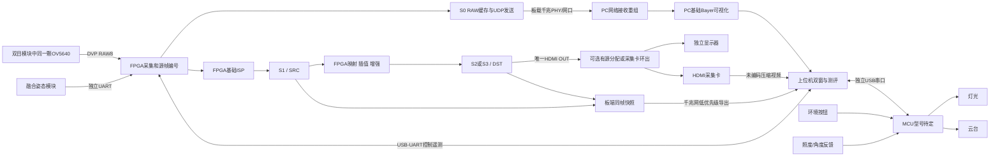

# 上位机硬件连接与通信

2026-10-07 几何显示增量：Web 经唯一串口控制会话发送 0x35，查询 CAPS 0x100，
读取 bank2 20 点坐标/颜色/可见性；不能以 UART ACK 代替 HDMI 实际应用确认。
前后头部与全部 READ 参数版本必须一致，元数据过期或失败即清除独立标记层。
网口仍为 RENH v2 增强 RAW8，叠加不改归档字节；HDMI 帧号 null/unverified。
见 [跨端协议](../FPGA灰度鱼眼矫正参数接口.md) 和
[Web 使用说明](../../host/docs/FPGA几何与显示Web接口.md)。此增量不代表已做硬件联调。

RAW8 整板增量：独立 0x71/ACK `RAW8` 启动候选，PRAW 描述符 0x38574152、param_version=1、1080p/Bayer=4；旧 0x70/TEST 不适用。每次冷启动新建 epoch，并以 host 的 `prepare_raw8_boot.py` 离线生成匹配的 boot/receiver 配置。按 [启动与预览说明](../../host/docs/RAW8双路候选启动与预览.md) 显式下发；Web 不自动写串口，不修改系统网络。来源仍 hardware_unverified，HDMI 帧身份保持 null。

通信联调增量（2026-09-22）：[MINI 通信候选](../FPGA通信上板联调方案.md)使用板载 CP2102（115200/8N1）模拟 MCU，启动前需专用 0x70 显式单播地址和新 epoch，不能假设现有 host UI 已会自动配置。只发 TEST 合成帧，无 ARP/ping/DHCP/网络 RX，无摄像头/HDMI。收到 descriptor_id=0x54534554 的数据必须标记 synthetic，不纳入真图测评；保持原正式 PRAW 线格式与同帧验收约定。真实 MCU 接线和实网 host 接收仍需联调，未执行上板；见[候选报告](../../fpga/reports/comms_board_candidate_20260922.md)。

实施进展（2026-09-07）：细化固定1400B分块、RAW4帧/100ms/64帧号窗口、快照单组/2s及缺块段API；UART握手、重读、释放尚未实现，不能跳过设备能力回读。 详见[协议与核心实现](../../host/docs/千兆网视频协议与上位机实现.md)及[软件验证记录](../../host/reports/PRAW_V1软件验证记录.md)。

版本：V2.0
状态：待实施规格；本文没有声明设备、驱动、协议或联调已经完成。
基线：PG2L100H（盘古100Kmini）＋同一颗OV5640 DVP RAW8；S0千兆网回传、FPGA结果单HDMI回采，目标真实1920×1080@30fps。地址与协议以[跨端回传方案](../OV5640_RAW8千兆网与HDMI双路回传方案.md)为权威。

本文定义 PC 如何连接 FPGA、MCU、视频采集与测量设备，规定各链路的输入、输出、接收处理和验收要求。完整数据字段、单位、唯一键和文件结构以 [输入输出与数据约定](./00_输入输出与数据约定.md) 为准；指标计算见 [算法处理与测评](./02_算法处理与测评.md)，实施阶段见 [开发流程和规划](./03_开发流程和规划.md)。

## 1. 职责与待确认项

FPGA侧实现进展索引（2026-09-21）：[通信子系统与PRAW发送](../FPGA通信子系统与PRAW发送实现V1.md)。PRAW V1字段不变，以现有host解码器校验RTL输出；MCU二进制端点需固件适配，真实千兆网仍未上板验证。

### 1.1 三端职责

| 端 | 必须负责 | 上位机需要确认的结果 |
| --- | --- | --- |
| FPGA | DVP RAW8接收、S0网络发送、ISP、几何映射、插值、增强、帧缓存、HDMI、IMU绑定 | 实际生效参数、源帧身份、视频计数、同帧快照、板端时间戳及错误状态 |
| MCU | 云台/电机、分区灯光、实体按钮、环境传感器与设备端保护 | 命令执行状态、实际照度、按键事件、角度反馈来源、停止/限位状态 |
| PC | 设备管理、通信、参数配置、采集、参考调用、测评与测试调度 | 可追溯图像、事件、计算结果、报告与异常记录 |

MCU 型号、融合 IMU 型号、照度传感器、云台控制器、采集卡和高速导图实现尚未冻结。文档中的接口名称是设计语义，不代表已分配的引脚、COM 号、网络地址、TCP/UDP 端口或命令编号。

PC 不转发相机主视频，不提供软件几何fallback，也不承担主视频的逐像素实时矫正；算法参考实现的权威来源是 `fpga/model/`，由 `host/src/` 的适配层调用。MCU 不把“夜间档”直接转换成 FPGA Gamma 参数，自适应增强应由实际图像统计触发。

### 1.2 开工前形成连接配置表

| 项目 | 必填记录 | 缺失时限制 |
| --- | --- | --- |
| FPGA 实物 | 板卡型号/修订、位流版本、匹配原理图、供电、接口电平 | 不猜引脚，不连接未确认电平的外设 |
| 相机 | 模组、分辨率、RAW/Bayer格式、曝光/增益读回能力 | 模式或图像格式未确认时，不启动正式精度检测 |
| PC–FPGA | USB桥接器信息、逻辑设备身份、协议版本、波特率 | COM 枚举成功不表示连接到了正确设备 |
| PC–MCU | 设备身份、协议版本、供电/复位行为 | 不能借用 FPGA 串口客户端直接解释任意 MCU 固件 |
| IMU–FPGA | 型号、电平、输出协议、更新率、时戳与融合延迟 | 未确认时显示未配置，不生成有效姿态数据 |
| 视频采集 | 采集卡型号、驱动版本、实际接收尺寸/帧率/像素格式 | 不以商品标称能力代替当前运行模式 |
| 快照数据口 | 已实现传输方式、能力、吞吐、错误检测 | PHY 或连接灯亮不表示能导出图像 |
| 环境设备 | 机械行程/回零方式、光照量程、反馈与事件时间来源 | 未测量的角度和照度不得标成真值 |

设备配置写入 `host/config/`，不得在代码中写死当前电脑的 COM 编号。设备身份优先结合序列号与握手回应确认；同型号无序列号设备需要人工绑定端口并保存依据。

## 2. 物理连接和输入输出

### 2.1 连接拓扑



千兆网承载S0 RAW8及限流的低频诊断，HDMI承载FPGA结果。PC不转发相机主视频；双目左右传感器不能分别充当原图和对应结果。板载PHY/连接灯不表示MAC、UDP发送与应用协议已实现。

结果同时服务显示器和PC时，使用经验证有源分配器或环出；没有分配设备时按实际连接分别验证。相机、FPGA及分配设备需保持独立供电/EDID，加载参数后断开PC控制与网络仍应能独立显示并响应板上按键；断网期间不计RAW连续回传通过。

两路各自保持完整1920×1080，第二HDMI发送器、FPGA分屏缩小图像及单HDMI60交替原图/结果均不是当前主线。

### 2.2 分链路输入、输出和处理

| 链路 | PC 发出/配置 | PC 接收 | PC 处理结果 |
| --- | --- | --- | --- |
| PC–FPGA 控制口 | 能力查询、参数写入/提交、模式、快照、计数查询 | 状态、执行事件、参数回读、计数、快照描述符 | 连接状态、实际配置、请求完成状态、图像关联依据 |
| FPGA–PC RAW口 | 通过控制口配置模式、能力和启停 | IPv4 UDP RAW8块与板端源帧键 | 完整RawFrame、基础预览及丢包/重组统计 |
| PC–FPGA 诊断口 | 冻结的分块读/重传/释放 | 同帧S1＋S2/S3、有效域或坐标 | 严格FrameBundle；与RAW共用千兆网并限流 |
| FPGA–采集卡–PC | 选择实际1080p模式、启停采集 | FPGA结果、SDK序号/时戳、格式与错误 | CaptureFrame；source_frame_id默认null，配对未验证 |
| PC–MCU | 灯光目标、运动目标、速度、停止、机械回零 | 接受/执行状态、事件、实测环境、设备故障 | 工况状态、环境时间线、到位和稳定判断 |
| IMU–FPGA | PC 经 FPGA 查询配置和状态；不转发每个姿态包 | FPGA 转出的姿态、接收时刻、年龄、同步质量 | 本帧姿态显示与同步有效性判断 |
| 外部量具 | 按仪器能力导入文件或读取测量记录 | 实际角度、LED/屏幕光变时间等 | 独立真值和系统延迟证据 |

只提供输出视频不足以完成实现精度验证；只提供 IMU 最新值不足以重建旧帧。两者均应经元数据关联到实际源帧。

### 2.3 接线与供电要求

- PC–FPGA 控制口优先沿用现有设计的板载 USB-UART；实际桥接器与板卡修订以实物核对为准。
- IMU 使用独立 FPGA UART 接收资源，PC 控制口、MCU 控制口与 IMU 口不得无仲裁并接。一个 UART 接收脚也不能直接接两个发送端。
- 对裸 UART 核对发送/接收方向、I/O 电平和接地方案。RS-232/RS-485 与 TTL/CMOS UART 不是同一电气接口，需要匹配收发器。
- 电机和照明按各自额定要求供电；不默认由 FPGA 排针或 PC USB 提供负载电流。核对公共地、隔离和反灌电条件。
- 相机与 IMU 使用刚性共同支架；运动线缆留出行程并固定应力释放点，记录拆装后是否复核安装旋转。
- 打开串口时显式管理 DTR/RTS 等控制线，确认是否会复位设备；不把意外复位误判成协议故障。
- 可选 MCU–FPGA 事件线需另行冻结电平、方向、脉宽、同步方式和事件号关联；未接入时不宣称已有硬件同步。

## 3. 通道带宽与视频采集

### 3.1 按实际载荷预算

RAW8每像素1 byte，RGB888每像素3 byte；MB为十进制，MiB为2²⁰ byte。IPv4 UDP/MTU1500、64字节头、最多1400字节图像及CRC32按跨端方案§6实现，UART CRC16不变。

| 内容 | 载荷 | 约束 |
| --- | --- | --- |
| 单张S0 | 2,073,600 byte，约1.978 MiB | 线上stride1920，不含DDR行填充 |
| RAW8 30fps | 62.208 MB/s＝497.664 Mbps | 基线实时原图回传 |
| RAW分包 | 1482包/帧：1481×1400＋末包200 byte，44,460包/s | 头、UDP/IP、以太网与时隙开销另计 |
| RAW30线上预算 | 无VLAN，含应用头和以太网时隙约543.9024 Mbps | 是预算，需实测MAC/网卡/队列能力 |
| S1或结果RGB888 | 6,220,800 byte，约5.93 MiB/张 | RGB888 30fps需186.624 MB/s，千兆网不支持该整路 |
| S1＋结果快照 | 12,441,600 byte，约11.87 MiB/组 | 1Hz约108.7763 Mbps线上预算，仅作有条件上限 |
| RAW30＋1Hz快照 | 线上合计约652.6787 Mbps | 附加标签、控制、重传与突发另计；DDR/网络均需留余量 |
| HDMI RGB888 30fps回采 | 净186.624 MB/s | 32bit采集格式按4 byte/像素重算 |
| HDMI60重复30fps结果 | 回采RGB888净373.248 MB/s | 内容重复不减少USB负载，也不证明算法60fps |
| RAW8 60fps | 净995.328 Mbps，线上约1087.8048 Mbps | 超过千兆；换真60输入后数据口也需重新设计 |
| UART115200、8N1 | 理论11,520 byte/s | 彩色双图约18分钟，仅作静态受限诊断 |

默认长稳每60秒1组快照；短时精度测试可在RAW30和主视频无丢帧条件下试到1Hz。2小时连续RAW净数据约447.9GB，RGB888结果约1.344TB，因此默认持续接收/计数、按策略归档，不默认全程落盘。每60秒一组快照2小时约1.49GB，另计参考和异常加采。

相机采集、处理、HDMI扫描和RAW实时发送优先，快照复制/导出有配额与忙状态。先延后新诊断或降GUI刷新，不能静默降分辨率、降输入帧率或压缩编码后宣称1080p30通过。

### 3.1.1 RAW网络接收、重组和异常

1. 握手核对身份、模式、协议、RAW8、Bayer、帧号、参数和描述符；能力未知不自动启动正式验收。
2. 按跨端方案§6校验64字节头、CRC-32/ISO-HDLC、长度/范围/类型后，以stream_epoch＋frame_id＋packet_type＋descriptor_id重组；不能另造头布局。
3. 依据packet_index/count、payload_offset/bytes和frame_bytes核对完整覆盖；RAW1482包尾块200字节。接受合法乱序和相同重复并计数，重复偏移内容冲突判失败。
4. 起始PC配置最多4个在途RAW帧、单帧100ms期限，均为待实测冻结值；按真实字节限制队列，超时/超限整体失败，不补零、不混入别帧。
5. 只有全部有效字节覆盖和校验通过才提交RawFrame。首版实时补传须受原槽保留、截止和带宽限制；不支持时明确拒绝，不无限阻塞后续帧。独立快照补读不依赖已覆盖RAW槽。
6. FPGA网络拥堵/断开不堵塞主视频；PC恢复后核对代次、模式、参数，旧包不能拼入新流。记录板端发送完成/丢弃和PC重组完成/缺包/超时，分清处理与传输故障。
7. 原图证据采用未压缩.raw，彩色快照采用.rgb，另存metadata；PNG只作派生预览。DDR RAW stride2048和RGB stride6144由FPGA转成线上1920/5760，PC不得把填充当像素。
8. 网络接收、HDMI采集、基础ISP和测评分别排队。GUI可丢旧显示任务，RAW完整性计数独立连续；接收缺口仍使对应连续回传验收失败/降级。

### 3.2 采集卡链路校验

1. 工程测试模式输入已知彩条、灰阶、单像素线、不对称图案和完整边框；图案编码帧号仅用于链路测试，正式有效像素不得被标记覆盖。
2. 在 PC 读取实际模式，检查尺寸、帧率、裁剪、旋转、通道顺序、色度抽样、量程和压缩。
3. 对比已知图案与接收结果，记录驱动或采集设备是否额外缩放；预览窗口缩放与原始采集尺寸分别记录。
4. 检查相同源帧的显示重复和采集遗漏。1080p60 显示重复 30fps 结果时，不能宣称处理达到了 60fps。
5. 冻结通过校验的模式与驱动配置；更换采集卡、端口、驱动或视频模式后复核。

采集卡未编码压缩、RGB/YCbCr、4:4:4/4:2:2、位深和量程分别验证；YUY2虽无视频编码仍可能发生色度抽样。未经验证的CaptureFrame保留source_frame_id=null和pairing_status=unverified，不能把串口/网络帧号直接赋给它。

正式像素误差和 MTF 优先采用板端无损数据。经采集卡测得的清晰度包含该链路影响，必须明确标注；将采集结果保存为 PNG 只避免后续有损编码，不撤销已有采集误差。

## 4. 控制协议与客户端行为

### 4.1 编解码基线

PC–FPGA 沿用项目现有规划的封包；PC–MCU 拟采用同一外层规范，但各端命令与能力分别协商。MCU 是否支持该协议应在固件联调时确认。

```text
55 AA | version:u8 | cmd:u8 | seq:u16 | length:u16 | payload | CRC16:u16
```

- 多字节字段小端，`length` 为载荷字节数，载荷上限 1024 byte。
- CRC-16/CCITT-FALSE：多项式 0x1021，初始值 0xFFFF，不反射，xorout 为 0；覆盖 `version` 至 `payload`，CRC 也按小端发送。
- 命令编号、版本兼容规则、响应/事件编码应由跨端协议表统一冻结，本文件不自行分配。
- 分块图像的块元数据也占载荷，不能在 1024 byte 数据之外再额外附加未计入长度的字段。
- 控制UART上限不限制独立网络数据口；UDP图像头/CRC32按跨端方案§6实现，补传与能力按实际版本协商，不在host另造格式。

解析器按流处理半包、粘包、垃圾前缀和连接中断：同步包头 → 有界读取头部 → 检查版本/长度 → 收齐载荷及CRC → 校验 → 分派。CRC 失败包只丢弃并计数，不执行其命令，也不以不可信的序号更新请求状态。

初期调试可采用整包超时 300 ms、普通查询超时 1 s、最多 2 次重试；这些是起点，应按实际波特率、最大包和设备响应冻结。最大 1034 byte 包在 115200、8N1 下纯线传输约 90 ms。运动、快照和长操作有独立完成超时，不能用普通查询超时判定执行失败。

### 4.2 操作生命周期

| 状态 | 设备含义 | PC 必须采取的动作 |
| --- | --- | --- |
| REJECTED | 请求未获准，例如范围、版本或资源不满足 | 显示原因；不更新当前配置，不继续依赖该操作的采样 |
| ACCEPTED | 请求已校验并接受/排队 | 记为处理中，等待执行事件或查询确认 |
| APPLIED | 请求已实际执行，返回版本和关联帧/事件 | 回读或核对实际状态；随后判断工况是否稳定 |
| FAILED | 接受后执行失败 | 保留失败和真实设备状态，终止或按预定策略恢复 |

“参数已发送”“收到 ACK”“设备已生效”和“环境已稳定”是不同阶段。灯光驱动已设置不代表实测照度已稳定，运动开始也不代表已到位；上位机必须检查反馈、持续时间与超时条件。

PC读取真实标定文件并封装K/D；FPGA自行解包、CRC/范围/模式校验，装载fx/fy/cx/cy/k1/k2/p1/p2及格式。回读必须来自实际寄存器，不只回显接收数据。PC文件解析与FPGA参数协议解析分别验收。

参数写入影子区并整组校验，按帧commit后实际用于逆映射，并按有效源帧号确认。GUI 同时显示待提交值和当前生效值，避免将编辑框值直接当作实验参数。机械回零与 FPGA 参考姿态重置使用独立操作与事件记录。

### 4.3 重试、重复请求和事件

- 握手建立会话；同一请求重传保持请求身份和载荷摘要，重复回应不得重复触发 GUI 动作。
- 优先采用“设置为指定状态”，避免“再切换一次”。运动/回零等动作不得因超时盲目重复执行。
- 同会话、同序号、同命令、同载荷应返回原结果；同序号不同载荷应拒绝。序号回绕和回应缓存边界须纳入协议测试。
- 若回应丢失，先查询操作状态；无法确认是否执行的操作标记状态未知，不能自动当作从未执行。
- 实体按钮由 MCU 产生事件并更新实际状态，PC 不应随后用旧界面目标自动覆盖。自动测试中人工干预按测试配置中止当前工况或标记受干预。
- MCU 事件需要递增身份与时间来源；事件日志覆盖或序号缺口应上报，不能悄然补成连续曲线。
- 确认保护条件后，设备端负责执行通信失联时的运动策略；PC 断开后不能依靠 PC 再发送停止来实现失联保护。

## 5. 同帧快照与接收处理

### 5.1 采集位置与容量

标准精度样本取 S1（基础 ISP 后、几何前 RGB888）作为输入，输出取 S2 或 S3 中一个明确观测点，并位于 OSD、分屏与显示缩放之前。是否启用增强、增强位置和实际 LUT 必须绑定该帧。

统一DDR规划如下；其他元数据、掩码、坐标和日志另计：

| 区域 | 起始地址 | 大小/用途 |
| --- | --- | --- |
| SRC0～SRC2 | 0x00000000、0x00800000、0x01000000 | 各8 MiB，S1 RGB888，DDR stride6144 |
| DST0～DST2 | 0x01800000、0x02000000、0x02800000 | 各8 MiB，结果RGB888，DDR stride6144 |
| RAW0～RAW2 | 0x03000000、0x03400000、0x03800000 | 各4 MiB，RAW8，DDR stride2048 |
| snap_S1 | 0x03C00000 | 8 MiB独立输入快照 |
| snap_result | 0x04400000 | 8 MiB独立选定结果快照 |

区域结束于0x04C00000，共76 MiB；使用前核对真实DDR配置/地址，这不代表已测得实物容量。RAW发送引用、SRC处理引用和DST显示引用分别管理，PC不能无限锁住实时帧槽。两快照槽支持一组S1＋一个S2/S3；增加S0/多个输出或多组快照须另增资源与能力。

FPGA核对复制期限及DDR仲裁，PC依实际能力启用采样。网络S0不能冒充严格几何测评的板端S1。

### 5.2 一次采样的完成条件

1. PC 检查磁盘预算、接收队列及所需能力，发送快照请求并记录请求目标。
2. FPGA 接受或返回忙；接受后选择实际可获取源帧，安全复制输入与同源输出到独立槽。
3. 全部图像写入与关联参数锁定完成后，设备发出 READY 类完成事件，返回实际帧身份和快照身份。
4. PC 获取描述符，按目标指标核对所需参数实体、长度、像素格式、观测点和有效性；仅阻止缺少必要字段的对应分析，并保留其他可计算项目。
5. 按块读取，以快照身份、图像类型、偏移和有效长度组装；核对 CRC、范围、重复块与完整字节覆盖。
6. 重传只补读原快照缺失块，不允许新帧的数据补入旧样本。输入输出同帧且参数一致后，才向分析模块提交。
7. 证据在 `host/data/` 完整落盘、生成文件校验和后发送释放请求；测评结果由后续流程写入 `host/reports/`。
8. 释放失败时查询槽状态并按协议恢复，不立即请求覆盖该槽；保存中断的样本标记为不完整，不能作为有效证据。

PC 应用临时文件或同等提交机制，避免半写图像被正常样本索引引用。块校验与主机 SHA-256 都应保留；板端未计算全帧哈希时，不声称主机哈希已与板端全帧哈希比对。

写盘失败、用户取消或传输超时时，停止新请求，保存已收数据和失败原因，再按明确取消/释放流程结束占用。不能因磁盘满而无限占用快照槽，也不能静默丢弃旧证据。FPGA 视频主链不应等待 PC 完成传输。

### 5.3 高速通道尚未就绪时

允许使用冻结单帧 UART 导出、明确 ROI 导出、既有证据回放和协议模拟推进开发。报告必须标记静态诊断、局部范围或模拟来源；不能把该模式写成实时全帧精度采集完成。

低频快照不能证明每一动态帧的峰值误差。动态验收需要连续原分辨率数据或经验证的逐帧特征观测，并保留源帧覆盖率；条件不足时只报告采样结果。完整方法见 [算法处理与测评](./02_算法处理与测评.md)。

## 6. 时间同步、计数与重连

### 6.1 时间来源

| 时间 | 产生位置 | PC 可用于什么 |
| --- | --- | --- |
| 图像输入/处理/首次输出时间 | FPGA 统一计数域或已验证跨域机制 | 计算指定端点的板端延迟 |
| IMU 时间、FPGA 接收时间 | IMU / FPGA | 建立时基转换、估计姿态年龄与融合/传输延迟 |
| MCU 驱动/按钮事件时间 | MCU | 环境事件顺序和响应测试；跨端比较前需要同步关系 |
| 实际光照变化时间 | 光传感器或外部量具 | 光照响应起点 |
| PC 接收时间 | PC 单调时钟 | 调度、超时、通信延迟观察；不替代曝光或 FPGA 处理时间 |
| 场景到屏幕时间 | 外部测量设备 | 包括相机、处理和显示器的系统延迟 |

记录计数频率、位宽、复位/回绕规则及时基关系，不能直接相减不同设备的原始计数。只有 UART 接收时间时，应标记近似同步并记录不确定度。VSYNC/首像素不自动等于曝光中心；姿态必须按实际定义的曝光参考时刻匹配并随源帧锁定。

输出尚未显示时，首次显示时间保持空值，后续按同一源帧身份补齐；不使用预测值计算测量成绩。缺少该显示端点会阻止相关延迟计算，但不自动阻止字段齐全的几何测量。PC 侧预览到达时间包含采集、驱动和队列延迟，不能标为 FPGA 硬件延迟。

### 6.1.1 两通道配对

S0具板端源帧键，HDMI采集帧只有采集通道的序号/时戳。实时两窗可分别显示最新完整帧，但标同帧未验证；不按到达顺序、固定软件延迟或当前输出帧号消息构造严格配对。

升级verified需要验证逐帧附加信息，或建立包含板端输入/输出映射、共同时间基准、重复/丢帧/重连恢复的完整机制。共同硬件时戳也不自动补全源帧身份。默认正式精度使用板端S1＋S2/S3同帧快照，低频快照只证明抽样帧。

### 6.2 分层计数与连接状态

至少分别记录输入/处理完成、唯一/重复显示、RAW发送完成/丢弃、UDP缺包/乱序/冲突、重组完成/超时、HDMI遗漏、GUI丢旧、视频溢出/欠载、快照拒绝/失败、分析拒绝、CRC、IMU过期与MCU遗漏。相机无内部序号时，只能报告 FPGA 可观察输入边界之后的丢失。

设备状态建议采用断开、连接中、能力确认、就绪、降级、故障等明确状态。拔插后重新握手并核对设备身份、协议、位流、实际参数、视频模式、计数代次及未释放快照，不从旧 GUI 状态推断设备状态。

PC重连建立新的通信会话，不重标在途图像或保留快照。stream_epoch只在采集重启、设备复位或模式切换等明确源帧边界更新；旧描述符保留旧代次。旧会话回应不得完成新请求；旧代次的帧不能与新帧拼成图像对。未确认是否完成的测试工况保持中断，不自动继续运动或重置参考姿态。

## 7. 联调与验收

### 7.1 无硬件阶段可交付的内容

| 模拟输入 | 要验证的客户端行为 | 不代表已完成的能力 |
| --- | --- | --- |
| 正常/分段/粘连/坏CRC报文 | 编解码、同步恢复、超时和统计 | 真实电气链路和设备执行 |
| ACCEPTED后延迟APPLIED、失败或断连 | 操作状态机，不提前采样，不重复运动 | 设备执行时间和机械精度 |
| 分块双图，包含乱序/重复/缺块 | 完整性、同帧配对、错误隔离 | DDR 实时复制和高速口吞吐 |
| 不同位流能力、缺少快照/姿态能力 | 界面禁用不支持用例，结果标未实现 | 实物功能覆盖 |
| 设备重启、序号回绕、历史回应 | 会话隔离、流代次处理和重连 | 实物长稳与硬件CDC |
| 磁盘预算不足或模拟写盘失败 | 停止新采样、部分记录、正确释放 | 实际长时间存储吞吐 |

模拟来源在界面、清单和报告中显式标识，不计入真实硬件成绩。回放真实证据可以复算历史测量，但必须保留原采集时间、来源和本次重算时间，不能当作本次新的实时采集或长稳证据。已知图案可以用于工程测试，但真实相机标定与实测不能由模拟参数替代。

### 7.2 首日接线检查顺序

1. 核对板卡修订、引脚、电平、供电、云台行程及线缆，建立设备清单与连接照片。
2. 先保持运动停止，以实际设备枚举结果连接 PC–FPGA 和 PC–MCU；读取身份和能力，不立即发送运动或改参命令。
3. 检查串口打开/关闭不会意外复位；查询状态、版本和计数，确认坏包不会执行操作。
4. 检查 FPGA 视频模式与已知图案，再接相机验证颜色、行列、帧号与有效输入速率。
5. 独立接入 IMU，用单轴小角度运动确认正方向、坐标转换、时间戳和过期检测；不用 IMU 自报值充当独立角度真值。
6. 分别手动切灯和执行云台小范围动作，确认按钮事件、实际状态、停止和回零；随后验证 PC 发起同类操作。
7. 接显示器和采集卡，核对 HDMI 分配/环出、采集格式及重复帧；保留已知图案证据。
8. 验证千兆MAC/UDP、1482包重组、Bayer/stride、坏包/超时后，开启完整S0 1080p30并与HDMI结果同时运行。
9. 获取一组板端S1＋S2/S3无损同帧快照，完成校验、未压缩落盘和释放；在RAW30与主视频无丢帧前提下提高抽样频率。

### 7.3 分项完成证据

| 检查项 | 通过依据 | 证据落点 |
| --- | --- | --- |
| 身份与连接 | FPGA/MCU 独立识别，重连不串台，无未经确认电平连接 | `host/data/` 连接记录与配置快照 |
| 参数提交 | 坏包/非法值被拒绝，合法配置回读一致且关联实际生效帧 | 命令日志、参数实体、帧元数据 |
| 双图完整性 | 输入/输出同源、无遗漏字节、CRC正确、版本齐全、可追溯释放 | 成对图像、描述符、块记录、哈希 |
| RAW实时链 | 完整1080p30、包覆盖/CRC、连续接收，失联不堵主视频 | 配置、网络/板端/PC计数及异常 |
| 双窗来源 | PC仅基础可视化，HDMI来自FPGA，未验证关联不冒充同帧 | 接线、标签、独立显示与板上按键演示 |
| 快照负载 | RAW持续开启，关闭/开启限流快照分别测量，忙拒绝可见 | 分层计数与两组性能记录 |
| 环境控制 | PC和实体按键均产生可关联事件，实际到位/稳定判断可复查 | 环境事件、照度/角度曲线 |
| 异常恢复 | 断连/坏包/失锁/快照取消有明确状态与恢复范围 | 故障用例日志和部分样本标记 |
| 长稳 | 正式不少于2小时，冻结版争取8小时，30分钟只作快速回归 | `host/reports/` 对应版本报告及数据引用 |

只将实际执行并具备证据的检查标记完成。未接入硬件、缺能力、图像损坏、事件漏记和同步不确定分别保留原因，不能以正常显示画面代替所有链路验收。

## 8. 依据与目录约束

- [项目工作约定](../../AGENTS.md)：上位机代码归 `host/src/`，采集证据归 `host/data/`，测评报告归 `host/reports/`；FPGA 模型归 `fpga/model/`。
- [上位机开发区](../../host/README.md)：配置、脚本、测试、构建和发布均在 `host/` 对应目录。
- [PG2L100H 详细设计](../PG2L100H_1080p畸变矫正详细设计方案.md)：平台、RGB888视频池、UART与实现基线。
- [可控光照箱与上位机测评详细实施方案](../可控光照箱与上位机测评详细实施方案.md)：IMU直连、快照扩展、协议和测试流程。

仅根目录 `reference/` 与 `PDS/` 按现有规则排除；本文不新增忽略目录，不将业务报告迁移到 `output/`，也不要求把实现依赖留在被忽略的参考区。发生跨端接口变更时，同步维护共享协议、各端实现和测试。
