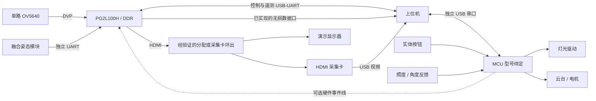

# 上位机硬件连接与通信

版本：V1.0  
状态：待实施规格；本文没有声明设备、驱动、协议或联调已经完成。  
基线：PG2L100H（盘古 100Kmini）＋单路 OV5640 DVP，目标为真实 1920×1080@30fps。

本文定义 PC 如何连接 FPGA、MCU、视频采集与测量设备，规定各链路的输入、输出、接收处理和验收要求。完整数据字段、单位、唯一键和文件结构以 [输入输出与数据约定](./00_输入输出与数据约定.md) 为准；指标计算见 [算法处理与测评](./02_算法处理与测评.md)，实施阶段见 [开发流程和规划](./03_开发流程和规划.md)。

## 1. 职责与待确认项

### 1.1 三端职责

| 端 | 必须负责 | 上位机需要确认的结果 |
| --- | --- | --- |
| FPGA | 相机接收、ISP、几何映射、插值、增强、帧缓存、HDMI、IMU接收与姿态绑定 | 实际生效参数、源帧身份、视频计数、同帧快照、板端时间戳及错误状态 |
| MCU | 云台/电机、分区灯光、实体按钮、环境传感器与设备端保护 | 命令执行状态、实际照度、按键事件、角度反馈来源、停止/限位状态 |
| PC | 设备管理、通信、参数配置、采集、参考调用、测评与测试调度 | 可追溯图像、事件、计算结果、报告与异常记录 |

MCU 型号、融合 IMU 型号、照度传感器、云台控制器、采集卡和高速导图实现尚未冻结。文档中的接口名称是设计语义，不代表已分配的引脚、COM 号、网络地址、TCP/UDP 端口或命令编号。

PC 不承担主视频的逐像素实时矫正；算法参考实现的权威来源是 `fpga/model/`，由 `host/src/` 的适配层调用。MCU 不把“夜间档”直接转换成 FPGA Gamma 参数，自适应增强应由实际图像统计触发。

### 1.2 开工前形成连接配置表

| 项目 | 必填记录 | 缺失时限制 |
| --- | --- | --- |
| FPGA 实物 | 板卡型号/修订、位流版本、匹配原理图、供电、接口电平 | 不猜引脚，不连接未确认电平的外设 |
| 相机 | 模组、分辨率、RAW/Bayer格式、曝光/增益读回能力 | 模式或图像格式未确认时，不启动正式精度检测 |
| PC–FPGA | USB桥接器信息、逻辑设备身份、协议版本、波特率 | COM 枚举成功不表示连接到了正确设备 |
| PC–MCU | 设备身份、协议版本、供电/复位行为 | 不能借用 FPGA 串口客户端直接解释任意 MCU 固件 |
| IMU–FPGA | 型号、电平、输出协议、更新率、时戳与融合延迟 | 未确认时显示未配置，不生成有效姿态数据 |
| 视频采集 | 采集卡型号、驱动版本、实际接收尺寸/帧率/像素格式 | 不以商品标称能力代替当前运行模式 |
| 快照数据口 | 已实现传输方式、能力、吞吐、错误检测 | PHY 或连接灯亮不表示能导出图像 |
| 环境设备 | 机械行程/回零方式、光照量程、反馈与事件时间来源 | 未测量的角度和照度不得标成真值 |

设备配置写入 `host/config/`，不得在代码中写死当前电脑的 COM 编号。设备身份优先结合序列号与握手回应确认；同型号无序列号设备需要人工绑定端口并保存依据。

## 2. 物理连接和输入输出

### 2.1 连接拓扑



HDMI 单输出同时服务显示器和采集卡时，必须使用经验证的分配器或带环出的采集方案，不能假设无源线缆一分二可用。若尚未配备分配设备，先按实际连接方式单独验证显示与采集。

### 2.2 分链路输入、输出和处理

| 链路 | PC 发出/配置 | PC 接收 | PC 处理结果 |
| --- | --- | --- | --- |
| PC–FPGA 控制口 | 能力查询、参数写入/提交、模式、快照、计数查询 | 状态、执行事件、参数回读、计数、快照描述符 | 连接状态、实际配置、请求完成状态、图像关联依据 |
| PC–FPGA 数据口 | 分块读取/重传/释放等已冻结操作 | 无损图像块、有效域或坐标诊断块 | 完整校验后的帧对象与证据文件 |
| FPGA–采集卡–PC | 选择实际视频模式、开始/停止预览 | 预览帧、采集时间、可读帧号、采集错误 | 实时画面、录像及采集侧覆盖率 |
| PC–MCU | 灯光目标、运动目标、速度、停止、机械回零 | 接受/执行状态、事件、实测环境、设备故障 | 工况状态、环境时间线、到位和稳定判断 |
| IMU–FPGA | PC 经 FPGA 查询配置和状态；不转发每个姿态包 | FPGA 转出的姿态、接收时刻、年龄、同步质量 | 本帧姿态显示与同步有效性判断 |
| 外部量具 | 按仪器能力导入文件或读取测量记录 | 实际角度、LED/屏幕光变时间等 | 独立真值和系统延迟证据 |

只提供输出视频不足以完成实现精度验证；只提供 IMU 最新值不足以重建旧帧。两者均应经元数据关联到实际源帧。

### 2.3 接线与供电要求

- PC–FPGA 控制口优先沿用现有设计的板载 USB-UART；实际桥接器与板卡修订以实物核对为准。
- IMU 使用独立 FPGA UART 接收资源，PC 控制口、MCU 控制口与 IMU 口不得无仲裁并接。一个 UART 接收脚也不能直接接两个发送端。
- 对裸 UART 核对发送/接收方向、I/O 电平和接地方案。RS-232/RS-485 与 TTL/CMOS UART 不是同一电气接口，需要匹配收发器。
- 电机和照明按各自额定要求供电；不默认由 FPGA 排针或 PC USB 提供负载电流。核对公共地、隔离和反灌电条件。
- 相机与 IMU 使用刚性共同支架；运动线缆留出行程并固定应力释放点，记录拆装后是否复核安装旋转。
- 打开串口时显式管理 DTR/RTS 等控制线，确认是否会复位设备；不把意外复位误判成协议故障。
- 可选 MCU–FPGA 事件线需另行冻结电平、方向、脉宽、同步方式和事件号关联；未接入时不宣称已有硬件同步。

## 3. 通道带宽与视频采集

### 3.1 按实际载荷预算

下表采用紧凑 RGB888，每像素 3 byte；MB 为十进制，MiB 为 2²⁰ byte。实际协议、掩码和行填充需要另计。

| 内容 | 载荷计算 | 对方案的要求 |
| --- | --- | --- |
| 单张 1080p | 1920×1080×3＝6,220,800 byte，约 5.93 MiB | 接收端先核对尺寸、stride、格式和有效长度 |
| 一组输入/输出 | 12,441,600 byte，约 11.87 MiB | 不能塞入原有单个 8 MiB 诊断区 |
| 单路 RGB888 30fps | 186.624 MB/s，约 1.493 Gbit/s | 千兆网无法无压缩承载该整路视频 |
| 每秒 1 组双图 | 12.44 MB/s，不含其他证据 | 可作为低频目标，需实测数据口及 DDR 开销 |
| UART 115200、8N1 | 理论最多 11,520 byte/s | 一组双图理论约 18 分钟，不用于实时全图采集 |
| 姿态包示例 | 32 byte×200Hz×10＝64,000 bit/s | 仅为容量示例；不代表已选模块能力 |

HDMI 连续预览与无损成对快照分别管理。短时精度测试可从每秒 1 组的目标开始；长稳建议每 60 秒 1 组，实际频率写入报告。每秒 1 组持续 2 小时，仅双图载荷约 89.6 GB；每 60 秒 1 组约 1.49 GB，均未计参考图和录像。

主视频链路优先于快照。PC 先检查磁盘空间和队列上限，FPGA 先检查缓存与复制能力，任一端无法满足时明确拒绝新采样，不用无限队列掩盖吞吐不足。

### 3.2 采集卡链路校验

1. 输入带唯一帧号的已知彩条、灰阶、单像素线、不对称图案和完整边框。
2. 在 PC 读取实际模式，检查尺寸、帧率、裁剪、旋转、通道顺序、色度抽样、量程和压缩。
3. 对比已知图案与接收结果，记录驱动或采集设备是否额外缩放；预览窗口缩放与原始采集尺寸分别记录。
4. 检查相同源帧的显示重复和采集遗漏。1080p60 显示重复 30fps 结果时，不能宣称处理达到了 60fps。
5. 冻结通过校验的模式与驱动配置；更换采集卡、端口、驱动或视频模式后复核。

正式像素误差和 MTF 优先采用板端无损数据。经采集卡测得的清晰度包含该链路影响，必须明确标注；将采集结果保存为 PNG 只避免后续有损编码，不撤销已有采集误差。

## 4. 控制协议与客户端行为

### 4.1 编解码基线

PC–FPGA 沿用项目现有规划的封包；PC–MCU 拟采用同一外层规范，但各端命令与能力分别协商。MCU 是否支持该协议应在固件联调时确认。

```text
55 AA | version:u8 | cmd:u8 | seq:u16 | length:u16 | payload | CRC16:u16
```

- 多字节字段小端，`length` 为载荷字节数，载荷上限 1024 byte。
- CRC-16/CCITT-FALSE：多项式 0x1021，初始值 0xFFFF，不反射，xorout 为 0；覆盖 `version` 至 `payload`，CRC 也按小端发送。
- 命令编号、版本兼容规则、响应/事件编码应由跨端协议表统一冻结，本文件不自行分配。
- 分块图像的块元数据也占载荷，不能在 1024 byte 数据之外再额外附加未计入长度的字段。
- 控制 UART 上限不自动限制独立高速数据口；高速口帧格式、传输协议、分块与重传机制另行冻结，并经相同数据契约适配。

解析器按流处理半包、粘包、垃圾前缀和连接中断：同步包头 → 有界读取头部 → 检查版本/长度 → 收齐载荷及CRC → 校验 → 分派。CRC 失败包只丢弃并计数，不执行其命令，也不以不可信的序号更新请求状态。

初期调试可采用整包超时 300 ms、普通查询超时 1 s、最多 2 次重试；这些是起点，应按实际波特率、最大包和设备响应冻结。最大 1034 byte 包在 115200、8N1 下纯线传输约 90 ms。运动、快照和长操作有独立完成超时，不能用普通查询超时判定执行失败。

### 4.2 操作生命周期

| 状态 | 设备含义 | PC 必须采取的动作 |
| --- | --- | --- |
| REJECTED | 请求未获准，例如范围、版本或资源不满足 | 显示原因；不更新当前配置，不继续依赖该操作的采样 |
| ACCEPTED | 请求已校验并接受/排队 | 记为处理中，等待执行事件或查询确认 |
| APPLIED | 请求已实际执行，返回版本和关联帧/事件 | 回读或核对实际状态；随后判断工况是否稳定 |
| FAILED | 接受后执行失败 | 保留失败和真实设备状态，终止或按预定策略恢复 |

“参数已发送”“收到 ACK”“设备已生效”和“环境已稳定”是不同阶段。灯光驱动已设置不代表实测照度已稳定，运动开始也不代表已到位；上位机必须检查反馈、持续时间与超时条件。

参数写入影子区并整组校验，提交后按有效源帧号确认。GUI 同时显示待提交值和当前生效值，避免将编辑框值直接当作实验参数。机械回零与 FPGA 参考姿态重置使用独立操作与事件记录。

### 4.3 重试、重复请求和事件

- 握手建立会话；同一请求重传保持请求身份和载荷摘要，重复回应不得重复触发 GUI 动作。
- 优先采用“设置为指定状态”，避免“再切换一次”。运动/回零等动作不得因超时盲目重复执行。
- 同会话、同序号、同命令、同载荷应返回原结果；同序号不同载荷应拒绝。序号回绕和回应缓存边界须纳入协议测试。
- 若回应丢失，先查询操作状态；无法确认是否执行的操作标记状态未知，不能自动当作从未执行。
- 实体按钮由 MCU 产生事件并更新实际状态，PC 不应随后用旧界面目标自动覆盖。自动测试中人工干预按测试配置中止当前工况或标记受干预。
- MCU 事件需要递增身份与时间来源；事件日志覆盖或序号缺口应上报，不能悄然补成连续曲线。
- 确认保护条件后，设备端负责执行通信失联时的运动策略；PC 断开后不能依靠 PC 再发送停止来实现失联保护。

## 5. 同帧快照与接收处理

### 5.1 采集位置与容量

标准精度样本取 S1（基础 ISP 后、几何前 RGB888）作为输入，输出取 S2 或 S3 中一个明确观测点，并位于 OSD、分屏与显示缩放之前。是否启用增强、增强位置和实际 LUT 必须绑定该帧。

原视频池按 3 个源槽＋3 个结果槽、每槽 8 MiB 共 48 MiB 规划。原 8 MiB 诊断预留需要扩展为两个 8 MiB 独立快照槽，共 16 MiB；视频池与快照槽合计 64 MiB。描述符、有效掩码、坐标数据和日志需另行安置，不能挤入已满的图像槽而不更新分配。

FPGA 需确认实际 DDR 地址范围、地址无重叠、复制期限和仲裁带宽。两个槽只保证一张输入与一张输出；同时保存多个输出阶段或多组快照需要进一步增加能力。PC 只依据能力回应启用对应采样模式。

### 5.2 一次采样的完成条件

1. PC 检查磁盘预算、接收队列及所需能力，发送快照请求并记录请求目标。
2. FPGA 接受或返回忙；接受后选择实际可获取源帧，安全复制输入与同源输出到独立槽。
3. 全部图像写入与关联参数锁定完成后，设备发出 READY 类完成事件，返回实际帧身份和快照身份。
4. PC 获取描述符，按目标指标核对所需参数实体、长度、像素格式、观测点和有效性；仅阻止缺少必要字段的对应分析，并保留其他可计算项目。
5. 按块读取，以快照身份、图像类型、偏移和有效长度组装；核对 CRC、范围、重复块与完整字节覆盖。
6. 重传只补读原快照缺失块，不允许新帧的数据补入旧样本。输入输出同帧且参数一致后，才向分析模块提交。
7. 证据在 `host/data/` 完整落盘、生成文件校验和后发送释放请求；测评结果由后续流程写入 `host/reports/`。
8. 释放失败时查询槽状态并按协议恢复，不立即请求覆盖该槽；保存中断的样本标记为不完整，不能作为有效证据。

PC 应用临时文件或同等提交机制，避免半写图像被正常样本索引引用。块校验与主机 SHA-256 都应保留；板端未计算全帧哈希时，不声称主机哈希已与板端全帧哈希比对。

写盘失败、用户取消或传输超时时，停止新请求，保存已收数据和失败原因，再按明确取消/释放流程结束占用。不能因磁盘满而无限占用快照槽，也不能静默丢弃旧证据。FPGA 视频主链不应等待 PC 完成传输。

### 5.3 高速通道尚未就绪时

允许使用冻结单帧 UART 导出、明确 ROI 导出、既有证据回放和协议模拟推进开发。报告必须标记静态诊断、局部范围或模拟来源；不能把该模式写成实时全帧精度采集完成。

低频快照不能证明每一动态帧的峰值误差。动态验收需要连续原分辨率数据或经验证的逐帧特征观测，并保留源帧覆盖率；条件不足时只报告采样结果。完整方法见 [算法处理与测评](./02_算法处理与测评.md)。

## 6. 时间同步、计数与重连

### 6.1 时间来源

| 时间 | 产生位置 | PC 可用于什么 |
| --- | --- | --- |
| 图像输入/处理/首次输出时间 | FPGA 统一计数域或已验证跨域机制 | 计算指定端点的板端延迟 |
| IMU 时间、FPGA 接收时间 | IMU / FPGA | 建立时基转换、估计姿态年龄与融合/传输延迟 |
| MCU 驱动/按钮事件时间 | MCU | 环境事件顺序和响应测试；跨端比较前需要同步关系 |
| 实际光照变化时间 | 光传感器或外部量具 | 光照响应起点 |
| PC 接收时间 | PC 单调时钟 | 调度、超时、通信延迟观察；不替代曝光或 FPGA 处理时间 |
| 场景到屏幕时间 | 外部测量设备 | 包括相机、处理和显示器的系统延迟 |

记录计数频率、位宽、复位/回绕规则及时基关系，不能直接相减不同设备的原始计数。只有 UART 接收时间时，应标记近似同步并记录不确定度。VSYNC/首像素不自动等于曝光中心；姿态必须按实际定义的曝光参考时刻匹配并随源帧锁定。

输出尚未显示时，首次显示时间保持空值，后续按同一源帧身份补齐；不使用预测值计算测量成绩。缺少该显示端点会阻止相关延迟计算，但不自动阻止字段齐全的几何测量。PC 侧预览到达时间包含采集、驱动和队列延迟，不能标为 FPGA 硬件延迟。

### 6.2 分层计数与连接状态

至少分别记录输入完整帧、处理完成帧、唯一显示结果、正常重复显示、视频溢出/欠载、快照拒绝/失败、PC 接收缺帧、解码失败、分析拒绝、CRC 错误、IMU 过期与 MCU 事件遗漏。相机无内部序号时，只能报告 FPGA 可观察输入边界之后的丢失。

设备状态建议采用断开、连接中、能力确认、就绪、降级、故障等明确状态。拔插后重新握手并核对设备身份、协议、位流、实际参数、视频模式、计数代次及未释放快照，不从旧 GUI 状态推断设备状态。

PC 重连建立新的通信会话；设备复位、视频模式重新开始或帧号重新起算时更新流代次。旧会话回应不得完成新请求；旧代次的帧不能与新帧拼成图像对。未确认是否完成的测试工况保持中断，不自动继续运动或重置参考姿态。

## 7. 联调与验收

### 7.1 无硬件阶段可交付的内容

| 模拟输入 | 要验证的客户端行为 | 不代表已完成的能力 |
| --- | --- | --- |
| 正常/分段/粘连/坏CRC报文 | 编解码、同步恢复、超时和统计 | 真实电气链路和设备执行 |
| ACCEPTED后延迟APPLIED、失败或断连 | 操作状态机，不提前采样，不重复运动 | 设备执行时间和机械精度 |
| 分块双图，包含乱序/重复/缺块 | 完整性、同帧配对、错误隔离 | DDR 实时复制和高速口吞吐 |
| 不同位流能力、缺少快照/姿态能力 | 界面禁用不支持用例，结果标未实现 | 实物功能覆盖 |
| 设备重启、序号回绕、历史回应 | 会话隔离、流代次处理和重连 | 实物长稳与硬件CDC |
| 磁盘预算不足或模拟写盘失败 | 停止新采样、部分记录、正确释放 | 实际长时间存储吞吐 |

模拟来源在界面、清单和报告中显式标识，不计入真实硬件成绩。回放真实证据可以复算历史测量，但必须保留原采集时间、来源和本次重算时间，不能当作本次新的实时采集或长稳证据。已知图案可以用于工程测试，但真实相机标定与实测不能由模拟参数替代。

### 7.2 首日接线检查顺序

1. 核对板卡修订、引脚、电平、供电、云台行程及线缆，建立设备清单与连接照片。
2. 先保持运动停止，以实际设备枚举结果连接 PC–FPGA 和 PC–MCU；读取身份和能力，不立即发送运动或改参命令。
3. 检查串口打开/关闭不会意外复位；查询状态、版本和计数，确认坏包不会执行操作。
4. 检查 FPGA 视频模式与已知图案，再接相机验证颜色、行列、帧号与有效输入速率。
5. 独立接入 IMU，用单轴小角度运动确认正方向、坐标转换、时间戳和过期检测；不用 IMU 自报值充当独立角度真值。
6. 分别手动切灯和执行云台小范围动作，确认按钮事件、实际状态、停止和回零；随后验证 PC 发起同类操作。
7. 接显示器和采集卡，核对 HDMI 分配/环出、采集格式及重复帧；保留已知图案证据。
8. 获取一组无损同帧双图，完成元数据、块校验、落盘和释放，再尝试提高抽样频率。

### 7.3 分项完成证据

| 检查项 | 通过依据 | 证据落点 |
| --- | --- | --- |
| 身份与连接 | FPGA/MCU 独立识别，重连不串台，无未经确认电平连接 | `host/data/` 连接记录与配置快照 |
| 参数提交 | 坏包/非法值被拒绝，合法配置回读一致且关联实际生效帧 | 命令日志、参数实体、帧元数据 |
| 双图完整性 | 输入/输出同源、无遗漏字节、CRC正确、版本齐全、可追溯释放 | 成对图像、描述符、块记录、哈希 |
| 快照负载 | 关闭/开启快照分别测量，忙拒绝可见，主视频不被阻塞 | 分层计数及两组性能记录 |
| 环境控制 | PC和实体按键均产生可关联事件，实际到位/稳定判断可复查 | 环境事件、照度/角度曲线 |
| 异常恢复 | 断连/坏包/失锁/快照取消有明确状态与恢复范围 | 故障用例日志和部分样本标记 |
| 长稳 | 正式不少于2小时，冻结版争取8小时，30分钟只作快速回归 | `host/reports/` 对应版本报告及数据引用 |

只将实际执行并具备证据的检查标记完成。未接入硬件、缺能力、图像损坏、事件漏记和同步不确定分别保留原因，不能以正常显示画面代替所有链路验收。

## 8. 依据与目录约束

- [项目工作约定](../../AGENTS.md)：上位机代码归 `host/src/`，采集证据归 `host/data/`，测评报告归 `host/reports/`；FPGA 模型归 `fpga/model/`。
- [上位机开发区](../../host/README.md)：配置、脚本、测试、构建和发布均在 `host/` 对应目录。
- [PG2L100H 详细设计](../PG2L100H_1080p畸变矫正详细设计方案.md)：平台、RGB888视频池、UART与实现基线。
- [可控光照箱与上位机测评详细实施方案](../可控光照箱与上位机测评详细实施方案.md)：IMU直连、快照扩展、协议和测试流程。

仅根目录 `reference/` 与 `PDS/` 按现有规则排除；本文不新增忽略目录，不将业务报告迁移到 `output/`，也不要求把实现依赖留在被忽略的参考区。发生跨端接口变更时，同步维护共享协议、各端实现和测试。
