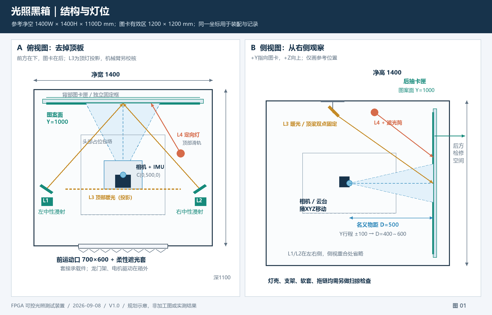
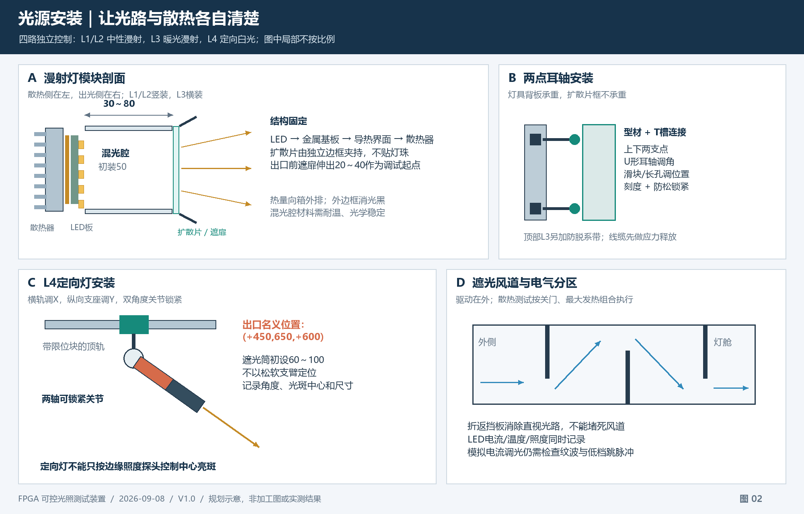
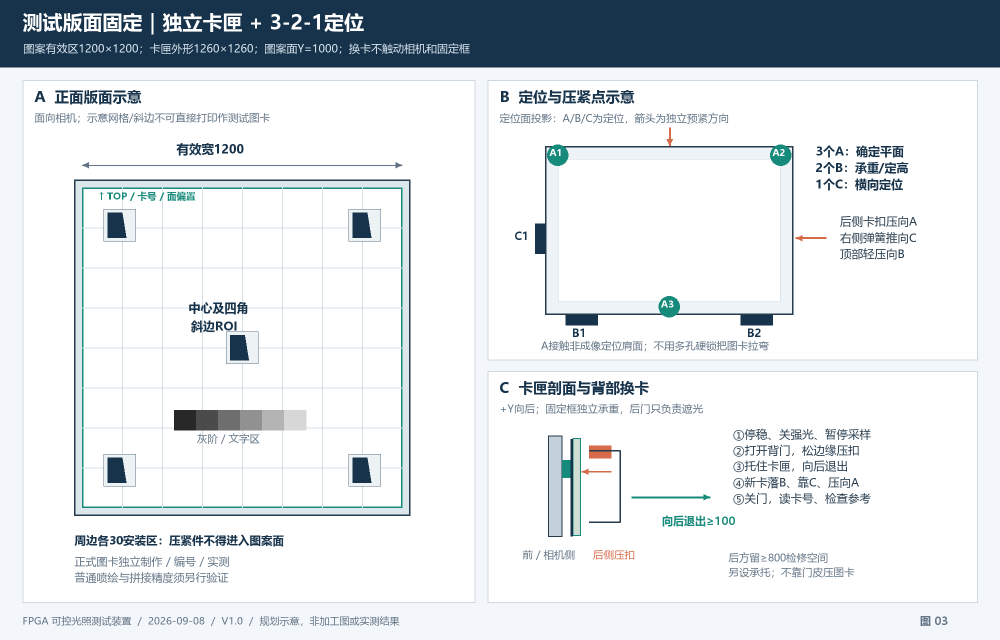
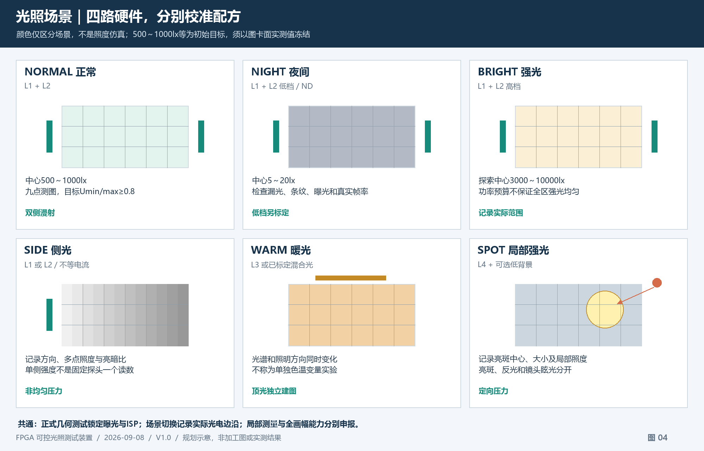

# 光照黑箱详细设计方案

版本：V1.0　日期：2026-09-08
状态：结构、光学布置与验收设计。尺寸为首版参考，不是已完成加工图；照度、温升、精度与动作时间均待实测。

本方案细化[三轴龙门架与二维无刷云台方案](STM32F407ZGT6_三轴龙门架与二维无刷云台黑箱测试系统设计方案.md)。沿用已明确的 STM32F407ZGT6、XYZ 三轴平移、Roll/Pitch 二维云台和四路光源，不新增 Yaw 轴。箱体、灯具与图卡架先组成可调样机，通过视场、照度和热测试后再冻结板材及孔位。

## 1. 推荐结构与图纸索引

推荐采用**可拆框架＋消光封板＋正面柔性遮光口＋左右漫射灯舱＋顶部暖光/定向灯＋背部快换图卡匣**。运动机构和电源驱动置于光学腔外，图卡架固定在主体框架上，背门只承担遮光和检修。

参考光学腔净空为 **宽1400 × 高1400 × 深1100mm**，图卡有效区为 **1200 × 1200mm**。这是一套需要独立台架的装置；尺寸由较大横滚范围与平移行程驱动，不按普通桌面小箱设计。若空间有限，可缩减有效行程和正式测评角度后重新计算，不能等比例缩小箱体并保留原能力声明。

| 图示 | 内容 | 可放大原图 |
| --- | --- | --- |
| 图1 | 俯视、侧视、灯位、运动区、图卡平面 | [SVG](figures/lightbox/01_layout.svg) |
| 图2 | 漫射灯剖面、支架连接、定向灯安装、遮光散热 | [SVG](figures/lightbox/02_light_mount.svg) |
| 图3 | 测试版面、3-2-1定位、边缘压紧、背部换卡 | [SVG](figures/lightbox/03_chart_mount.svg) |
| 图4 | 六类光照场景及通道组合 | [SVG](figures/lightbox/04_modes.svg) |

所有示意图的单位均为mm；详图局部不按比例，标注尺寸和本文件表格为准。图中的网格、斜边与灰阶仅解释版面布局，**不能作为标定或MTF测试图卡打印使用**。

## 2. 总体布局、坐标与尺寸

### 2.1 统一坐标

沿用运动方案的坐标：X向右、Y从前门指向图卡、Z向上。原点为前壁内表面的几何中心。所有灯位记录使用同一坐标，不能把灯具支架刻度当成另一套未说明的坐标。

- 光学腔边界：X∈[-700,700]，Y∈[0,1100]，Z∈[-700,700]。
- 图案实际表面：Y=1000；中心T=(0,1000,0)，朝向相机的法向为-Y。
- 图卡有效区：X、Z均为[-600,600]；正式全幅包络另保留20mm边距，使用[-580,580]。
- 名义相机光心：C=(0,500,0)，到图卡距离D=500。
- 平移目标：X±150，Y相对名义位置±100，Z±75，对应D=400～600。
- 零姿态相机轴：x_C=+X，y_C=-Z，z_C=+Y。
- 两转轴方案为外Pitch、内Roll的计算示例；实物嵌套顺序、轴线偏置必须测量并更新几何模型。

### 2.2 参考尺寸表

| 部位 | 首版参考值 | 设计要求 |
| --- | --- | --- |
| 光学腔净空 | 1400W × 1400H × 1100D | 不包含框架厚度、外置灯舱和龙门架 |
| 框架 | 40系列铝型材作为起点，底架独立加强 | 承载截面依据总重量、跨距与变形复核 |
| 箱体外廓预算 | 约1500W × 1500H × 1200D | 仅空间预算；灯舱、支脚、把手及机构另计 |
| 图卡有效区 | 1200 × 1200 | 用于全幅网格、组合版面；不是现有实物尺寸 |
| 图卡匣外形 | 1260 × 1260 | 周边各30非成像安装区；背部厚度按结构实测 |
| 图卡固定框外形 | 约1320 × 1320 | 四周安装于主体，不固定在活动门皮上 |
| 图案面到后壁 | 100 | 容纳背框、卡扣及取出动作；不能全被加强筋占满 |
| 前壁运动口净开口 | 初设700W × 600H，居中 | 用于承载件穿入；需按真实扫掠及遮光套压缩尺寸复核 |
| 相机/云台局部包络 | 暂按以光心为中心半径180 | 是空间占位假设，不是云台实测尺寸 |
| 左/右漫射出口 | 各900高 × 90宽 | 竖向长面，中心高度与图卡中心一致 |
| 顶部暖光出口 | 900长 × 90宽 | 横向长面；与两侧中性光分别标定 |
| 漫射混光距离 | 可调30～80，初装50 | 根据灯珠间距、扩散片和实拍热点调整 |
| 后门净通行口 | ≥1300 × 1300，双开或整块可拆 | 卡匣退出路径不能被门铰链、锁扣或背梁阻挡 |
| 后部检修空间 | 建议≥800深，另留图卡搬运空间 | 取卡需至少可向后拉出100；以实物人员操作检查 |
| 侧面检修门 | 约400W × 500H | 实际避开承力构件、灯舱和线缆 |

前口连接固定框与**不随Roll转动的移动承载件**，采用多折遮光套；云台在套内侧转动。遮光套不可绑在镜头上，也不可把全部转角传给软套。插入臂、拖链、相机、板卡及承载件都要进入机械模型，不能只检查表中180mm球体。

若采用外置龙门架加悬臂，先验悬臂挠度和振动；XYZ的300/200/150行程不自动保证此箱体能容纳现有机构。前口和箱深须在运动样机到位后最终冻结。

### 2.3 材料与分件

1. **承力框架**：底部矩形框、四角立柱、顶框，图卡架独立横梁。大跨度处增加可拆斜撑或角板；龙门架振动不经薄门板传递给图卡。
2. **封板**：2～3mm铝板或满足刚度及温度要求的复合板作为候选。内面用低反射哑黑涂层，外面便于清洁；近灯舱不使用普通泡沫、纸板或会脱落的黑绒。
3. **门缝**：台阶搭接＋连续压缩密封条；铰链侧也连续遮光。压紧点均匀分布，避免只关中间锁扣、四角翘起。
4. **观察**：优先通过实时视频观察。若保留透明窗，外加不透光盖板；正式低照测量时盖板关闭。
5. **拆装**：框架、左右封板、前模块、后图卡模块分别编号，装回使用定位面。大幅图卡匣整体运输，不折叠图案面。
6. **尺寸冻结**：先确认运输门宽、独立台架承载和操作空间，再下料。这里不提供未经接头、壁厚和端面核对的型材切割清单。

## 3. 光源位置、朝向和调整方式

### 3.1 四路灯位表

下表坐标表示**漫射出口/定向光出口中心**，不表示整个散热器的位置。推荐固定灯具、移动相机；不要把光源安装到云台上，否则姿态改变也会同时改变照明。

| 通道 | 初始出口中心(X,Y,Z) | 出口/照射方向 | 安装与调整范围 |
| --- | --- | --- | --- |
| L1 左中性漫射 | (-600,400,0) | 朝图卡中心，竖向900×90 | 左侧支架；Y=100～500、Z=±100可调，向中心方向转动 |
| L2 右中性漫射 | (+600,400,0) | 与L1镜像，朝图卡中心 | 右侧同型支架，调整范围与L1相同 |
| L3 顶部暖白漫射 | (0,400,+600) | 向后下方指向图卡，横向900×90 | 顶部双吊架；Y=100～500、X=±100可调 |
| L4 定向白光 | (+450,650,+600) | 初始照向T，随后按亮斑目标调整 | 顶部横轨X=-500～+500，纵向支座Y=550～750；双角度锁紧 |

L1/L2照向中心时，相对图卡法线的入射角初值约45°；L3同理。L4初始中心入射角约65°，用于局部斜入射压力工况，不作为均匀照明主灯。角度定义为“入射光线与图卡法线的夹角”，避免与支架刻度、相对图卡平面的角度混用。

左右长条灯互补、竖向安装并用遮扉控制直入镜头的杂散光，是反射图卡常见的布置方式；最终均匀性取决于距离和朝向，不能由“45°”或“加漫射板”直接保证。[Imatest反射图卡照明说明](https://www.imatest.com/products/reflective-lighting/)

**上述调整范围是支架可调建议，不是全部可在运动中开放的轨迹。** 调整后必须重新检查灯壳、遮扉、导线与视场/机构是否相交，并保存灯位版本。灯舱尽量向外壁凹入；出口边框和遮扉的位置也计入净空。

### 3.2 光束、视场和遮挡的检查

对每个正式相机位置和姿态，分别检查以下两类路径：

- **成像路径**：镜头有效视场到图卡，不能穿过灯架、前口、遮扉、拖链或传感器。零姿态无遮挡不能证明倾斜时也无遮挡。
- **照明路径**：各灯到正式图卡ROI，不能被云台、插入臂或其他灯遮挡。图卡照度与相机位置原则上无关；如移动相机后照度改变，应先查阴影和漏光。

L1/L2中心位于相机两侧，并可能随相机前移处于镜头横截面之后；必须在全部允许位置检查反光和直入镜头，不能仅凭左右对称认定无眩光。正式几何模式下使用遮扉和哑光板；故意产生直入镜头的L4眩光单列测试。

## 4. 光源安装详图与电气实现

### 4.1 L1/L2/L3漫射灯模块

从散热侧向出光侧依次为：

**铝散热背板 → 导热界面 → LED金属基板 → 30～80mm混光腔 → 可拆扩散片 → 消光边框/遮扉 → 图卡。**

- LED板用螺钉按平整基面固定，导热材料只填接触间隙；不靠双面泡棉粘在塑料外壳上散热。
- 混光腔内部可用耐温、稳定的漫反射材料改善混光；腔外、出口外沿及箱体内壁消光黑。不要把整个混光腔也涂黑后假定光效不变。
- 扩散片用独立槽框安装，初选1～2mm乳白扩散材料，最终依其透过率、扩散角、温度等级选定。四边留热膨胀余量，不贴在灯珠上。
- 出口前设置两片可转遮扉，初始伸出20～40mm。其宽度随视场检查调整，不以挡住图卡边缘来掩盖杂散光。
- 可记录编号的ND片装在出光附件框内，覆盖整个有效出光口；左右两侧用匹配片并分别标定。附件不能堵住热路。
- 900×90出口可以由多块同型号LED子板组成，但单通道仍为一个受控光源。串并联、均流和串压按驱动设计，不直接并接任意灯条。
- 主光L1/L2采用同批次中性白模块，色温采购目标约4000～5000K；L3约3000K。色温目标不是已测光谱。

### 4.2 型材连接与可重复定位

每个长灯至少使用两个相距较远的金属安装支点，防止单个球头承载后慢慢下垂。

推荐连接顺序：

1. 箱体承力型材的T槽螺母与M5连接件固定底座；具体槽型、螺母和螺纹规格随实物确认。
2. 底座通过纵向导轨提供Y=100～500位置调整，短长孔用于精调，锁紧后用独立刻度记录出口中心位置。
3. 两端U形耳轴支架提供朝向调节，垫片防松，至少一端有角度刻度；左右耳轴同轴。
4. 灯具散热背板连接耳轴，不让扩散片槽框承重。
5. 首次标定后在底座与框架上做对准标记，并记录紧固状态。换灯/松开支架后重新建照度表。

L3安装在顶横梁，两支点承载、另加独立防脱系带。线缆先在固定梁上做应力释放，再留短服务弯接到灯具，不能用电源线吊灯。

### 4.3 L4定向灯

L4采用有匹配恒流接口和散热器的白光模块，配透镜、两轴可锁紧支架、可替换光阑及消光遮光筒。只改变这一路的位置即可形成局部亮斑、左右照度差和斜入射反光。

- 顶部横轨固定在承力梁；以限位块防止滑块脱轨。
- 俯仰及方位关节采用齿盘或可靠摩擦锁紧，不用松软摄影软管作为正式定位机构。
- 遮光筒内壁消光，有效长度初设60～100mm；筒口、支架和整灯扫掠全部做碰撞检查。
- 初始照向图卡中心；随后记录光斑中心(X,Z)、沿图卡面主/次方向的尺寸及边缘阈值。例如以中心增量照度50%的等值线定义光斑，不把透镜标称角度等同实测光斑。
- 例：出口到目标距离约828mm，若圆锥全角20°，垂直光轴截面的直径约292mm；投到倾斜图卡会拉长且照度不均，因此292mm不能作为图卡上圆斑直径验收值。
- 用L4“照亮图卡局部”、“照射附加反光片”、“直接进入镜头造成眩光”分别建场景。最后一项需单独验证角度、相机允许曝光和关门条件。

### 4.4 调光、电源与热路

沿用四路各20W上限的预算：F407 → DAC60504 → 匹配量程接口 → 恒流驱动 → LED；每路独立使能和支路保护，驱动、电源置箱外。F407引脚和候选LM3409模块细节见[已有电气方案](STM32F407ZGT6_三轴龙门架与二维无刷云台黑箱测试系统设计方案.md)。

正式静态工况采用**模拟电流调光，并验证电流纹波与低档行为**。模拟设定不代表电流绝无纹波。LM3409为开关控制器，低电流可能进入断续模式；不能仅凭标称调光能力保证5～10000lx的全量程。用低电流档或ND附件扩展，分别建立标定表。[TI LM3409数据手册](https://www.ti.com/lit/ds/symlink/lm3409.pdf)

散热链为LED结/封装、金属基板、导热界面、散热器、箱外空气。温度会影响光输出及颜色；热设计需要考虑整条热阻路径。[Cree LED热管理指南](https://downloads.cree-led.com/files/da/x/XLamp-Thermal-Management.pdf)

- 散热器优先通过灯舱背部向外散热；必要时设置与图卡空间隔开的风道，避免风直接吹图卡。
- 导线、扩散片、粘接材料、驱动器分别按其额定温度验收，不用LED结温上限代替所有部件上限。
- 四路80W为电输入上限预算，不保证大图卡全域10000lx。例如1200×1200mm平面若每处达到10000lx，仅落在卡面上的入射光通量就需至少10000×1.44=14400lm；还未计灯具、扩散片和未照到图卡的损耗。被腔内吸收的光最终也形成热，不能在封闭箱总热预算中扣掉全部光功率。
- 风扇振动不传到图卡固定架。进出风经过两次以上折返挡板，要求从外侧看不到光学腔；增加挡板后复测风量、温度与漏光。
- 给每路散热器设置温度测点；温度阈值按选定模块与材料额定值冻结，软件过温降流/关断后该工况中断，不继续记合格样本。

## 5. 测试版面的固定与更换

### 5.1 图卡匣与测试图案分开管理

建议制作若干套**相同机械基准的刚性图卡匣**。每套包含背部加强框、平整基板、实际测试图案和边缘编号。完整图案面固定在基板上，换卡时整匣替换。

- 基板可选铝蜂窝板或带背部加强框的稳定板材；依据尺寸、重量和实测平整度选定，不能把材料名称当作平整度证明。
- 纸质图卡由受控整面装裱工艺固定，排除皱褶、气泡和接缝。四角夹纸、磁铁压纸、贴几条胶带仅用于联调。
- 正式面前不加普通玻璃/亮面亚克力压板；它会新增反光、重影和光路变化。
- 若采用玻璃精密标定板，使用专用边缘托架和防脱结构，记录其实际平面；不硬夹易损边缘。
- 1260×1260卡匣较大，搬运方式按实测重量决定；设置两侧后置提手，提手不突出图案面、不进入ROI。

目标平整度可先定为有效区峰谷差≤0.3mm，作为加工与检查目标；重复装夹的基准平面位置差初设≤0.1mm。两者均需量具验证，**不能据此直接声称亚像素测评真值足够准确**。例如距离500mm、焦距1500px、离轴位置500mm处，0.3mm深度变化产生的比例误差可达到约0.9px；正式误差预算仍须依据真实内参、测量位置和目标精度收紧。

后方设置带软垫的可收起承托平台/推车，额定承载按卡匣实测质量留余量；退出过程中始终托住下缘，转移后再收起。后门全开净口至少1300×1300，框梁/锁扣不得缩小退出通道。1260大板不得仅依靠一只手悬举；两人操作还是单人借助推车，按质量和现场操作验证冻结。

### 5.2 推荐3-2-1定位

固定框设置六个几何定位约束，压紧件只负责预紧，避免多孔硬锁把板拉弯：

| 基准 | 布置 | 限制与作用 |
| --- | --- | --- |
| A1/A2/A3，三点平面基准 | 位于非成像边缘的定位肩面，三点不共线 | 确定卡匣沿Y位置及平面对X/Z的倾斜 |
| B1/B2，两个下托基准 | 左下、右下边缘，接触卡匣底边 | 承重，确定高度与绕Y的平面内转角 |
| C1，一个侧向基准 | 左侧边缘 | 确定X位置 |
| 后侧压紧件 | 靠近A点的边框，向前压入A基准 | 不直接压图案面，避免中间压弯 |
| 右侧弹性推块 | 对准C方向，推向左侧基准 | 消除侧向游隙，不作为第二硬侧挡 |
| 顶部弹性压块 | 轻压向B基准 | 防跳动，避免过大压力弯板 |

图案朝前。A接触面使用卡匣非成像边缘的前向定位肩面，固定框从前侧挡住该肩面；后侧卡扣把卡匣压向A。A点确定的是**卡匣基准面**，图案实际表面可能与它有偏置，必须测量后换算到Y=1000。不要因图示画在背视图，就把A点理解为任意压在薄板背面的位置。

可用圆销＋菱形销/长孔替代B/C定位，但两套方法择一实现。固定框的四个安装螺钉连接主体框架，不等于图卡的四个几何定位销。

### 5.3 卡匣安装动作与防装反

1. 背门打开前先请求“换卡”：运动受控停止、Z轴进入已验证保持/防坠状态，L4关闭，正式采样暂停。
2. 待状态允许后打开后门。门状态传F407；正常灯也关闭，必要的检修灯独立开关且正式采样时关断。
3. 松后侧压紧件，解除顶部和右侧弹性压块；两手握提手，沿后方退出约100mm，再取离框架。下托块在松扣后仍承重。
4. 放入新卡匣，先落在B1/B2，再轻推到C1和A1/A2/A3，最后锁压紧件。卡匣右上做防装反缺口，方向标识不能替代机械防错。
5. 扫描/录入chart_id，核对图案类型、方向、图案尺寸和基准面偏置；关闭后门。
6. 只恢复已验证的灯光和相机参考位置，检查焦点、视场、卡面姿态。换卡不自动机械回零，不自动重置IMU参考。
7. 新卡号或位置发生变化时建立新的工况记录。镜头K/D是否重标取决于焦距、焦点、传感器模式等；图卡位姿与ROI要复核，不能盲目把旧外参套到新卡上。

前部图卡框可以设置短导向槽辅助插入，但导向槽只负责引导，不与3-2-1基准同时作紧配定位。背门密封条压在独立门框上，不能在关门时把图卡挤向镜头。

### 5.4 推荐测试版面

| 卡匣 | 版面 | 用途与约束 |
| --- | --- | --- |
| C-CAL | 实测棋盘/圆点，明显方向标记 | 真实标定；图案尺寸可小于大卡匣，记录实际网格与单位 |
| C-GRID | 横竖长直线、斜线、边缘定位标志 | 全视场直线度、断裂、比例与姿态 |
| C-SFR | 中心及四角高质量斜边ROI | 边缘与像素网格夹角适宜，目标约5°；按实际姿态检查ROI有效性 |
| C-TONE | 灰阶、低对比文字、暗部细节 | 曝光固定与AE开启分开测；记录色彩处理 |
| C-COMB | 网格＋5个可替换斜边小卡＋灰阶 | 现场综合演示；不同材料/厚度的插片分别登记面偏置 |
| C-GRAY | 均匀哑光灰面 | 照明热点、条纹与时间噪声辅助检查，不代替照度计 |
| C-GLARE | 规定区域附加可编号反光片 | 定义反光压力项；不能与哑光卡的MTF结果混算 |

小尺寸精密斜边卡可装在大幅刚性基板的预留凹位，表面尽量齐平。若只有中心斜边达标，就只申报中心清晰度；不能用普通喷绘边缘宣称镜头和系统的完整MTF能力。大幅网格若需拼接，拼缝不得穿过测量线和ROI，且实测直线与格距。

## 6. 视场、角度和机械包络验算

### 6.1 首版计算示例

**以下60°水平视场是计算假设，不是OV5640现有镜头参数。** 假设16:9针孔成像、转轴交于光心、外Pitch内Roll，无额外畸变边缘扩展：

~~~text
a = tan(60°/2)
b = a × 9/16
ρ = sqrt(a²+b²) = 0.662421379

Roll连续覆盖±90°，Pitch绝对值上限为P时：
max|X| = ΔX + Dmax×ρ / sqrt(cos²P − ρ²sin²P)
max|Z| = ΔZ + Dmax×tan(P + atanρ)

适用条件：所有相关边缘光线朝向图卡，分母为正；
本例角度满足该条件，不能外推到接近平行/背向图卡的姿态。
~~~

| 工况组 | 位置/角度假设 | X/Z绝对最大值，mm | 相对±580有效边界 |
| --- | --- | --- | --- |
| A | XYZ全行程，Roll±90°，Pitch=0 | 547.5 / 472.5 | 计算上可覆盖 |
| B | XYZ全行程，Roll±90°，Pitch±5° | 549.6 / 552.6 | 计算上可覆盖；最少余量约27.4 |
| C | C固定(0,500,0)，Roll±90°，Pitch±15° | 348.4 / 565.6 | 计算上可覆盖；最少余量约14.4 |
| D | XYZ全行程，Roll±90°，Pitch±30° | 646.7 / 1279.5 | 明显越界；不能作为全画幅组合 |

D组即使不加安全边距也需要约1293×2559mm图卡。故本版优先把A作为首轮全幅工作域，B/C通过真实光学校核后才开放，C可先限Pitch±14°联调；Pitch±30°仅作为机械能力/已声明ROI压力测试。不得在报告中把这四行写成硬件实测结果。

### 6.2 使用真实镜头后的校核

实物到位后先锁定1080p RAW8模式、焦点、裁剪和镜像，获取真实K/D。对原始有效像素边界进行足够密集采样，用相机模型求各像素射线，再与Y=1000平面相交：

~~~text
世界/箱体射线 d = R × d_C
交点 P = C + t×d
t = (1000 − C_Y) / d_Y

要求 d_Y > 0、t > 0；
并检查P处于声明图卡有效区，整段射线不被结构遮挡。
~~~

- 真实畸变镜头的射线包络不能只用理想四角替代，尤其边界曲线、中间像素和裁剪方式需检查。
- 转轴偏置会使光心随角度移动，使用实际齐次变换更新C，不固定光心后仅旋转R。
- 分别求原图覆盖、矫正后有效ROI和裁剪范围；缩放裁剪须记录，不用黑边填充冒充完整视场。
- 若镜头更广、云台更大或ROI余量不足，优先缩限工况；换焦距/调焦则复核K/D。也可加大箱体，但必须重新设计照明均匀性。
- 无法落到图卡的像素、遮挡区域及视差，不靠双线性插值或IMU恢复。

### 6.3 机械碰撞与停止距离

临时180mm头部包络叠加XYZ后为X±330、Y=220～780、Z±255；这只用于早期布置。正式应以相机、云台、短DVP接口/板卡、线缆接头、承载臂、软套和拖链的实际几何求扫掠。

沿用运动方案速度/加速度作示例：50mm/s、200mm/s²时，仅制动距离为6.25mm；还需控制响应、弹性变形与余量。可以先以20mm额外净距作为建模检查起点，但不能代替最大载荷实测停止距离。此机械净距与前述20mm图卡光学边距是两项独立要求。调整L4、遮扉或图卡厚度后，更新允许域，不只看轴限位。

## 7. 光照场景、测量点和调试

### 7.1 场景定义

| 场景ID | 灯光组合 | 初始目标/记录 |
| --- | --- | --- |
| DARK | L1～L4全关 | 轨迹全域漏光≤0.5lx，且≤最低正式照度10% |
| NORMAL | L1＋L2，L3/L4关 | 图卡中心500～1000lx，检查采样点均匀性 |
| NIGHT | L1＋L2的已标定低档/ND组合 | 中心5～20lx，记录漏光占比、曝光和真实帧率 |
| BRIGHT | L1＋L2已验证高档 | 中心3000～10000lx为能力探索目标，按实测冻结 |
| SIDE | L1或L2单独，或两路不等电流 | 多点照度、亮暗比与方向，不要求均匀模式门槛 |
| WARM | L3单开或与L1/L2混合 | 记录组合、照度图；顶光位置变化与光谱变化同时存在 |
| SPOT | L4＋可选低背景L1/L2 | 光斑中心、尺寸、局部照度、饱和比例 |
| STEP | 上述已验证模式之间切换 | 请求、DAC动作、光电边沿、曝光与输出响应分别计时 |

WARM不称为“只改变色温”的实验，因为主照明位置也改变了。若要单变量光谱测试，应把中性/暖光模块换到同一光学位置并分别校准，或另立同位置双色设计，不能暗中修改现有四路映射。混合灯颜色也不能只用DAC比例线性推算色温。

实体按键保持“正常、夜间、强光、侧光/场景切换、停止”的可理解语义，由F407执行已标定配方。上位机显示场景名与实际照度、稳定状态；场景名本身不能作为测量值。

### 7.2 九点建图、五点复核

初始九点坐标为X、Z各取{-540,0,+540}，测量面Y=1000。正式ROI靠边或出现热点时增加采样点。日常复核使用中心和四个角部点，保存测点坐标。

**照度计感光面与图卡面平行、法向统一为-Y；不能逐点转向灯具。** 移动探头测量时采用定位模板，不能把探头放在镜头旁来代表图卡照度。

~~~text
Eavg = ΣEi / N
Umin/max = Emin / Emax
Umin/avg = Emin / Eavg
~~~

正式均匀模式沿用项目目标Umin/max≥0.8；两种均匀性指标同时保存，不混用。该门槛不是比赛发布的阈值。色调/颜色定量测试还需更严的空间均匀性目标，如各采样点相对平均值±5%，未达到时只按实际条件分析。Imatest亦区分局部SFR/畸变测量和更严格的色调/颜色照明要求。[Imatest实验室布置指南](https://www.imatest.com/solutions/test-lab-setup/)

九点仅证明所采样位置，不能排除点间灯珠热点。灰卡原始图可辅助找热点、暗带和镜头暗角，但因反射率、暗角、曝光及ISP影响，图像灰度不能直接替代lx。

### 7.3 固定探头和快响应探头

- OPT3001固定监测点初设S=(+630,1000,-520)，在图卡安装边缘，感光面与图案平行。其壳体和导线不侵入有效区。
- 固定点只跟踪该点稳定性；建立它与中心/九点的对应关系，并记录随光源组合变化的差异。L4照不到固定点时，不用它闭环控制中心光斑。
- 光电二极管可与S相邻，或放在声明的光斑测量位置；保存位置和探头编号，避免饱和。它提供相对变化及边沿，未经标定不输出lux。
- OPT3001用于慢速照度采样；其100/800ms转换模式不能直接作为毫秒灯光边沿。按有效新转换更新，不能把重复读寄存器当成独立样本。[TI OPT3001数据手册](https://www.ti.com/lit/ds/symlink/opt3001.pdf)
- 灯光阶跃时记录驱动请求和实际光变，FPGA帧/事件同步沿用既有方案；PC收到串口包的时间不等于发光时间。

### 7.4 首次光学校准步骤

1. 不装扩散片点亮最低安全档，核对四路实际编号、方向、关断和支路保护，然后装回扩散片及遮扉。
2. 灯全关，在室外/室内照明不同状态、门缝和全部允许运动位置检查漏光。量具分辨率及不确定度不够时标记“无法判定”。
3. 分别点L1和L2，测九点；调整位置、倾角及电流比例，再测两灯组合。先解决热点/阴影，再提高亮度。900mm发光长度和当前中心朝向不保证1200mm图卡九点均匀性；未达标时按以下结构调整路径处理，不能只把电流同比提高。
   - 先把L1/L2沿Y轨向前移，扩大到图卡的距离，并调整交叉照射方向，复测角部和中边。
   - 若上下照度不足，可把发光区加长到1100～1200mm，或增加上下端的固定LED密度/配光补偿；仍保持L1/L2两个受控通道，重新设计串压、均流、功率与散热。
   - 若受尺寸和功率约束无法达标，缩小并明确正式均匀ROI，重新计算相机距离/动作范围；大卡面其余区域只用于已声明的非均匀压力测试。P2未放行前不冻结批量灯壳和箱体下料。
4. 对NORMAL、NIGHT、BRIGHT的实际可用档分别建表；低档不能沿用高档比例推算。装ND后再次检查左右一致性与均匀性。
5. L3及每个混光组合独立建图；L4建立光斑图。所有场景关联灯位、图卡和附件版本。
6. 在相机/云台最不利姿态复测图卡是否被遮光；移动前后照度变化要有原因。
7. 预热时间初设15min，再依据漂移判稳；静态采样前至少10次独立新读数均在设定值±5%内，并记录所需时间。该条件不代替长时间热漂移验收。
8. 最低、正常、最高档测光电/电流波形，并用实际最短计划曝光和正常曝光拍灰卡。发现条纹、跳脉冲或周期亮度变化时降低能力声明或修改驱动。
9. 锁紧灯架，导出“灯位版本＋调光查表＋九点照度＋温度条件＋允许曝光范围”，作为自动测试配方输入。

## 8. 接线、换卡联锁与数据记录

### 8.1 外部连接

- F407、恒流驱动、步进驱动、电源与通信接口集中在箱外电气板，强弱电分开走线。
- 灯具线从侧/顶的密封穿线孔进入，先应力释放，再接灯舱；线孔采用密封接头或双折遮光结构。
- 图卡传感器线沿固定框背面走，进入腔内部分消光并固定；不跨图案正面。
- 相机与独立IMU刚性安装，IMU UART直接连接FPGA。DVP线长和运动线缆按真实1080p30联调，不能为箱深直接延长普通排线。
- 若短DVP要求FPGA靠近相机，板卡和供电/网线/HDMI拖链质量一并计入运动载荷与包络。固定电源不允许用未经验证长排线替代接口设计。
- 维持OV5640 RAW8→FPGA，S0千兆网、结果单路HDMI回传；PC只采集控制和评估，灯光箱不改变视频架构。[跨端基线](OV5640_RAW8千兆网与HDMI双路回传方案.md)

### 8.2 状态与门联锁

建议设备状态为IDLE、MOVING、LIGHT_SETTLING、READY、CARD_CHANGE、FAULT。这里只定义行为，协议字段及固件仍在对应开发区实施。

| 事件 | 行为 |
| --- | --- |
| 申请换卡 | 先停运动、确认Z保持/防坠，关闭强光，暂停正式样本 |
| 门意外打开 | 门信号进入既有硬件许可/设备故障链，禁止继续运动、关闭L4；按已验证的制动时序处理Z，不等待PC |
| 合门 | 仅允许重新检查，不自动恢复旧轨迹或旧强光 |
| 实体急停 | 沿既有硬件运动禁止、制动和强光关断回路；软件记录结果 |
| LED过温/掉电/MCU复位 | 灯禁能，工况无效；恢复后新建事件并重新判稳 |
| 人工改灯位/遮扉/图卡面 | 增加结构配置版本，旧照度/包络校核失效待复核 |

急停与门开不应简单无序断开所有支路导致Z自由下落；具体执行与防坠按照[运动系统第10章](STM32F407ZGT6_三轴龙门架与二维无刷云台黑箱测试系统设计方案.md)实施。图卡门和前检修门均纳入检测。

### 8.3 每次测试至少保存

| 类别 | 字段/信息 |
| --- | --- |
| 结构 | box_id、结构版本、图卡面坐标、灯位版本、门状态 |
| 图卡 | chart_id、类型/来源、实测尺寸、面偏置、方向、固定状态、ROI版本 |
| 光源 | 场景、L1～L4使能/DAC码/电流档、扩散片/ND编号、位置/角度 |
| 测量 | 各点lx及坐标、仪器/量程/不确定度、温度、稳定标志、实际光电事件 |
| 运动 | 目标和实际位置/姿态、测量来源、允许包络、零位/安装变换版本 |
| 成像 | 曝光、增益、白平衡、焦点、模式、K/D与FPGA配置版本 |
| 来源 | run_id、设备启动标识、event_id、frame_id及其验证状态 |

命名可映射到已有host/MCU协议，不在本文重新冻结二进制报文。数据落入host/data，系统测评报告落入host/reports；MCU板级数据与热调试归mcu/data、mcu/reports。图卡制作验收、灯具实测记录不得伪装成本规划已完成的结果。

严格图像精度使用板端S1与同帧S2/S3；S0可视化不冒充S1。HDMI帧身份未验证仍为null/unverified。原始证据保持.raw/.rgb＋元数据，PNG为派生图。

## 9. 装配顺序与验收表

### 9.1 实施顺序

| 阶段 | 工作 | 放行条件 |
| --- | --- | --- |
| P0 参数确认 | 镜头真实视场/焦点、云台外形、卡面尺寸、运输空间 | 冻结能实现的首轮全幅域，不直接照图下料 |
| P1 开放框架 | 底架、固定图卡架、运动口模拟件、相机/云台安装 | 对焦、扫掠、停止距离、DVP运动链路验证 |
| P2 光学样机 | L1/L2支架和可调混光腔，再装L3/L4 | 主光九点均匀性、光斑、无遮挡、低档波形检查 |
| P3 卡匣工装 | A/B/C基准、边缘压紧、方向防错、后门 | 平整度/重复装夹、换卡动作与门联锁通过 |
| P4 封箱 | 消光板、软套、门缝、遮光风道、电气分区 | 全轨迹漏光和关门最大负荷温升通过 |
| P5 联机冻结 | 建立灯位/图卡/配方版本，接上位机记录 | 可重复自动测试及实体按键切换、证据可追溯 |

### 9.2 具体验收

| 编号 | 项目与方法 | 首版目标/判据 |
| --- | --- | --- |
| B01 | 实测内部尺寸、实际灯位/角度与图卡面 | 更新尺寸图和配置；与允许域一致 |
| B02 | 各轴慢速、组合极限、带线运动 | 无碰撞/拉扯/遮光套卡滞；最大速度停止距离另测 |
| B03 | 全关灯、外光开关、全轨迹 | ≤0.5lx且≤最低正式照度10%；不确定度满足判定 |
| B04 | 每个均匀场景九点、多次新读数 | Umin/max≥0.8；记录实际范围与漂移 |
| B05 | 静止灰卡、计划曝光、电流和光电波形 | 无影响指标的条纹/周期波动；结论关联曝光范围 |
| B06 | 最大允许灯组合、关门运行 | 运行至少60min并达到热稳定；末15min温度斜率建议<1℃/10min，未稳定则延长 |
| B07 | B06各热点与灯光漂移 | 各材料/器件留经选型定义的温度余量；记录照度、电流、风道条件 |
| B08 | 卡匣反复装夹10次，量具测面与基准 | 初设面位置重复≤0.1mm，卡面平整≤0.3mm；不直接等于图像真值精度 |
| B09 | 不同厚度/不同图卡随机更换 | 定位明确，面偏置可追溯，不自动归零/恢复运动 |
| B10 | 正式A/B/C工作域边界与中间姿态 | 实测全画幅/声明ROI覆盖；无挡光、明亮灯面入镜 |
| B11 | 正常↔暗光、正常↔强光，至少3次 | 命令/实际光变/图像响应分开计时，不丢事件 |
| B12 | 门开、急停、过温、通信断开 | 停止和恢复符合定义；旧工况不自动续跑 |
| B13 | 整机连续运行 | 按整机测评要求≥2h，冻结版本争取8h，保存故障/漂移 |

所有结果使用“通过/失败/无效/未测”区分。若只在500lx中心区达标，报告就限定该条件；不能因高档按键已实现而声称全图10000lx或任意角度均可测。

## 10. 初步部件清单与未冻结项

| 部件 | 数量 | 采购/制作要求 |
| --- | --- | --- |
| 可拆框架及独立底架 | 1套 | 根据真实总重、跨度、外形和运输拆装冻结 |
| 消光封板、前软套、侧门、后门 | 1套 | 接缝、运动、热环境下保持遮光 |
| L1/L2中性漫射灯 | 2套 | 同型号同批次，900×90出口起点，模拟恒流可控 |
| L3暖光漫射灯 | 1套 | 独立校准，双点顶部固定 |
| L4定向灯＋支架/筒/光阑 | 1套 | 位置角度锁定，光斑可记录 |
| 四路恒流驱动＋DAC控制 | 1组 | 沿既有F407方案，选定负载后核量程和热设计 |
| 图卡固定框 | 1套 | 独立承力，3-2-1基准与非成像边缘压紧 |
| 图卡匣/测试卡 | 按测试类型准备 | 首批至少网格、斜边/灰阶组合和标定卡 |
| 照度计、固定照度探头、快光电探头 | 各1起 | 照度计覆盖最低档并有可用精度，固定探头不代替全图 |
| 温度测点、门检测、接插件/线槽 | 1组 | 与控制和数据记录对应 |
| ND/扩散附件与备件 | 按量程试验确定 | 有编号和复测记录，不按无标签深浅片替换 |

**加工前还需确认**：现有镜头与1080p模式真实视场/焦点；云台和悬臂外形及重量；短DVP所需板卡位置；可承受图卡尺寸与运输空间；所购LED的光通量/配光、模拟调光与散热指标；图卡平整度和量具能力。当前不冻结品牌、材料价格、型材下料长度或未经核对的引脚。

本文件及示意图属于output规划材料。后续机械实物制作/接线记录和灯光固件归mcu，PC工况控制与测评实现归host，FPGA视频与算法归fpga；不把本设计图当成实物照片或测量报告。
