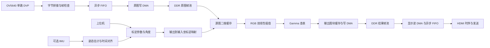

# 单路 OV5640 DVP＋盘古 50K 任意角度畸变矫正系统设计方案

版本：V1.0
日期：2026-09-05
用途：历史选型与算法讨论记录，不再作为当前项目的实施依据。

## 当前状态（2026-09-06）

本文封存为PGL50H/早期720p方案，以下旧指标、RGB565和外设假设仅供追溯。当前已选PG2L100H（盘古100K MINI），单OV5640 RAW8 DVP，真实1080p30必达；S0原图经板载千兆网，FPGA RGB888结果经唯一HDMI回采。当前不采用本文的720p交付指标或SPI IMU选型。

实施请阅读[当前主设计](PG2L100H_1080p畸变矫正详细设计方案.md)与[RAW8千兆网＋HDMI回传](OV5640_RAW8千兆网与HDMI双路回传方案.md)。PC基础RAW预览不是FPGA S1；正式精度使用板端同帧快照。历史正文保留，不能把其旧假设标成当前已验证功能。

## 1. 设计结论与适用边界

使用已提供的双目 OV5640 DVP 模组，仅启用其中一路，利用盘古 50K 完成图像采集、外部 DDR 帧缓存、二阶径向及切向畸变逆映射、双线性插值、任意面内旋转、Gamma 增强和 HDMI 输出。上位机生成真实标定参数并控制模式；IMU 作为动态角度输入扩展。

本方案按资源较紧的 **Logos PGL50H** 设计，不将它与 Logos-2 PG2L50H 混用。具体板卡版本尚未提供，封装、DDR 位宽/容量、晶振、HDMI 芯片和物理引脚必须依据实际板卡原理图填写，本文不编造引脚约束或寄存器初始化表。

### 1.1 分阶段指标

| 阶段 | 输入与有效处理目标 | 功能 | 定位 |
|---|---|---|---|
| 联调 | 640×480，帧率按模组已验证配置 | 采集、帧缓存、原图显示 | 验证硬件链路 |
| 基线 | 单路 1280×720@30fps | 畸变矫正、双线性插值、0～360° 面内旋转、固定 Gamma | 首个完整作品版本 |
| 完善 | 单路 720p30 | IMU 动态旋转、自适应 Gamma、性能计数、同帧对比 | 稳定演示版本 |
| 冲刺 | 单路 1920×1080@30fps | 保留核心矫正功能并重新验证缓存和时序 | 以模组真实输出及实现结果为前提 |
| 扩展 | 在已通过的分辨率下 | 有限俯仰范围的透视补偿、低延迟输出 | 不阻塞主版本交付 |

720p30 是工程起步指标，不自动等于满足比赛最终性能要求。若组委会规定最低为 1080p30，应在项目早期证明指定 DVP 模组可以输出所需未压缩格式；无法实现时需向组委会澄清允许的模式，不能用放大图像或重复帧代替真实 1080p30/60。

“任意角度”基础实现明确为平面内连续旋转。相机俯仰导致的透视变化采用后续单应性变换扩展。单目无法补回未拍到的区域，也不能通过一个整帧变换消除一般三维场景中的平移视差或快速运动下的卷帘形变。

### 1.2 已知规格与待验证条件

PGL50H 官方资源为 42,800 LUT5、64,200 FF、84 个 18×18 APM、134 块 18 Kbit RAM，DDR3 数据速率上限 800 MT/s。[S1] 这是器件上限，不是板卡保证工作频率。

设计优先使用现有板卡的 32 位 DDR3；如果实物只有 16 位，必须按实际速率重新测带宽并调整指标。按每块 18×1024 bit 计算，片上块 RAM 总容量约 301.5 KiB，实际可用量还受端口和组织方式影响，不能容纳一帧 720p RGB565 图像，因此完整帧放入外部 DDR。

## 2. 硬件与连接方案

| 部件 | 选择 | 实施说明 |
|---|---|---|
| FPGA 板 | 已有盘古 50K，暂按 PGL50H | 复用板厂 DDR、PLL、HDMI 基础工程 |
| 图像输入 | 已有双目 OV5640 DVP 模组的相机 1 | 只初始化和采集该路；另一颗按模组电路置待机/复位，勿任意切断共享电源 |
| 镜头 | 模组原配可锁焦镜头 | 固定焦距和焦点；更换或重新调焦后重新标定 |
| 输出 | 板载 HDMI 发送电路＋1080p 显示器 | 使用与实际 HDMI 芯片匹配的配置例程 |
| 参数通信 | 板载 USB-UART | 基线 115200 bit/s，参数量足够；大数据离线传输允许较慢 |
| 姿态输入 | ICM-42688-P SPI 模块，可选 | 引出 INT，最好引出 FSYNC；IO 电平匹配，固定在相机支架上 [S6] |
| 标定 | 刚性哑光棋盘格 | 建议 10×7 方格、9×6 内角点，格长 25 mm；尺寸可按拍摄距离调整 |
| 画质测试 | 高质量斜边测试卡＋网格线图卡 | 分别测 SFR/MTF50 与直线度 |
| 机械结构 | 刻度旋转台、俯仰支架 | 相机、镜头、IMU 刚性固定 |
| 辅助 | 低闪烁可调 LED、配套电源/JTAG、短线缆 | 复用现有电脑和显示器 |

### 2.1 DVP 接口约定

逻辑端口定义为 `cam_d[7:0]`、`cam_pclk`、`cam_href`、`cam_vsync`、`cam_xclk`（若模组需要）、`cam_reset_n`、`cam_pwdn`、`cam_scl`、`cam_sda`。

- 使用 RGB565 输出，每像素两个 DVP 字节；拼接顺序由摄像头配置及彩条实测确定。
- 有的模组暴露 D[9:0]，RGB 模式使用 D[9:2]，不能直接假设板上 D[7:0] 对应有效字节。AN5642 官方手册有此说明，实物仍以自身原理图为准。[S2]
- 在有效行内将两个字节拼成一个像素；每个 HREF 起始重新对齐字节相位。
- 对奇数字节行、行长不符、帧高不符进行计数，将异常帧判为无效，禁止提交为可显示帧。
- VSYNC/HREF 极性、采样边沿、XCLK 来源按实际寄存器配置与模组时序确定。
- 40 针接口不能跨厂家直接认定兼容；需确认电源脚、地、信号电平及 PCLK 的时钟管脚位置。
- 若两颗传感器共用 SCCB 地址和总线，利用模组的独立复位/使能实现选路；若无隔离条件，先核实能否只配置一路，不得让两颗同时驱动返回数据。

### 2.2 OV5640 模式验收

OV5640 官方列出了 1080p30、720p60 和 DVP/MIPI 接口，但实际帧率依赖输出格式及接口配置。[S3] RGB565 在 8 位 DVP 上传输时，仅有效数据需要的 PCLK 下限为：

| 模式 | 有效 PCLK 下限 |
|---|---:|
| 640×480@30 | 18.432 MHz |
| 1280×720@30 | 55.296 MHz |
| 1920×1080@15 | 62.208 MHz |
| 1920×1080@30 | 124.416 MHz |

这些是 `宽×高×帧率×2` 的计算值，未计消隐，不是允许的芯片时钟参数。第一周必须记录实际 PCLK、每行像素数、每帧行数、帧间隔和数据格式。若 1080p30 RGB565 不可达，不通过超规格时钟强行实现；RAW 等替代模式还涉及 DVP 带宽、ISP 和精度，需另行论证。

## 3. 系统架构

基线采用“采集完整原图→计算完整结果→显示完整结果”的架构。增加结果帧缓存，使任意角度下的 DDR 缓存未命中不会直接中断 HDMI 时序；代价是增加带宽和帧级延迟。



### 3.1 时钟与复位

| 时钟域 | 建议来源/初始目标 | 模块 |
|---|---|---|
| `cam_pclk` | 摄像头实际输出 | DVP 捕获、字节合并、写 FIFO 源端 |
| `sys_clk` | 板载晶振/PLL，初始 100 MHz | UART、SCCB、寄存器、时间戳 |
| `proc_clk` | 初始目标 100 MHz；1080p 冲刺再评估 150 MHz | 坐标、缓存、插值 |
| `ddr_ui_clk` | DDR IP 实际用户时钟 | DMA 与 DDR 仲裁 |
| `pix_clk` | 720p60 常用 74.25 MHz；1080p60 常用 148.5 MHz | HDMI 显示；完整时序来自验证例程 |

100/150 MHz 是设计目标，必须经过布局布线证明。不同域之间通过异步 FIFO 或请求/应答传递；多位参数不能用逐位两级同步。复位异步置位、各域同步释放，DDR 初始化完成前不得启动 DMA。

30fps 摄像头可配 60Hz 显示，每幅结果重复显示约两次，但计数和报告必须分别给出采集 fps、处理 fps、显示 Hz。

## 4. DDR 地址与帧管理

### 4.1 固定地址规划

采用 RGB565，每像素 2 字节；统一行跨度 `STRIDE=4096` 字节，覆盖 1080p 并便于地址计算。每帧槽位 8 MiB，预留 3 个原图槽位和 3 个结果槽位，共 48 MiB。

| 槽位 | DDR 相对字节偏移 | 状态管理 |
|---|---:|---|
| SRC0 | 0x00000000 | 原图帧 |
| SRC1 | 0x00800000 | 原图帧 |
| SRC2 | 0x01000000 | 原图帧 |
| DST0 | 0x01800000 | 结果帧 |
| DST1 | 0x02000000 | 结果帧 |
| DST2 | 0x02800000 | 结果帧 |

地址公式：`addr = frame_base + y*4096 + x*2`。这是内部字节地址，连接板厂 DDR IP 时根据其地址单位进行转换。720p 每槽实际覆盖 2,949,120 字节；1080p 为 4,423,680 字节，均在 8 MiB 内。仅传输有效像素，不读写行尾填充部分。

### 4.2 帧所有权

- 原图状态：`FREE → CAPTURING → READY → PROCESSING → FREE`。
- 结果状态：`FREE → RENDERING → READY → DISPLAYING → FREE`。
- 每帧附带 `frame_id`、采集首像素时间、末像素时间、参数版本、宽高和错误标志。
- 写完全部数据且 DDR 写事务确认完成后才置 READY；不能仅在 DMA 发出最后一个命令时置位。
- 处理器选最新的完整原图。可丢弃未被占用的旧 READY 帧并累计丢帧数，绝不覆盖 PROCESSING 帧。
- 显示只在场消隐边界选择最新完整结果；释放旧结果前先排空对应未完成读事务。
- 无空闲原图槽时丢弃整帧；无新结果时重复旧完整帧，不切换到正在写入的帧。
- 三缓冲提供调度空间，不意味着固定等待三帧。稳定帧率验收仍要求正常输入下不丢帧。

### 4.3 DDR 仲裁

建立四类客户：显示顺序读、采集顺序写、源图缓存填充读、结果顺序/分段写。显示 FIFO 低水位和采集 FIFO 高水位触发紧急服务；正常状态使用带最大等待时间限制的轮转调度，避免处理通路长期饥饿。

通过板厂可运行例程确认用户总线位宽、突发长度、背压时序和 outstanding 能力。首版可以限制事务数量以简化实现，但每个读响应都必须与请求匹配，不能把缓存填充数据误送到显示 FIFO。

### 4.4 带宽预算

按输入/处理 30fps、显示 60Hz、RGB565、同输入输出尺寸计算，单位使用十进制 MB/s：

| 数据流 | 720p | 1080p |
|---|---:|---:|
| 原图写入 | 55.296 | 124.416 |
| 四邻域读取，假设每个输出像素读 4 个像素且无复用 | 221.184 | 497.664 |
| 结果写入 | 55.296 | 124.416 |
| 60Hz 结果显示读取 | 110.592 | 248.832 |
| 合计有效载荷参考 | 442.368 | 995.328 |

四邻域读取值不是 DDR 最坏带宽上界：整图块回填但只使用少量像素时，实际传输可能更大；缓存命中时则更小。应测量 `cache_fill_bytes/output_pixels` 而不是仅计算理论像素流量。32 位、800 MT/s 的理论 3.2 GB/s 不能当作有效随机带宽。

## 5. 图像坐标算法

### 5.1 统一采用逆映射

遍历每个输出像素 `(u,v)`，先撤销显示旋转/缩放或透视变换，得到理想归一化坐标 `(x,y)`，再计算镜头畸变位置 `(ud,vd)`，从原图采样。此方向避免正向投点造成的空洞，与 OpenCV 的 remap 思路一致。[S4]

基础模型：

```text
r2 = x*x + y*y
r4 = r2*r2
radial = 1 + k1*r2 + k2*r4
xd = x*radial + 2*p1*x*y + p2*(r2 + 2*x*x)
yd = y*radial + p1*(r2 + 2*y*y) + 2*p2*x*y
ud = fx*xd + cx
vd = fy*yd + cy
```

主路径使用 `k1,k2,p1,p2`。标定时固定 `k3=0` 且不启用额外高阶模型；不能用完整高阶模型得到参数后只截掉 k3 而仍声称与软件模型相同。若真实镜头二阶模型残差过大，应记录模型不足，再决定更换适当镜头或实现高阶扩展。

### 5.2 面内旋转与裁剪

输出中心为 `cxo,cyo`，显示正向放大倍率为 `s>0`，显示旋转角为 theta。逆向旋转写成：

```text
du = (u-cxo)/s
dv = (v-cyo)/s
u0 =  cos(theta)*du + sin(theta)*dv + cxo
v0 = -sin(theta)*du + cos(theta)*dv + cyo
x = (u0-cxo)/fx_out
y = (v0-cyo)/fy_out
```

上位机将这组运算折叠为六个系数：`x=a00*u+a01*v+a02`、`y=a10*u+a11*v+a12`。FPGA 对每个输出图块先计算起点，然后用行/列增量递推，减少逐像素乘法。系数保持较高小数精度，递推累积误差纳入仿真。

正负角度方向须用不对称箭头图验证，报告明确采用屏幕坐标系，不能仅凭数学坐标系直觉判断。0～360° 支持表示角度可连续设定，不表示所有角度都保留完整视野且没有黑边。

### 5.3 俯仰/透视扩展

将基础六系数前端替换为 `q = H_inv * [u,v,1]^T`，再算 `x=q0/q2`、`y=q1/q2`，后接相同畸变与采样模块。H_inv 必须按标定内参、外参以及约定的视图方向生成。

纯旋转视图可由相机内参和相对旋转构造单应性；平面目标的透视校正还可通过棋盘格/标记点估计。一般三维场景中相机发生平移时不能直接使用同一模型声称完全校正。[S5]

当分母过小、符号不符合约定或坐标超出数值域时置 invalid。倒数采用范围归一化＋LUT 初值＋定点迭代，或先用可综合迭代除法验证；后者必须重算吞吐率。俯仰扩展是独立里程碑，不在未验证时承诺角度范围。

### 5.4 定点表示与误差控制

下表中“有符号 W/F”表示总位宽 W、小数位 F，实际值为有符号整数乘以 `2^-F`，不使用含义不统一的 Q 格式简称。

| 数值 | 初始候选格式 | 说明 |
|---|---|---|
| K 与畸变系数的传输值 | IEEE754 float32 | 上位机存档；下发前另转为各寄存器定点格式 |
| 六个仿射系数 | 有符号 32/26 | 用于高精度递推；范围需验证 |
| 仿射累加器 | 有符号 40/26 | 图块起点与步进，取值后舍入 |
| 归一化 x、y | 有符号 24/20 | 范围约 [-8,8)，超域标无效 |
| k1、k2、p1、p2 | 有符号 32/26 | 对标定结果做范围检查 |
| r2、r4、radial 等中间量 | 按浮点模型区间逐级确定，乘积先保留完整位宽 | 不将所有中间量硬塞回 24 位 |
| 源图采样坐标 | 有符号 28/12 | 可表示负坐标与亚像素位置 |
| 插值权重 | 无符号 9 位整数，取值 0～256 | 对应 8 位小数；可表达 1.0 |

这些是开始做位宽搜索的候选值，不是已经通过资源和精度验证的结论。24×24、32×24 乘法不能按“一个 18×18 APM”估算；需检查 PDS 的实际映射、拆分和复用成本。

实施顺序：浮点参考→定点逐级模型→区间扫描→缩窄位宽/复用→综合。建议内部目标为有效区域映射误差 RMS≤0.05 像素、最大值≤0.25 像素；这是自定工程目标，不是赛题官方阈值。失败时保留更多位数或缩小受支持参数域，禁止静默溢出环绕。

### 5.5 双线性插值与边界

取 `i=floor(ud)`、`j=floor(vd)`，a、b 为对应小数部分。先检查 `0≤i<W-1`、`0≤j<H-1`，再读取四个邻域。负坐标不能用向零截断代替 floor。

```text
top = (256-a)*P00 + a*P10
bot = (256-a)*P01 + a*P11
Pout = round(((256-b)*top + b*bot) / 65536)
```

对 RGB 三个分量分别运算。RGB565 读取后先扩展到 8 位分量，保留足够中间精度，插值后再做 Gamma，最终舍入回 RGB565 保存。参考模型必须采用相同的 RGB565 量化链，避免把输入量化误差归咎于插值。

invalid 区域默认填黑并输出有效掩码。另提供手动缩放裁剪；自动裁剪由上位机对当前真实映射域搜索并验证。插值可以填补采样网格间隙，不能恢复源图视场外的内容。明显缩小时双线性可能混叠，基线避免强缩小；更强缩小需要预滤波扩展。

## 6. 二维缓存与输出组织

### 6.1 基线缓存结构

- 源图按 16×16 像素逻辑图块缓存，64 个缓存槽；RGB565 数据容量为 32 KiB，不含标签和 RAM 端口布局开销。
- 首版使用 4 路组相联、16 组，按图块 X/Y 混合生成组索引；标签含图块坐标和帧代号。
- 开始处理新帧时清空有效位，避免复用旧帧内容；帧代号回绕时仍需使缓存失效。
- 每个块按 16 行回填，每行 32 字节有效数据；DDR 实际突发长度若更大，必须统计额外读出的字节。
- 每个像素最多涉及四个源块。串行检查/读取的简单版本用于正确性验证；冲刺版本采用坐标队列及四邻域并行命中检查。
- 依据源像素 x/y 奇偶将像素分配到四个 RAM bank，四个相邻像素对应不同 bank。回填与读取冲突时通过端口仲裁和背压解决，不能假设 RAM 有任意多读口。
- 未命中时冻结相关坐标与参数，发出回填；四个邻域全部有效后才提交输出。多个 miss 的合并与预取在基线跑通后加入。

64 槽、16×16 是初始配置，需比较 8×8、16×16、32×8 在 0°/45°/90° 和边缘拉伸下的填充字节数、miss 等待时间及 RAM 占用。

### 6.2 输出图块

输出以 16×16 图块遍历，图块内按行扫描。结果暂存双缓冲小 RAM，然后按行段写入 DDR。因为结果先完整保存，输出图块顺序无需与 HDMI 扫描顺序一致，便于保持源图局部性。

不在首版额外实现复杂图块包围盒预取；强非线性映射下只用四角估计包围盒可能漏读。后续如实现预取，必须加安全边界或密集采样验证。

### 6.3 吞吐设计门槛

720p30 有效需求 27.648 Mpixel/s，100 MHz 下平均约 3.62 周期/像素。1080p30 为 62.208 Mpixel/s，100 MHz 下仅 1.61 周期/像素，150 MHz 下约 2.41 周期/像素。这些周期预算包含运算停顿和缓存等待。

因此第一版把“映射＋插值”的无停顿启动间隔设计目标设为不超过 2 周期/像素，缓存等待另外测量。若只能达到 4 周期/像素，则 100 MHz 下连 720p30 都无余量，需要提高已验证时钟或重新安排复用，不能仅以流水线延迟较短说明吞吐达标。

## 7. 自适应 Gamma

基线先用固定 256 项 LUT，再加入基于原图亮度均值的自适应选择：

1. 从原图 RGB 估算亮度 `Y≈(77R+150G+29B)>>8`。
2. 每 4×4 网格抽样一次，累加亮度和样本数；累加器用 32 位，除法在帧间完成。
3. 三组 Gamma 表由上位机离线生成，采用 `out=255*(in/255)^gamma`，暗场选 0.7、正常选 1.0、过亮选 1.3。上述数值为起始调试值。
4. 亮度阈值先设 70/180，增加约 10 灰度迟滞及连续 4 帧确认，防止画面闪动。
5. 表索引与处理参数在帧开始时锁定，一帧中不切换。

首版对 RGB 分量共用同一表，成本低但存在色彩变化，需用色卡检查；亮度域处理作为画质优化。强光已饱和细节不能靠 Gamma 恢复，低照度提亮也可能放大噪声。实验时固定曝光/增益做受控对比，再单独测试自动曝光情形。

## 8. 参数通道与 IMU

### 8.1 UART 协议

采用 8N1、115200 bit/s，低字节在前：

```text
SOF(0x55,0xAA) | version(u8) | cmd(u8) | seq(u16) |
payload_len(u16) | payload | CRC16(u16)
```

CRC 使用 CRC-16/CCITT-FALSE：poly=0x1021、init=0xFFFF、RefIn/RefOut=false、XorOut=0；覆盖 version 至 payload，CRC 本身按低字节在前发送。限制 payload≤1024 字节，超长/超时包丢弃并恢复帧头搜索。

| 命令 | 功能 |
|---|---|
| 0x01 GET_STATUS | 读固件版本、模式、帧率和错误计数 |
| 0x10 WRITE_PARAMS | 写影子参数：内参、畸变、变换系数、裁剪和 Gamma |
| 0x11 COMMIT_PARAMS | 校验并请求生效，返回参数版本及实际生效帧号 |
| 0x12 SET_MODE | 原图、矫正、同帧分屏、测试图 |
| 0x20 READ_METRICS | 读处理周期、cache miss、DDR 字节数、丢帧数 |
| 0x30 READ_SNAPSHOT | 分块导出 DDR 图像，仅暂停/测试模式使用 |
| 0x40 ZERO_POSE | 设置姿态零位 |

WRITE_PARAMS 使用定点整数载荷，各字段格式由共同协议文件定义。接收逻辑检查长度、CRC、版本、系数范围、fx/fy>0 等条件；COMMIT 通过握手切换到活动参数集。处理器以“开始处理一幅原图”为生效边界，不按任意系统时钟立即改变参数。

### 8.2 姿态方案

第一阶段由上位机发送角度并生成六系数，逐像素运算仍在 FPGA。高阶阶段增加 IMU：

- FPGA 通过 SPI 读陀螺仪/加速度，初始 ODR 设为支持的约 200 Hz 档，具体寄存器来自器件资料。[S6]
- 初版将带 FPGA 时间戳的原始数据送到上位机做零偏标定、互补滤波和相机—IMU 轴向转换，再下发角度/矩阵。
- 上位机方案验证后，可把姿态计算迁入 FPGA，或在规则允许时使用 MCU；无需让 MCU 处理图像。
- IMU 样本与相机首帧/曝光时间对应。DVP 的 VSYNC 时间不等于曝光中心，需按传感器模式标定固定时差并记录曝光设置。
- 按采集时刻选取姿态，而不是按处理开始的当前姿态补偿旧图像。UART 方案需保存带帧号的参数或姿态时间序列，并测量通信迟延。
- 六轴 IMU 航向会漂移，提供零位复位；移动加速度会影响倾角估计，应限制演示运动强度并说明误差。

## 9. RTL 模块划分与接口约定

| 模块 | 职责 | 关键验证 |
|---|---|---|
| `clock_reset` | PLL、各域复位、初始化门控 | 锁定失败不启动数据流 |
| `ov5640_sccb` | 配置与读回 | NACK、重试、超时 |
| `dvp_capture` | 字节拼接、坐标、帧有效性 | 丢字节、极性、尺寸错误 |
| `capture_dma` | FIFO→DDR 顺序写 | 背压、写完成屏障 |
| `frame_manager` | 槽位所有权、帧号、时间戳 | 永不读写同一占用帧 |
| `param_bank` | UART 参数双缓冲 | 每帧版本唯一 |
| `tile_scheduler` | 输出图块遍历 | 边界图块不越界 |
| `coord_affine` | 逆旋转/缩放递推 | 角度符号与累计精度 |
| `coord_distort` | 径向/切向公式 | 位宽、舍入、饱和 |
| `coord_projective` | 可选透视前端 | 分母保护与吞吐 |
| `source_cache` | 标签、四邻域、回填 | 跨块、帧切换、冲突 |
| `bilinear_rgb` | 三分量插值 | 极值与边界 |
| `gamma_stats_lut` | 亮度统计、Gamma | 迟滞及帧内固定 |
| `result_dma` | 图块结果写入 | 行跨度、字节使能 |
| `display_dma` | 顺序读取、跨域 FIFO | 场边界换帧、欠载 |
| `video_output` | HDMI 时序与 PHY 配置 | 彩条与视频格式 |
| `uart_control` | 协议、寄存器、快照 | CRC、超时、重复序号 |
| `imu_spi` | 可选传感器读取 | 数据就绪与时间戳 |
| `perf_monitor` | 计数器与 GPIO 标记 | 计数定义一致 |

内部可背压流采用 `valid/ready`：只有同时为 1 才传输，停顿时数据和元信息保持。坐标、像素、frame_id、param_version、valid_mask 必须经过相同停顿/流水级。DVP 和 HDMI 物理侧不能背压，只能依靠 FIFO 与帧丢弃/重复策略保护。

## 10. 资源控制与时序约束

### 10.1 综合门槛

| 资源 | 首版规划上限 | 原因 |
|---|---:|---|
| LUT5 | 约 32,000 | 为布线和后续功能留空间 |
| FF | 约 45,000 | 允许必要流水线 |
| APM | 不超过 60/84 | 预留映射位宽与插值优化余量 |
| 18 Kbit RAM | 不超过 100/134 | 留给 DDR IP、FIFO 和调试调整 |

这是设计预算，不是已综合结果。DDR IP 等基础模块占用应先综合测出，再分配算法预算。32 KiB 源缓存、FIFO、输出图块和标签都需按 RAM 实际端口/宽度配置统计，不能只按字节容量换算。

资源不足时依次：移除非必要 OSD→保持固定 Gamma→优化乘法位宽和复用→调整 cache 规模→降低阶段分辨率。不可通过删除溢出检查或 CDC 处理换取资源。

### 10.2 约束与检查

- 导入实际板卡管脚约束、IO 标准、DDR 专用约束，不复制其他型号。
- 为参考时钟、PCLK、PLL 输出和生成时钟建模；相机输入相对 PCLK 设置输入延迟，依据数据手册及板级走线预算。
- HDMI 侧输出延迟按实际发送芯片时序建立，含数据与时钟关系。
- CDC 仅在合规同步器/FIFO 路径上设置必要例外；禁止用全局 false path 掩盖数据通路问题。
- 检查异步 FIFO 灰码指针同步及实现所需的总线偏斜约束，优先使用厂商验证 IP。
- 每个阶段检查 WNS/TNS、未约束路径、锁存器、乘法推断、RAM 推断和高扇出。

## 11. 上位机标定与参考工具

建议使用 Python＋OpenCV，建立以下工具，实施时创建独立文件：

| 工具 | 输出 |
|---|---|
| `capture_calib` | 固定模式下的标定原始图像、曝光与分辨率元信息 |
| `calibrate_camera` | camera_params.json、重投影误差、角点覆盖图 |
| `reference_float` | 浮点逆映射坐标及参考结果 |
| `reference_fixed` | 与 RTL 一致的逐级定点结果和溢出报告 |
| `cache_trace` | 不同角度的访存轨迹、填充字节数、周期估算 |
| `serial_control` | 参数下发、状态读取、帧快照 |
| `evaluate_image` | 坐标误差、像素误差、直线度、SFR/MTF50 |

采集约 20～30 幅不同位置、距离和姿态图像，覆盖四角；剔除模糊图像，预留独立测试图。格长使用实测物理尺寸。保留原始图、标定脚本版本和参数哈希。

关闭几何防抖等会改变坐标关系的自动功能；固定模式下标定。OV5640 的 ISP “lens correction”可能涉及亮度阴影校正，不应仅根据名称认定是几何去畸变，需查配置含义。曝光、锐化、降噪、白平衡等设置记录在案，以便解释画质变化。

更换分辨率可能改变裁剪、binning 和主点，优先分别标定；仅在确认纯等比例缩放且无裁剪变化时按比例换算内参。

低速 UART 可在停止采集后分块导出静态原图/结果用于精度评估，不能承担实时全帧传输。精度对照优先使用 DDR 原始像素，HDMI 采集卡压缩结果只作为演示录像。

## 12. 验证与验收

### 12.1 数字功能验证

1. 零畸变、零旋转、内参一致时得到恒等映射，内部非边界区域与相同量化参考一致。
2. 用单像素点、坐标编码图、不对称箭头、渐变、棋盘格检查方向、地址和通道。
3. 比较 0°、±1°、30°、45°、89°、90°、135°、180°、270°、359°；增加连续角度扫描和随机合法参数测试。
4. 覆盖负坐标、四边、末行末列、跨图块四邻域、缓存同组冲突、DDR 背压。
5. 在采集和显示时钟略有偏差、参数频繁更新、输入帧异常时检查所有权和恢复。
6. RTL 像素与定点模型要求逐像素一致或符合明确记录的舍入差异；浮点模型用于评价数值精度，不强求与 OpenCV 优化插值的每一位完全相同。

### 12.2 真实图像与画质

| 指标 | 测量方式 | 判定原则 |
|---|---|---|
| 标定重投影误差 | 独立记录整体和各图误差 | 不用训练集误差替代最终直线度 |
| 定点坐标误差 | 全输出域对比浮点有效坐标 | 建议 RMS≤0.05 px、最大≤0.25 px |
| 直线度 | 校正图中多条直线拟合，统计点到线距离 | 建议内部目标 RMS≤0.5 px；记录位置和有效样本 |
| 清晰度 | 中心与四角斜边 SFR/MTF50 | 与同坐标变换的软件结果比较，注明局部缩放 |
| 边界 | 有效掩码、裁剪范围和边缘连续性 | 不把裁掉困难区域当作全视场精度 |
| 光照适应 | 固定场景改变照明并对照原图 | 同时记录噪声、饱和比例和曝光 |

MTF50 不能仅把旋转前后数值直接相除评价优劣；需匹配局部缩放和输出采样尺度。所有上述建议阈值均为团队内部目标，最终按组委会明确标准验收。

### 12.3 性能与延迟

- 正常模式持续运行至少 30 分钟，统计实际输入帧数、结果帧数、重复显示帧、丢帧、FIFO 溢出/欠载和 DDR 错误。
- 对每个压力角度记录整帧处理时间，720p30 要求持续处理能力覆盖 33.33 ms/帧，并保留调度余量；平均达标但周期性超时不算稳定达标。
- 记录采集首/末像素、处理开始/结束、对应结果首次显示的时间戳。
- 基线完整帧架构：从采集首像素到结果首像素显示约为“采集帧时间＋排队＋处理时间＋等待显示场边界”。30fps 采集、处理接近一帧、60Hz 显示时可接近 83.3 ms，另有队列和链路开销；这只是量级估算，不是测量值。
- 用 GPIO/逻辑分析仪测 FPGA 边界时延；用闪烁 LED＋光电探头/高速拍摄测光到屏幕时延。二者分别报告，显示器响应不能算作纯 FPGA 运算时间。

## 13. 开发计划与退出条件

| 阶段 | 工作 | 完成条件 |
|---|---|---|
| 第 1 周 | 核实实物、跑通 SCCB/DVP/DDR/HDMI、测真实输入模式 | 原图稳定显示，帧率尺寸记录完整，确定 1080p 是否可用 |
| 第 2 周 | 帧池管理、时间戳、UART、真实标定、浮点与定点参考 | 无撕裂，参数可读写，标定可复现 |
| 第 3 周 | 静态逆映射、双线性、源图缓存、结果写入 | 0° 矫正与软件对照通过 |
| 第 4 周 | 连续面内旋转、缓存轨迹与流水线优化 | 720p30 在主要压力角度稳定 |
| 第 5 周 | Gamma、IMU/上位机动态控制、同帧对比 | 参数按帧一致、动态演示无明显跳变 |
| 第 6 周 | 1080p 冲刺或透视扩展、长稳、画质、报告 | 输出可复现实测结果和完整演示脚本 |

工期是建议排期，不是承诺。若第 1 周已确认输入无法达到硬性比赛分辨率/帧率，应立即调整参赛指标或与组委会确认，不能拖到算法完成后处理。

## 14. 低延迟优化路线

完整帧版本稳定后，才考虑取消结果 DDR 帧：按输出扫描顺序预取源图块，用多行结果 FIFO 直接送 HDMI，节省结果写入和读取，并降低等待。

该路线需要证明每个输出截止时间之前数据必定就绪，单纯平均带宽够用不够。应记录最坏 cache miss 服务时间、显示 FIFO 余量和源帧占用；不满足时保留完整帧输出模式。任意旋转下通常仍需原图帧缓存，不能承诺纯行缓存的固定几行延迟。

## 15. 比赛演示与交付

现场顺序：显示实时原图和输入 fps→开启真实参数矫正→同一原图帧的前后对比→连续旋转→IMU 复位及动态补偿→改变照明展示 Gamma→读取资源/帧率/延迟统计。

分屏应使用同一原始帧及其对应结果，不用两个镜头分别充当前后图。基线可在结果渲染时把一半区域设为原图映射，另一半设为矫正映射；缩放与比较区域需清楚标注，精度测试使用全分辨率独立输出模式。

最终交付包括 RTL/PDS 工程、约束、摄像头初始化表来源、标定数据、参考模型、测试向量、资源及时序报告、性能原始日志、演示录像和启动说明。

### 上板前待填记录

| 项目 | 当前状态 |
|---|---|
| FPGA 完整丝印与封装 | 待实物确认；本文按 PGL50H |
| 开发板型号/PCB 版本 | 待确认 |
| DDR 型号、容量、位宽、已验证工作速率 | 待确认，预算优先按 32 位 |
| 晶振及 PDS/DDR IP 版本 | 待板厂工程确认 |
| HDMI 发送芯片和输出时序 | 待确认 |
| 单路 DVP 有效数据引脚、电平、极性 | 待原理图及彩条实测确认 |
| RGB565 720p30 / 1080p30 实际能力 | 待测，不依据芯片宣传直接判定 |
| 仅启用一路是否符合补充规则 | 按当前方案执行；比赛补充条款需核对 |

## 16. 参考资料

公开规格核对日期：2026-09-05。硬件事实与算法定义参考以下来源；缓存规模、资源预算、协议、排期及内部阈值为本项目设计建议。

- [S1 紫光同创 Logos 官方资源表](https://www.pangomicro.com/en/product/logos_family/1797.html)：PGL50H 资源及 DDR3 速率。
- [S2 ALINX AN5642 双目摄像头官方手册](https://alinx.com/public/upload/file/AN5642_UG.pdf)：DVP 模组接口参考，不代替所提供模组的原理图。
- [S3 OMNIVISION OV5640 官方产品发布说明](https://www.ovt.com/press-releases/omnivision-launches-optimized-quarter-inch-5-megapixel/)：器件接口、视频能力及 ISP 功能；具体 DVP 格式需独立验证。
- [S4 OpenCV Geometric Image Transformations](https://docs.opencv.org/4.x/da/d54/group__imgproc__transform.html)：逆映射、remap 与边界处理。
- [S5 OpenCV Camera Calibration and 3D Reconstruction](https://docs.opencv.org/4.x/d9/d0c/group__calib3d.html)：标定、畸变模型与视图变换。
- [S6 TDK ICM-42688-P 数据手册](https://invensense.tdk.com/wp-content/uploads/2020/04/ds-000347_icm-42688-p-datasheet.pdf)：SPI、采样、同步接口和电气参数。
